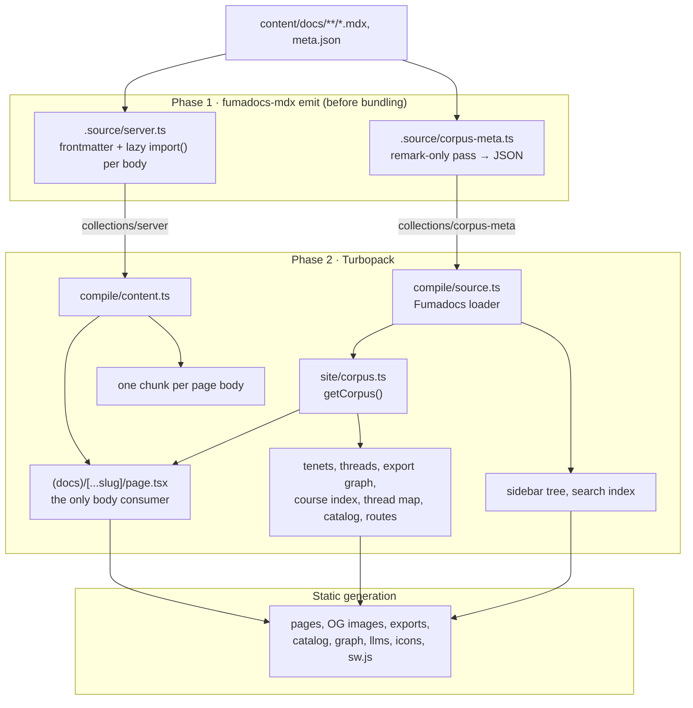

# Compile

How MDX on disk becomes everything the site serves. The site compiles **page
metadata and page bodies separately**: the same MDX files go through the same
remark plugins twice, once in a metadata pass that runs before bundling and
produces one JSON module, and once in the bundler, which compiles each body
into its own lazily loaded chunk. Everything except the rendered page (the
sidebar, search, the reading dock, threads, exports, OG images, the terminal)
works from the metadata and from a **corpus** of indexes derived from it once
per process.

The module owns `source.config.ts`, `lib/compile` (the metadata plugin, the
Fumadocs loader and lazy bodies), the corpus composition in
`lib/site/corpus.ts`, and the data sent to client components (`routes` and
`catalog.json`, in `lib/course`). It sits in the middle of the layering: it
reads `mdx-env`, `markdown` and `course`, and the corpus composes `export` and
`relations` on top; `site`, `terminal` and the routes read the result.

## Layout

```
source.config.ts                    the docs collection, remark/rehype plugins, the corpus-meta plugin
src/lib/compile/
  corpus-meta/plugin.ts             fumadocs-mdx plugin: writes .source/corpus-meta.ts; dev regeneration
  corpus-meta/generate.ts           the remark-only pass over every page and meta.json
  corpus-meta/types.ts              CorpusMeta, CorpusMetaPage, CorpusMetaFile, DocsFrontmatter, DocsMeta
  source.ts                         the Fumadocs loader built from corpus-meta; getSourcePages; docsRoute
  content.ts                        loadPageContent: the only way to a compiled body
src/lib/site/corpus.ts              getCorpus: every derived index; resolveDocsPage, docsStaticParams
src/lib/course/
  routes.ts                         CourseRoutes and indexRoutes: the render-time route index
  catalog.ts                        PageCatalog, CatalogPage, URL helpers
  client.ts                         catalogResource: /catalog.json, loaded once
  urls.ts                           catalogRoute (shared with the service worker)
src/components/course/provider.tsx  CourseRoutesProvider, useCourseRoutes, useCurrentRoute
src/app/catalog.json/route.ts       serves the catalog as static JSON
.source/                            generated by fumadocs-mdx (git-ignored)
  corpus-meta.ts                    every page's metadata as one JSON module
  server.ts                         frontmatter imports + one lazy import() per body
```

## Phases

|                 | Metadata (corpus-meta)                                                    | Bodies                                  |
| --------------- | ------------------------------------------------------------------------- | --------------------------------------- |
| **What**        | frontmatter, environments (`envs`), search structure, links               | rendered MDX, KaTeX, code highlighting, TOC |
| **Compiled by** | the `corpusMeta()` fumadocs-mdx plugin, before bundling                   | the bundler, through the fumadocs MDX loader |
| **Pipeline**    | remark only                                                               | remark → rehype → recma → JS            |
| **Output**      | `.source/corpus-meta.ts`, one JSON module (1.76 MB)                       | one lazy chunk per page                 |
| **Read by**     | the loader, the corpus, and through them everything else                  | `app/(docs)/[...slug]/page.tsx` only    |



## Corpus metadata

`corpusMeta()` (`plugin.ts`) is registered in `source.config.ts`. Its `emit`
hook runs when Next loads `next.config.ts`, before Turbopack starts, and writes
`.source/corpus-meta.ts`: a typed module wrapping
`JSON.parse("…")` of the whole corpus.

`generateCorpusMeta` (`generate.ts`):

1. finds the single docs collection (it throws unless there is exactly one);
2. resolves the MDX options the bundler will use (`applyMdxPreset(…)("bundler")`
   or the collection's own), so both passes run the same plugins;
3. builds one `@mdx-js/mdx` processor per format with `rehypePlugins: []` and
   `recmaPlugins: []`, running `remarkInclude`, the resolved remark plugins
   (the Fumadocs preset's, the course's syntax plugins, `remarkMdxMermaid` and
   `remarkMdxEnv`) and finally `remarkCapture`;
4. reads every page in parallel: parses frontmatter, validates it with the
   collection's schema (`core.transformFrontmatter`), pads the body with blank
   lines so error positions match the file, and processes it;
5. reads every `meta.json` through `core.transformMeta`.

`remarkCapture` copies what the other plugins left on the file:

| Field | From | Used for |
|---|---|---|
| `envs` | `remarkMdxEnv` | environments, recalls, threads, segments (MDX-ENV.md) |
| `structuredData` | Fumadocs' `remarkStructure` | the search index |
| `extractedReferences` | every Markdown link's `href` | page-to-page edges in the export graph |

Missing `envs` or malformed `structuredData` throws with the page's path.

In production a broken page throws and fails the build. In dev the plugin
watches the docs collection, re-runs `emit` 100 ms after the last change, and
on error writes a module that throws at import time, so the dev server stays up
and shows the error on the next request.

## The loader and bodies

`source.ts` builds the Fumadocs `loader()` from **virtual files** made from
corpus-meta: each page's `data` is its frontmatter plus `envs`,
`structuredData` and `extractedReferences`; each `meta.json` is a meta file.
The base URL is `docsRoute` (`/`), so pages live at `/core/…`, `/algebra/…`,
`/calculus/…`. `getSourcePages` pairs each page with its `envs` and strand.

Because the loader never sees an MDX module, `source.getPageTree()`,
`source.getPage()`, `createFromSource(source)` and the rest of the Fumadocs API
work without compiling or importing a body.

Bodies come from `.source/server.ts`, which fumadocs-mdx generates for
`docs.async: true`:

```ts
import { frontmatter as __fd_glob_13 } from "../content/docs/algebra/index.mdx?collection=docs&only=frontmatter"
…
export const docs = await create.docsLazy("docs", "content/docs", {…meta…}, {…frontmatter…}, {
  "algebra/index.mdx": () => import("../content/docs/algebra/index.mdx?collection=docs"),
  …
});
```

`?only=frontmatter` parses YAML only. The `() => import(…)` is the full compile,
and Turbopack gives each page its own server chunk. `content.ts` maps each
entry by path, and `loadPageContent(path)` calls `entry.load()`, returning the
MDX component and its TOC. It throws if corpus-meta and the collection
disagree about a path.

## The corpus

`getCorpus()` (`lib/site/corpus.ts`) composes every derived index from the
loader, in dependency order:

| Step | Builds | Owner |
|---|---|---|
| `getPageIndex` | source pages, kind views (`kindViewsFromPages`), and `byUrl`: every notes page and kind view as a `ResolvedDocs` | MDX-ENV.md |
| `createTenetIndex`, `assertTenetIndex` | slugs and citations; fails on duplicate or unknown slugs | MDX-ENV.md |
| `courseOrder`, `assertStrands` | strands, reading order and chapters from the page tree; fails if the `course.config` strands and the top-level folders (`meta.json`) disagree | RELATIONS.md, README.md |
| `createThreadIndex` | threads and their members in reading order; fails on duplicate or unknown thread slugs | MDX-ENV.md |
| `buildExportGraph` | nodes, edges, kind views and threads for exports and prompts | EXPORT.md |
| `buildCourseIndex` | the course outline the dock and threads read | RELATIONS.md |
| `buildThreadMap` | the threads page and route strips | RELATIONS.md |
| `buildCatalog`, `buildRoutes` | client data (below) | this doc |

`resolveDocsPage(slugs)` and `resolveDocsUrl(url)` look a URL up in `byUrl`,
returning a notes page or a kind view with its parent page, title and
description. `docsStaticParams(...suffix)` lists every notes page's slugs, with
an optional suffix (`image.png` for OG images). Links in page bodies are
resolved to page URLs by `resolvePageHref`, relative to the linking file;
links to anything outside the strands are ignored.

Both `getPageIndex` and `getCorpus` go through `memoInProduction`: in
production a plain module-level memo (built once per process, so once per
static-generation worker), in dev React's `cache` (once per request, so content
edits appear without a restart).

## Client data

Client components (the sidebar, the terminal, the dock) need course data, and
their props are serialised into the RSC payload inlined in every prerendered
page. So the data is split by when it is needed:

| When | Data | Size | How it arrives |
|---|---|---|---|
| first render, every page | `routes`: page URLs and the kind views of each page | ~10 KB | props of `CourseRoutesProvider` in `app/(docs)/layout.tsx` |
| first render, one page | the page's `PageDock` | varies by page | props of `ReadingDock` (RELATIONS.md) |
| after hydration | the full catalog: titles, descriptions, aliases, breadcrumbs, prompt targets for 317 pages and kind views | 291 KB | `/catalog.json`, fetched once per page load by `catalogResource` and cached by the service worker |

`indexRoutes(routes)` (`routes.ts`) turns the route data into a `RouteIndex`:
`match(url)` says whether a URL is a page or a kind view (and which page a kind
view belongs to), `kindViews` lists every kind view, and `subdirectories(dir)`
lists a directory's children for the sidebar.
`useCurrentRoute()` matches the current pathname. The sidebar never waits for
the catalog: its tree is built on the server and it reads only `routes`. The
terminal reads the catalog through `useResource(catalogResource)`: completions
stay empty and commands wait until it has loaded, and a URL that isn't in the
catalog gets a placeholder `RoutePage` built from the URL
(`currentPagesFromUrl`, `catalog.ts`).

## Prerendering

| Route | Params | Static? |
|---|---|---|
| `/[...slug]` | every notes page (`docsStaticParams()`) | prerendered; kind views render on first request and are cached (`dynamicParams = true`, `revalidate = false`) |
| `/og/docs/[...slug]/image.png` | every notes page | same: kind-view images on first request, then cached |
| `/llms.mdx/docs/…`, `/llms.mdx/context/…` | every page, environment, kind view and thread | all prerendered (`dynamicParams = false`), about 940 files each (EXPORT.md) |
| `/threads/[slug]` | every thread | prerendered (RELATIONS.md) |
| `/catalog.json`, `/graph.json`, `/llms.txt`, `/llms-full.txt` | | prerendered |
| `/api/search` | | on request (TERMINAL.md) |

SITE.md has the full request map.

## Design decisions

**1. Metadata is compiled before bundling.** By the time Turbopack starts,
every non-body consumer has a plain data module to import. The bundler never
compiles an MDX page just to learn its title, its theorems or its links, and a
broken environment fails before any bundling work.

**2. The metadata pass is remark-only.** No rehype, no recma: KaTeX, code
highlighting and JS codegen, the expensive parts of an MDX compile, never run
for metadata. That is what makes a second pass over the corpus cheap.

**3. Both passes share one plugin list.** Corpus-meta reads the bundler's
resolved MDX options and the same frontmatter schema instead of keeping its own.
A plugin added to `source.config.ts` runs in both, so metadata and bodies can't
drift through configuration.

**4. Bodies are lazy.** With `docs.async: true`, a body is compiled and
evaluated only when `entry.load()` is called, and the only caller is the docs
page. Every other route's server trace is free of body chunks.

**5. The loader is built from metadata, not from the collection.** Standard
Fumadocs APIs (page tree, search, page lookup) work without importing a single
MDX module, so search, the sidebar and `llms.txt` stay light while still using
Fumadocs.

**6. Derived data is computed once per process.** Every index is built inside
`getCorpus()`, memoised in production. Each static-generation worker builds the
corpus once and every page, image and export it renders reuses it.

**7. Non-body outputs are rebuilt from remark output.** Page Markdown, per-
environment Markdown and `llms-full.txt` come from `envs.segments` and each
environment's `statement` and `body`, which `remarkMdxEnv` serialises back to
Markdown at compile time. OG images use the
title, description, `ideas` and an environment census. None of them loads a
compiled body.

**8. Only canonical pages are prerendered.** Kind views (241 of them) and their
OG images render on first request and are then cached forever. Static outputs
grow with the number of pages, not pages × kinds. Exports are the deliberate
exception: they are small files and agents fetch them by URL, so all of them
are prerendered.

**9. Client data is split by when it's needed.** The full catalog as layout
props would be serialised into every page; as `routes` plus a static JSON file
fetched after hydration, each page carries about 10 KB of shared data plus its
own dock, and the catalog is fetched once per page load (network first through
the service worker, which keeps a copy for offline use).

**10. The build checks the content.** Duplicate or unknown slugs, unknown thread
tags, `course.config` strands that don't match `meta.json`, invalid environment
attributes and an invalid pack all throw during the corpus-meta pass or the
first `getCorpus()`. A broken environment or thread reference is a failed build,
never a dead link; ordinary Markdown links are not checked (an unknown target
just adds no export edge).

**11. Dev regenerates, prod fails.** In dev, a content error becomes a module
that throws when imported, so the server survives and the next save fixes it;
in production the same error stops the build.

## Performance

Measured on the last production build (76 pages, 241 kind views):

| Output | Size or count |
|---|---|
| `.source/corpus-meta.ts` | 1.76 MB (server only) |
| `/catalog.json` | 291 KB, 317 entries |
| `routes` props | ~10 KB per page |
| prerendered HTML pages | 84; median 870 KB, largest 4.7 MB (`/algebra/linear-transformations/seen`, 255 KB gzipped) |
| page body chunks | one per page |

About 60% of a large page's HTML is the inlined RSC payload, which carries the
KaTeX markup a second time; the rest is the rendered page. Formula-dense pages
are the heaviest, and gzip removes most of the repetition.

- Remark runs twice per page; rehype and recma once.
- Every page's metadata is regenerated on every build and, in dev, on every
  content save.
- The corpus is built once per worker; fragments rendered while building it
  are cached (MARKDOWN.md).

## Limitations

**Remark runs twice per page.** Parsing and running remark plugins is the cheap
part of an MDX compile, and the expensive part still runs once. Merging the
passes would mean pulling metadata out of the bundler's compile, coupling every
non-body consumer back to the body pipeline, which is what the split exists to
avoid. The cost: both runs must produce the same `envs`, and every remark
plugin's cost is paid twice.

**Corpus-meta has no cache.** Every build, and every dev save, re-processes all
pages. A remark-only pass over 76 pages takes milliseconds, and a per-file cache
would risk serving stale `envs` after a plugin change that leaves the MDX
unchanged. The cost grows linearly with the corpus.

**Rehype output exists only in the docs page.** The TOC from `rehypeToc`,
rendered KaTeX and highlighted code exist only in body chunks. A non-page route
that needs equivalent data must get it from a remark plugin.

**Exactly one docs collection.** Corpus-meta, `source.ts` and `content.ts` all
assume a single corpus, and `getDocsCollection` throws otherwise.

**The content path is fixed.** `content/docs` is hardcoded in
`source.config.ts` (and in the source link), which a multi-course setup will have
to parameterise.

## Changing things

**A new field from a remark plugin:** leave it on `file.data`, capture it in
`remarkCapture` (and its `Captured` type), copy it into the page in `readPage`,
type it in `CorpusMetaPage`, and map it into the virtual file (and `PageData`)
in `source.ts`. Skip a step and it never reaches `page.data`.

**A new derived index:** build it inside `getCorpus()` (memoised), add it to
`Corpus`, and pass it down as props or into route handlers. Never compute it in
a route handler, where it would run once per output.

**New client data:** if the first render needs it, keep it small and pass it as
props; otherwise serve it from a static JSON route, load it with
`jsonResource`, and add the route to the service worker's data routes
(PWA.md) so it works offline.

**A new remark plugin:** add it to `source.config.ts`; it runs in both passes.
Keep it deterministic and free of I/O.

## Invariants

These don't fail loudly; breaking one makes the build slower, a bundle bigger,
or metadata quietly disagree with bodies.

- `lib/compile/content.ts` and `collections/server` are imported only by the
  docs page. Any other importer traces every body chunk; calling
  `loadPageContent` in a loop evaluates every body during the build.
- `docs.async` stays `true`.
- `source`, `getCorpus` and corpus-meta are never imported by a `"use client"`
  module (`corpus.ts` is `server-only`); the JSON would ship to the browser.
- Layout props stay small; interaction-time data goes in a JSON route.
- Remark plugins are deterministic and don't branch on which pass is running:
  `envs` comes from corpus-meta while `<KindFilter>` and the env components come
  from the bundler run, and the two must agree.
- Anything expensive derived from the corpus lives in `getCorpus()`.
- Kind views stay out of `generateStaticParams`.
