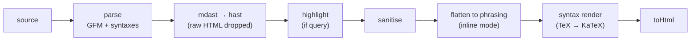

# Markdown

Pages are compiled by MDX, but much of what the site shows is not a page: page
and environment titles in the sidebar and the dock, statements in previews and
thread stations, thread summaries, search results with highlighted terms, plain
text for metadata and exports. All of that is **short Markdown rendered outside
MDX**, by `lib/markdown`, into HTML strings and plain text.

The module also defines how a course adds syntax beyond GFM. A
`MarkdownSyntax` plugs into every stage of the fragment pipeline and into the
MDX page pipeline; the course lists its syntaxes in `course.markdown.ts`. The
only syntax today is TeX, rendered with KaTeX, in `lib/packs/math/markdown`.

`lib/markdown` is a foundation module: it imports nothing from other modules
except the `course.markdown` binding (through `syntaxes.ts`), and nearly every
other module imports it.

## Layout

```
src/lib/markdown/
  fragment.ts        compileMarkdownFragment, highlightMarkdownFragment, compileMarkdownPreview
  render.ts          renderMarkdown, renderMarkdownInline, renderMarkdownTree: the pipeline
  parse.ts           parseMarkdown (GFM + syntaxes), cloneMarkdownTree
  hast.ts            mdast → hast, inline flattening (toPhrasingRoot), wrapMark
  sanitize.ts        drops unsafe tags, event handlers and unsafe URLs
  highlight.ts       wraps search terms in <mark>
  plain.ts           markdownToPlain
  truncate.ts        truncateMarkdownTree: cut a tree to a character budget
  cache.ts           remember: a small LRU shared by parse, render and plain
  element.ts         hast helpers: classList, elementChildren, elementText
  types.ts           MarkdownFragment, RenderedMarkdown, InlineLabel, rendered, plainInlineLabel, literalInlineFragment
  syntax.ts          MarkdownSyntax contract (types only)
  syntaxes.ts        the course's syntaxes, merged per stage
src/lib/packs/math/markdown/
  index.ts           mathMarkdown: the TeX syntax
  options.ts         remark-math and KaTeX options
  tex.ts             isMathElement, simplifyTex, mathMatchesQuery
  katex.ts           applyKatex: TeX → KaTeX in fragments
  katex-display.ts   wraps display math in a horizontal scroller
  katex-html.ts      rehypeKatexHtml: KaTeX output as one innerHTML element in MDX
src/components/markdown/
  html.tsx           InlineHtml, BlockHtml, InlineLabelView
  label.tsx          MarkdownLabel, markdownLabelNode (server only)
course.markdown.ts   the course's syntax list
```

## Fragments

A fragment carries everything a consumer might need, computed once:

| Type | Fields | Used for |
|---|---|---|
| `MarkdownFragment<M>` | `source`, `html`, `plain`, `mode` | stored in the corpus (titles, statements, summaries); the source lets it be re-rendered with a highlight |
| `RenderedMarkdown<M>` | `html`, `plain`, `mode` | sent to the client (dock, thread map, search hits); no source |
| `InlineLabel` | `string \| RenderedMarkdown<"inline">` | terminal labels that may be plain text |

`M` is `"inline"` (phrasing content only, safe inside a heading or a table cell;
it may itself contain links, so don't nest it in one) or `"block"` (paragraphs,
lists, tables). The mode is part of the type, so a block fragment can't be
passed where inline HTML is expected.

Entry points:

| Function | Produces |
|---|---|
| `compileMarkdownFragment(source, mode)` | a full fragment: HTML, plain text and source |
| `highlightMarkdownFragment(fragment, query)` | the same fragment re-rendered with `<mark>` around query terms (terminal search) |
| `compileMarkdownPreview(source, maxChars)` | a block `RenderedMarkdown` whose HTML is truncated to a budget, with an ellipsis if cut; `plain` stays the full text (statement previews) |
| `renderMarkdownInline(source)` | inline HTML only (sidebar labels, page headings) |
| `markdownToPlain(source)` | plain text (metadata, OG text, search, exports) |
| `literalInlineFragment(value)` | a fragment for text that is not Markdown (slugs, kind labels, paths): escaped, not parsed; highlighting it does parse its `source`, as for a search hit's pathname title |
| `rendered(fragment)` | strips `source` before a fragment is sent to the client |

## The pipeline



`renderMarkdownTree` runs the stages in that order:

1. **Parse** (`parse.ts`): `mdast-util-from-markdown` with GFM plus each
   syntax's micromark and mdast extensions.
2. **To hast** (`hast.ts`): `mdast-util-to-hast` with `allowDangerousHtml:
   false`, so raw HTML in the source never becomes nodes.
3. **Highlight** (`highlight.ts`), only when a query is given: each distinct
   whitespace-separated term is matched case-insensitively at word boundaries
   in text nodes and wrapped in `<mark>`. Code elements are skipped. An
   **atom** (a rendered formula) is matched as a unit by its syntax's
   `atom.matches` and wrapped whole.
4. **Sanitise** (`sanitize.ts`): see Security below.
5. **Flatten** (inline mode only, `toPhrasingRoot`): block elements are
   unwrapped into their phrasing children, with a space between blocks, so a
   multi-paragraph title becomes one line. Phrasing tags and atoms are kept
   intact.
6. **Syntax render**: each syntax's `render` hook rewrites the sanitised tree;
   math replaces TeX code elements with KaTeX output.
7. **Serialise**: `hast-util-to-html`, again without dangerous HTML.

Plain text (`plain.ts`) walks the mdast instead: text and code are kept,
inline formatting is joined without spaces, blocks with spaces, raw HTML is
dropped, and a syntax's literal nodes use its `plain` reading
(`\mathrm{rank}(A)` becomes `rank(A)`).

Truncation (`truncate.ts`) clones the tree, counts text characters until the
budget runs out (code is kept but not counted), cuts text mid-node at the
budget and drops everything after it, then, if anything was cut, appends `…`
to the last paragraph or heading (descending into lists, list items and
blockquotes), or adds a paragraph holding it. A syntax's
literal node counts as its `length` (TeX: the formula plus its dollar signs)
and is never split: it is kept whole or dropped.

## The syntax contract

`MarkdownSyntax` (`syntax.ts`) lists the hooks a syntax may provide. Every
field is optional; `syntaxes.ts` merges the course's syntaxes stage by stage,
in the order `course.markdown.ts` lists them.

| Field | Stage | Consumer |
|---|---|---|
| `fromMarkdown` | parsing fragments (micromark + mdast extensions) | `parse.ts` |
| `toMarkdown` | serialising environment bodies back to Markdown | `mdx-env/remark.ts` |
| `literals` | plain text and truncation length of the leaf nodes the syntax adds | `plain.ts`, `truncate.ts` |
| `atom` | elements kept whole when flattened, matched as one unit by search | `hast.ts`, `highlight.ts` |
| `render` | rewriting a sanitised fragment | `render.ts` |
| `remarkPlugins`, `rehypePlugins` | MDX pages, ahead of the site's own plugins (corpus-meta reuses the remark plugins only) | `source.config.ts` |

The math syntax (`mathMarkdown`) fills every field:

- parsing with `micromark-extension-math` and `mdast-util-math`,
  `singleDollarTextMath` on (`$x$` and `$$x$$`);
- `inlineMath` and `math` literals, read as `simplifyTex` and counted as the
  formula plus 2 or 4;
- elements with `language-math`, `math-inline` or `math-display` as atoms,
  matched by a word of the simplified formula or a command name (`det`
  matches `\det`);
- `applyKatex` as the fragment renderer;
- `remark-math`, then `rehype-katex` (`strict: "ignore"`),
  `rehypeKatexDisplayScroll` and `rehypeKatexHtml` for pages.

## TeX rendering

Pages and fragments render TeX differently, on purpose:

| | Pages (MDX) | Fragments |
|---|---|---|
| Parsing | `remark-math` | `micromark-extension-math` (same options) |
| Rendering | `rehype-katex` during the MDX compile | `applyKatex` after sanitising, per fragment |
| Output in the module | one `innerHTML` element per formula (`rehypeKatexHtml`) | an HTML string |
| Display math | wrapped in `.katex-display-scroll` | wrapped the same way (`wrapKatexDisplays`) |
| Errors | `rehype-katex` renders with `throwOnError: true`, reports the error as a build message, retries leniently, and falls back to a `.katex-error` span | `throwOnError: false`; if KaTeX still throws or returns nothing, a `.katex-error` span or div with the raw TeX |

`rehypeKatexHtml` replaces each `.katex` subtree that `rehype-katex` produced
with an MDX JSX element of the same tag whose only attributes are its
`className` and `dangerouslySetInnerHTML` holding the serialised KaTeX HTML.
Without it, every span of every formula would become a JSX call in the compiled
page module.

`.katex-display-scroll` lets wide equations scroll horizontally instead of
overflowing the page (rules in `app/global.css`). `applyKatex` also handles a
display formula that arrives as `<pre><code class="language-math">`.

`resolveKatexRender` accepts both the CommonJS and the ES module shape of the
`katex` export, since the same code runs in the build, server components and
route handlers.

## Rendering fragments in React

`components/markdown/html.tsx` is the only place fragment HTML enters the DOM:
`InlineHtml` (`span.md-fragment-inline`) and `BlockHtml`
(`div.md-fragment-block`), each with a `biome-ignore` for
`dangerouslySetInnerHTML`. `InlineLabelView` renders an `InlineLabel`, as text
or as HTML.

`MarkdownLabel` and `markdownLabelNode` (`label.tsx`) render from source, so
they call the renderer and must only be used from server components (the
sidebar's page tree labels and the docs page). Client components always receive
already-rendered HTML as props.

CSS classes (`app/global.css`) size formulas by context: `md-fragment-inline`,
`md-fragment-block`, and two modifiers consumers add, `md-fragment-chip` and
`md-fragment-compact`.

## Design decisions

**1. Fragments skip MDX.** A title or a statement is a few dozen characters;
compiling it with MDX would mean a JavaScript module per string. The fragment
pipeline goes straight from Markdown to an HTML string and plain text, which are
plain data: they can be cached, put in JSON (`catalog.json`, the dock payload),
sent to client components as props and written into exports. The cost is two
pipelines for the same syntax, which is why `MarkdownSyntax` hooks both.

**2. Fragments are rendered on the server only.** No client component imports
`render.ts`, `fragment.ts` or `syntaxes.ts`, so `mdast`, `micromark` and KaTeX
never reach a client bundle. Client code gets `RenderedMarkdown` (HTML + plain
text). Keep it that way: importing `MarkdownLabel` or the renderer into a
`"use client"` module would ship KaTeX to the browser.

**3. The syntax list is its own binding.** `course.markdown.ts` is separate
from `course.config.ts` because client components read the config (header,
course routes provider, terminal). If the syntax list lived in the config, every
one of them would bundle KaTeX. For the same reason the contract (`syntax.ts`,
types only) is split from the registry (`syntaxes.ts`, which reads the
binding): `course.markdown.ts` and the math pack import only the contract
(plus, for the pack, the dependency-free `element.ts` helpers), so the binding
never imports anything that imports it back.

**4. A syntax hooks every stage, or it leaks.** Parse alone isn't enough: a
formula must also read as words in plain text, count as one unit when
truncated, stay whole when a title is flattened to one line, be matched as a
unit by search, be written back when environment bodies are serialised, and be
rendered. Each of those is a field of the contract, so the core never
special-cases a syntax.

**5. Raw HTML is dropped, then the tree is sanitised anyway.** `toHast` runs
without dangerous HTML, so `<script>` in a title is gone before sanitising.
`sanitize.ts` is the second layer: it removes `script`, `iframe`, `object`,
`embed` and `link` elements, every `on*` attribute, `srcDoc` and `srcSet`, and
`href` on `<a>` and `src` on `` when the value is not a string, number
or boolean, or is empty, protocol-relative (`//host`) or uses
`javascript:`, `data:` or `vbscript:`. Content is authored in the repo, so the
threat is accidental HTML, not an attacker; the two layers make the
`dangerouslySetInnerHTML` in `html.tsx` safe regardless.

**6. Syntax rendering runs last.** Highlighting and inline flattening need to
see a formula as one element holding its TeX source (an atom), not as KaTeX's
deeply nested spans and MathML, and the sanitiser only needs to check what the
author wrote. KaTeX output is generated, so it is inserted after both.

**7. Highlighting happens on the tree, before flattening.** Matching on the
tree means a term inside a link or emphasis is highlighted without breaking
the markup, code is never highlighted, and a formula is highlighted as a whole
(a `<mark>` around a `.katex` span) instead of a stray match inside its
MathML.

**8. Fragments know their mode.** `MarkdownFragment<"inline">` and
`<"block">` are distinct types. Inline HTML can go inside an `<a>` or an
`<h2>`; block HTML can't. Encoding it in the type stops the mistake at compile
time.

**9. Parsed trees are shared, so they are never mutated.** `parseMarkdown`
returns a cached tree. `toHast` builds a new tree, and `truncateMarkdownTree`
clones before cutting (`cloneMarkdownTree`). Anything that edits an mdast tree
must clone first.

## Performance

- `parse`, `render` and `plain` each keep a `remember` cache: a 512-entry LRU
  per map, keyed by the JSON of the arguments (`[mode, query, source]` for
  HTML). The caches are module state, so they live per server process (per
  build worker during `next build`). Repeated titles (a page title appears in
  the sidebar, the catalog, the dock and exports) are rendered once.
- Fragments are rendered at build time while composing the corpus and
  prerendering pages; at request time only search renders new HTML (each
  hit's title and snippet are compiled from the index content where needed,
  then `highlightMarkdownFragment` re-renders them).
- `rehypeKatexHtml` keeps compiled page modules small: one string per formula
  instead of a JSX tree.
- Only `types.ts` and `html.tsx` reach client bundles (with the CSS classes);
  the parser, the renderer and KaTeX never do.

## Limitations

- KaTeX still leaks outside the math pack: `app/layout.tsx` imports
  `katex/dist/katex.css` for every course, `app/global.css` has KaTeX sizing
  rules, and the terminal highlighter (`components/terminal/highlight.tsx`)
  skips `.katex-mathml`. A course without TeX still loads the stylesheet.
- A syntax can't add block-level plugins to fragments beyond micromark/mdast
  extensions (no remark transforms run on fragments).
- `simplifyTex` is a set of regex rewrites, good enough for plain text and
  search, not a TeX parser: nested braces in `\frac` are not handled.
- The caches have a fixed size and no metrics; a corpus much larger than this
  one would churn them.

## Changing things

**A new syntax:** write a `MarkdownSyntax` under the pack that needs it (see
`lib/packs/math/markdown/index.ts`), fill every stage the syntax affects, and
add it to `course.markdown.ts`. If it renders to elements that must stay whole,
give it an `atom`; if it adds mdast leaf nodes, give them `literals`.

**A new fragment consumer:** render on the server with
`compileMarkdownFragment` (or `markdownToPlain` for text), store or pass the
fragment, `rendered()` it before handing it to a client component, and display
it with `InlineHtml`/`BlockHtml`.

**A new unsafe pattern:** extend `UNSAFE_TAGS`, the attribute filter or
`UNSAFE_PROTOCOL` in `sanitize.ts`; there is no allowlist.

## Invariants

- Client components never import the renderer; they receive HTML strings.
- `html.tsx` is the only place fragment HTML is set as `innerHTML`.
- Fragment HTML has passed `toHast` without dangerous HTML and `sanitizeHast`
  (or, for literal fragments, HTML escaping); KaTeX output is the only HTML
  inserted after sanitising.
- Cached mdast trees are never mutated; clone before editing.
- Inline fragments contain phrasing content only.
- The core names no syntax: TeX, KaTeX and math class names appear only in
  `lib/packs/math/markdown` (and the leaks listed under Limitations).
- `course.markdown.ts` and packs import only `syntax.ts` (and, for packs,
  `element.ts`) from this module.
