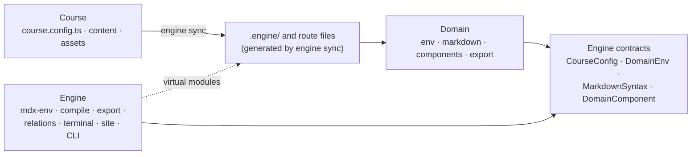

# Migration

The plan for turning this repo from one course (MATH1251) into an engine that
serves many: maths, programming, commerce, actuarial. Part 1 is the order of
work; Part 2 is the end state it aims at. The module docs (COMPILE.md,
EXPORT.md, MARKDOWN.md, MDX-ENV.md, PWA.md, RELATIONS.md, SITE.md, TERMINAL.md)
describe each module as it is today.

It picks up after `refactor/course-config` (9cdb44c), which put every course
value in `course.config.ts` / `course.markdown.ts` and made the `lib/` graph
acyclic. This is a direction, not a commitment: each phase stands on its own
and is worth doing even if the later ones never happen, and phases 0–4
improve this repo with no new repos or tooling.

The code still calls domains **packs** (`lib/packs`, `EnvPack`) until phase 1
renames them; this file uses the new names throughout. Package and command
names (`@scope/engine`, `engine sync`) are placeholders until Decision 1.

## Part 1: Plan

### End state

| Repo | Holds | Publishes |
|---|---|---|
| engine | `packages/engine` (compiled, with the `engine` CLI), `packages/notation-tex`, `template/`, `fixtures/domain-test`, `fixtures/course` | `@scope/engine`, `@scope/notation-tex` |
| domain-math, domain-code, … | one domain package, `fixtures/course` | `@scope/domain-<subject>` |
| math1251 (this repo), … | a thin app: `course.config.ts`, content, assets, files `engine sync` generates | nothing; it deploys |

The engine stays **one** package. Its modules ship together, to every course,
at one version; module boundaries inside it are kept by subpath exports and the
import-graph test (phase 0).

For now there is one user (the author), so new courses start from a copy of
`template/` and `engine sync` does the wiring. `bunx create-engine`, `engine
add` / `remove` and public npm come when other people use it (Later).

### Order and why

0. Guardrails
1. Rename packs → domains
2. Make the engine injectable
3. Clear the per-course leaks
4. Component lowering
5. Second course, in this repo
6. Extract and publish
7. COMP on the published engine

Everything up to phase 5 happens in this repo, as one app, with no new tooling.
Each repo boundary is a published version, so a misplaced line found after
phase 6 costs an engine release and an upgrade in every repo; found before, it
is a file move. The second course (phase 5) is the only real test of where
those lines belong, so it comes first. Each phase is its own PR into `main`.

### Phase 0: guardrails

There are no tests, and the Layering rules in README.md are enforced by
nothing. Every later phase moves code without meaning to change output, so
output gets pinned first.

- [ ] Golden-output tests: snapshot `graph.json`, `llms.txt`, `llms-full.txt`,
      and a sample of page, env, kind-view and thread documents and prompt
      contexts from a production build. A phase that changes them on purpose
      updates the snapshots in the same PR.
- [ ] `src/architecture.test.ts` (`bun test`, no new dependency): read every
      `src/**/*.{ts,tsx}`, map each `@/…` import to its module, and fail on
      - a `lib/` module importing a higher layer, `components/` or `app/`
      - `components/` importing `app/`
      - any component module other than `site`/`sidebar` importing `lib/site`
      - a component-module cycle
      - a kind name or label (read from the domains' `kinds`) appearing as a
        **string literal** outside `lib/domains`. Matching identifiers or
        comments flags words like "example" and "method" everywhere.
- [ ] CI (GitHub Actions): install, `next build`, `tsc --noEmit`, `bun test`,
      Biome. The same workflow later becomes the template for every repo.

Done when CI passes on the current tree and fails if, say, `lib/mdx-env`
imports `lib/export`, or a document's output changes.

### Phase 1: rename packs → domains

A **domain** is a subject's vocabulary: its environment kinds (`env`), its
notation (`markdown`) and, from phase 4, its components. Pure rename, no
behaviour change.

| From | To |
|---|---|
| `src/lib/packs/` | `src/lib/domains/` |
| `lib/mdx-env/pack.ts` | `lib/mdx-env/domain.ts` |
| `EnvPack` | `DomainEnv` |
| `assertEnvPack` | `assertDomainEnv` |
| `createEnvRegistry(pack)`, `ENV.pack` | `createEnvRegistry(env)`, `ENV.env` |
| "pack" / "packs" in docs | "domain" / "domains" |

- [ ] Move the folder and rename the symbols (`course.config.ts`,
      `course.markdown.ts`, `lib/course/types.ts`, `lib/mdx-env/{kinds,remark}.ts`,
      `lib/export/{documents,prompt}.ts`, `components/mdx-env/mark.tsx`).
- [ ] Update README.md (Layout, binding table, Modules, Layering, Design
      decisions), MDX-ENV.md (`## The pack` → `## The domain`), MARKDOWN.md,
      COMPILE.md, EXPORT.md, RELATIONS.md, SITE.md, TERMINAL.md. Leave
      "Turbopack" alone.
- [ ] Phase 0 test: `packs` → `domains` in the layer table.

Done when `grep -rniw 'packs\?' src *.md *.ts` finds nothing and CI passes,
snapshots unchanged.

### Phase 2: make the engine injectable

Today engine files import the course by path: `lib/course/config.ts` and
`lib/mdx-env/kinds.ts` read `course.config`, `lib/markdown/syntaxes.ts` reads
`course.markdown`, `lib/compile/content-dir.ts` reads the config for the
content path, and two compile files read Fumadocs' generated `collections/*`.
Once the engine is a package in `node_modules`, it cannot import its consumer.
Two mechanisms replace those imports (Part 2, The binding):
**injection** where the metadata pass loads code in plain Node, and **virtual
modules** aliased by Turbopack everywhere else.

- [ ] **Spike first**, in the scratchpad: a compiled package (tsc-emitted ESM,
      `"use client"` modules, `#lib/*` package imports, an ambient
      `declare module "course.env"`) installed into `node_modules` of a Next 16
      app with Fumadocs. Confirm:
      - `next build` and `next dev` resolve the virtual module through
        `resolveAlias` set by a `withCourse` wrapper;
      - `tsc --noEmit` passes in the app with no `paths` entry;
      - the metadata pass loads the package from `node_modules` and works when
        given its inputs as arguments.

      The earlier spike proved `resolveAlias` with TypeScript source in a
      workspace; this one repeats it against what will actually ship. If the
      runtime alias fails, inject at runtime too: the course builds the
      registry, syntax list and loader and passes them into an engine factory.
      About 25 files read the singletons, so that is the expensive path.
- [ ] Inject the metadata pass: `defineCourseSource({ env, syntaxes,
      contentDir })` in `source.config.ts`; every module it loads takes those
      as arguments (`remarkMdxEnv` already takes `{ env }`; `corpusMeta` and
      `content-dir.ts` change). Phase 0 test: no module reachable from
      `source.config.ts` imports `course.*`.
- [ ] `withCourse(nextConfig)` in `lib/next` (later `@scope/engine/next`): MDX,
      Serwist, the `/graph` redirect and the `resolveAlias` entries for the
      virtual modules. `next.config.ts` becomes `export default
      withCourse({})`.
- [ ] `binding.d.ts` declaring `course.config`, `course.env`, `course.markdown`
      and the `collections/*` modules the compile module reads.
      (`course.components` and `course.export` join in phases 4 and 7.)
- [ ] Move the course wiring into `.engine/` as hand-written files with
      exactly the shape `engine sync` will generate in phase 6: `env.ts`
      (re-exports the domain's env), `markdown.ts`, `styles.css`. The root
      `source.config.ts` imports `.engine/*` relatively. `course.markdown.ts`
      goes away.
- [ ] `CourseConfig.domains` (package names, or for now `lib/domains/*`
      paths) replaces `env`.
- [ ] `Strand` becomes `string`; check nothing else narrows on `as const`
      values.
- [ ] `compile/corpus-meta/plugin.ts:6`: `TYPES_FILE` is a hardcoded
      app-relative path. Make it the engine's module specifier so the
      generated `.source` file imports types from the package.

Done when the engine compiles against `binding.d.ts` alone (point the aliases
at a stub course and it still type-checks), and snapshots are unchanged.

### Phase 3: clear the per-course leaks

The README's Limitations, sorted by destination:

| Leak | Goes to |
|---|---|
| TeX syntax inside the math domain | `src/lib/notations/tex/` (becomes `notation-tex`); domain-math's `markdown` lists it |
| `import "katex/dist/katex.css"` in `app/layout.tsx`, `.katex*` rules in `app/global.css` | `notations/tex/styles.css`, imported by domain-math's `styles.css`, imported by `.engine/styles.css` |
| terminal highlighter skipping `.katex-mathml` | `MarkdownSyntax.skipSelector` |
| logomark (integral sign), app and PWA icons, `favicon.ico` | `CourseConfig.assets` and the course's `assets/` |
| fonts (`app/fonts/*.woff2`) | engine default, overridable by the course |
| `#thm-y` example anchor in `llms.txt` conventions | derived from the domain's first kind code |
| `lib/export`, `lib/client` mixing hooks with server-safe code | split into `./server` and `./client` entries |
| `alignedRows` and `routeMembers` (`relations/thread-map.ts`) assuming strands are taught in parallel | `CourseConfig.teaching`: `"parallel"` or `"sequential"` |
| relation labels ("Proves", "Proved by") fixed in `export/model.ts` | `DomainEnv.relationLabels`, merged over the engine defaults; relation **names** stay engine-fixed (`graph.json` API) |
| dock phrases ("Builds on", "Practised in", "Leads to") hardcoded in `relations/subject.tsx:76-78` | `DomainEnv.dock` (`buildsOn`, `leadsTo`, `practisedIn`), merged over engine defaults |
| `{ proof: "derive" }` legacy alias in `use-prompt.ts:66` | deleted; it only migrates old stored preferences |
| contracts spread over `course/types.ts`, `mdx-env/domain.ts`, `markdown/syntax.ts`, `markdown/element.ts` | one `contracts/` folder, the only engine files domains and courses import |
| `@/` imports inside the engine | package `imports` (`#lib/*`, `#components/*`) in the root `package.json`, so extraction moves files without rewriting imports |

- [ ] Each row above.

Done when grepping the engine for `katex`, `MATH`, `1251` and math kind names
finds only `notations/tex` and domain-math, and snapshots are unchanged.

### Phase 4: component lowering

Today a domain is data only, and the one custom component, `Mermaid`, is
registered globally. A component inside content is serialised into the corpus
as raw JSX: `/core/concept-map`'s corpus metadata already holds
`<Mermaid chart="graph TD …">`, which reaches its Markdown export,
`llms-full.txt` and prompt context. This phase gives every component a
renderer and a **lowering** to plain Markdown, applied once at the top of the
metadata pass (Part 2, Components, Stage 1). Exporters, the optional
third part, wait until a component needs one (phase 7).

- [ ] Add the `DomainComponent` contract and a `components` list on
      `MarkdownSyntax`, so lowerings arrive through `course.markdown`.
- [ ] `lowerComponents`: the first remark plugin of the metadata pass only
      (`compile/corpus-meta/generate.ts`), before `remarkStructure` and
      `remarkMdxEnv`. The bundler pass keeps the JSX.
- [ ] Skip page-only plugins in the metadata pass (`remarkMdxMermaid`), so a
      ```` ```mermaid ```` fence stays a fence there.
- [ ] Fail the metadata pass on any JSX element left that is neither an
      `ENGINE_TAGS` element nor a kind label.
- [ ] `course.components` binding (`.engine/components.ts`, typed
      `satisfies Record<Tag, ComponentType>`), read only by
      `components/mdx/index.tsx`; `Mermaid` moves onto the same contract as an
      engine component.
- [ ] Static props: `PropSpec` per component; literal values and identifiers
      naming a literal `export const` in the same file are read from the
      estree; anything else fails the build.
- [ ] Slug props: recorded for every component in the metadata pass, checked in
      `getCorpus` beside `assertTenetIndex`.

Done when no JSX appears in corpus metadata, any export, prompt context or
`graph.json` (`/core/concept-map` exports a ```` ```mermaid ```` fence; that
snapshot changes on purpose), and adding a component touches only its domain
and `.engine/components.ts`.

### Phase 5: second course, in this repo

- [ ] Move MATH1251's course files into `courses/math1251/`: `course.config.ts`,
      `.engine/`, `content/`, its assets.
- [ ] A temporary `COURSE` build variable (default `math1251`) that
      `withCourse` uses to point the aliases, `.engine/` and `contentDir` at
      `courses/$COURSE/`. Build one course at a time; the variable goes away at
      phase 6, when each course becomes its own app.
- [ ] A small second course on `domain-code`: one strand plus a handful of
      pages using every code kind and one code component with a lowering,
      enough to exercise the graph, threads, terminal, exports and prompts.
- [ ] Fix whatever the engine still assumes about maths, in the engine, and
      record each fix here.
- [ ] From what this course needed, write `fixtures/domain-test`: the smallest
      domain that uses every contract (a kind for each role, a syntax, a
      component). The engine repo's tests run against it, so the engine never
      depends on a real domain.

Done when `COURSE=<second> bun run build` produces a working site with no
maths anywhere, and MATH1251's snapshots are unchanged.

### Phase 6: extract and publish

- [ ] **Engine repo** (new): `packages/engine` from `src/lib` +
      `src/components` + the route implementations; `packages/notation-tex`
      from `lib/notations/tex`. Built with `tsc` to `dist/` (per-file, so
      `"use client"` survives), declarations included. Peer dependencies: `next`,
      `react`, `react-dom`, `fumadocs-core`, `fumadocs-mdx`; everything else
      its own. Bun isolated installs mean each package lists every dependency
      and `@types/*` it uses.
- [ ] **`engine sync`** in the engine package: reads `course.config.ts` and
      each listed domain's `package.json` (`exports` and the `engine.domain`
      marker); writes `.engine/{env,markdown,components,styles}` (later
      `export`), `source.config.ts` and the route files, each with a header.
      It writes, overwrites and deletes only headed files. `--check` fails on
      stale output. Its output for MATH1251 must equal phase 2's hand-written
      files.
- [ ] **`engine doctor`**: version mismatches, unknown tags, unused domains.
- [ ] Route files: list every route under `src/app` with its literal segment
      config; `sync` writes each as that config plus a re-export from
      `@scope/engine/routes/…`.
- [ ] `template/`: a minimal course (config, one page, `next.config.ts`,
      `global.css`, `package.json` with `predev`/`prebuild` running `sync`).
      CI copies it, installs, syncs and builds.
- [ ] `fixtures/domain-test` and `fixtures/course`; the golden tests and
      import-graph test move here and run in CI.
- [ ] Tailwind v4: `.engine/styles.css` carries an `@source` line for the
      engine's and each domain's `dist/`.
- [ ] Module docs (COMPILE, EXPORT, MARKDOWN, MDX-ENV, PWA, RELATIONS, SITE,
      TERMINAL) and this file move to the engine repo.
- [ ] Releases via changesets to the registry (Decision 2); `bun link` for
      local work across repos.
- [ ] **domain-math repo** (new): `lib/domains/math` as a package depending on
      `@scope/notation-tex`, with a `fixtures/course`.
- [ ] **This repo becomes the math1251 course**: delete the engine and domain
      source, depend on the published packages, run `engine sync`. Content
      history stays here.

Done when this repo builds MATH1251 from published packages with snapshots
unchanged, `engine sync --check` passes in CI, and a fresh copy of `template/`
builds.

### Phase 7: COMP on the published engine

- [ ] **domain-code repo**: `lib/domains/code` as a package, plus a COMP course
      (its own repo, or the phase 5 course moved).
- [ ] The first component that needs context in its exports (likely
      `<Output of>`) drives **exporters** (Part 2, Components, Stage 2),
      as an engine minor release:
      - `ComponentExporter`, `ExportContext`, `GraphReader` contracts;
      - occurrences and parts recorded in the metadata pass; components with an
        exporter must be top-level;
      - the components side map on the export graph;
      - `exportView(graph, surface)`, which renderers take in place of the
        graph, so the reads of `node.body`, `node.statement` and
        `segment.markdown` in `documents.ts` and `context.ts` stay as they are;
      - the `course.export` binding (`.engine/export.ts`), generated by `sync`
        from each domain's `./export`.

Done when `<Output>` prints the solution it belongs to in documents and adds a
`details` block in contexts; adding another exporter touches only its domain.

### Later

When the engine has users other than its author, or a course needs it:

- `bunx create-engine <dir>`: copies `template/`, asks for code, title and
  domains, runs `sync`.
- `engine add <domain>` / `engine remove <domain>`: install or uninstall, edit
  the `domains` array (magicast), run `sync`. `remove` refuses while content
  still uses the domain's kinds or components.
- `engine upgrade`: engine and domains together, then `sync`.
- Public npm: `bunx` is only frictionless without a registry token.
- Several kind-bearing domains in one course (Part 2, Composition):
  collision aliases, wording precedence.
- Turborepo in any repo that grows several course apps.

### Decisions

**1. Package scope and CLI name.** `@<scope>/engine`, `@<scope>/domain-math`,
`@<scope>/notation-tex`, and the binary name. Needed before phase 6.

**2. Registry.** GitHub Packages while the author is the only user: private,
free, one token in `~/.npmrc` and in CI. Public npm when `create-engine`
ships. Needed before phase 6.

**3. Where course apps live.** Own repo per course (default), or `apps/<code>/`
inside the domain repo. The architecture holds either way; decide per course.

Settled:

- **One app per course, generated.** Replaces "one app built per course".
  Segment config must be literal in each route file, so `engine sync` writes
  the thin route files; each course has its own app, output folder and
  deployment, with no build-time switch.
- **Second course:** programming on `domain-code`, since its domain is already
  written.
- **One kind-bearing domain per course for now;** the config takes a list from
  the start.

### Out of scope

- Splitting the engine into per-module packages (revisit only if a course needs
  a subset).
- Making relation names configurable.
- A graph across courses.

## Part 2: Target architecture

Where a section describes something not built yet, it says so, and
[Status](#status) maps every part to its phase.

### Three parts

Everything belongs to exactly one of three parts:

| Part | Is | Knows | Never knows |
|---|---|---|---|
| **Engine** | the machinery every course shares: environments, citations, the export graph, relations, the terminal, the PWA, the site, the routes, the CLI | structure: roles, edges, IDs, routes, tiers | a kind name, a notation, a course, a strand |
| **Domain** | a subject's vocabulary: its environment kinds and their wording, its notation, its MDX components | its own kinds, syntax and components; the engine's contracts | a course, strands, content, any engine module beyond the contracts |
| **Course** | one set of notes: config, the domains it lists, content, assets | everything about itself | engine internals (it only fills in contracts) |

Dependencies point one way. A course depends on domains and the engine; a
domain imports engine contracts only; the engine reaches the course only
through files `engine sync` generates inside the course and a handful of
declared **virtual modules** that point at them (see [The binding](#the-binding)),
never by import path.



### Repos

Each part lives in its own repo and reaches the others through published
packages:

| Repo | Holds | Publishes |
|---|---|---|
| **engine** | the engine, shared notation packages, the CLI, a starter template, a test domain and course | `@scope/engine`, `@scope/notation-tex` |
| **one per domain** (COMP, COMM, ACTL, MATH, …) | one domain package and a small test course | `@scope/domain-<subject>` |
| **one per course** (MATH1251, COMP1511, …) | a thin Next app: config, content, assets | nothing; it deploys |

```
engine/
  packages/engine/            one package; a subpath export per module
    src/lib/<module>/         logic (today's src/lib, minus domains)
    src/components/<module>/  UI (today's src/components)
    src/routes/               route implementations the generated route files re-export
    src/contracts/            the only files domains and courses import
    src/cli/                  engine sync, engine doctor
    docs/                     COMPILE, EXPORT, MARKDOWN, MDX-ENV, PWA, RELATIONS, SITE, TERMINAL
  packages/notation-tex/      TeX: micromark/mdast math, KaTeX, styles.css
  template/                   a minimal course; what a new course starts from
  fixtures/domain-test/       a small domain exercising every contract
  fixtures/course/            a course on it; golden-output tests run here

domain-math/
  src/env.ts                  kinds, roles, difficulties, wording
  src/markdown.ts             its syntaxes (notation-tex) and component lowerings
  src/components/             React renderers for its components
  src/export.ts               component exporters (server only)
  src/styles.css              CSS its components need (imports notation-tex's)
  fixtures/course/

math1251/
  course.config.ts            the course (CourseConfig); the only binding file a person writes
  next.config.ts              export default withCourse({})
  content/docs/               the notes
  assets/                     logomark, icons, favicon
  .engine/                    generated: env, markdown, components, export, styles, source config
  src/app/                    generated route files, plus any routes of the course's own
```

**Where a course lives is not architectural.** A course is an app that
depends on the engine and its domains. It can have its own repo (the default) or
sit in a domain repo's `apps/` folder; nothing in this doc changes either way.

**Anything two domains need moves to the engine repo.** TeX is the first case:
MATH, ACTL and COMM all write maths, so it is `notation-tex`, not part of
`domain-math`. The engine itself never depends on a notation package.

**The engine is one package, not one per module.** Its modules ship together,
to every course, at one version, and none is useful alone; package boundaries
between them would add a dozen manifests and a dense dependency graph without
making anything reusable. Module boundaries inside it are kept by subpath
exports and by the import-graph test (phase 0).

### Engine

#### Layers

Unchanged from README.md, except that domains leave the engine. A `lib/` module
imports only from lower layers:

```
foundation   client  cn  markdown  pwa  result  url
             mdx-env
             course
             compile  export
             relations
             terminal
top          site
```

The component rules stay as they are: `lib/` never imports `components/` or
`app/`; feature UI receives corpus data as props, and only `components/site`
and `components/sidebar` read `lib/site`.

#### Contracts

`src/contracts/` (exported as `@scope/engine/contracts`) is the whole surface a
domain or course may import. Each file holds types plus, at most, a validator,
and imports nothing from the engine but another contract.

| Contract | Today | Holds |
|---|---|---|
| `CourseConfig` | `lib/course/types.ts` | the course's fields ([CourseConfig](#courseconfig)) |
| `DomainEnv` | `lib/mdx-env/pack.ts` (`EnvPack`) | kinds, roles, difficulties, wording; `ENV_RELATIONS`, `ENV_STYLES`, `ENGINE_TAGS`; `assertDomainEnv` |
| `MarkdownSyntax` | `lib/markdown/syntax.ts` | parse, serialise, render, literal and atom hooks; MDX plugins; `skipSelector` for the terminal highlighter |
| `DomainComponent` | new | a component's tag, prop spec and lowering ([Components](#components)) |
| `ComponentExporter`, `ExportContext`, `GraphReader` | new | a component's export method and everything it may read |
| hast helpers | `lib/markdown/element.ts` | `classList`, `elementChildren`, `elementText`, for syntax `render` hooks |

#### Entry points

Each module is a subpath export. Where a module mixes server-only and
client-safe code, it gets two entries so resolution enforces the split instead
of convention:

| Entry | Runs | Notes |
|---|---|---|
| `./export/server` | server only | renderers, `server.ts` (`server-only`) |
| `./export/client` | browser | `prompt.ts`, `client.ts`, the hooks |
| `./export` | both | `model.ts`, `urls.ts` (data and URL rules) |
| `./client` | browser | today's `lib/client` |
| `./markdown` | server only | the fragment pipeline (notation and micromark stay out of client bundles) |
| `./routes/*` | as each route | what the generated route files re-export |
| `./next` | `next.config.ts` | `withCourse`: MDX, Serwist, redirects, the virtual-module aliases |
| `./source` | the metadata pass | `defineCourseSource`, used by the generated source config |
| others | as today | one entry per module |

#### Build and release

The engine is published as **compiled JavaScript with type declarations**, not
TypeScript source. The metadata pass runs in Node while `next.config.ts` loads,
and Fumadocs bundles the source config with every package left external, so
Node loads the engine straight from `node_modules`; it cannot run `.ts` there.
With compiled files, Turbopack, `tsc` and that Node pass all resolve the same
code.

- `tsc` emits one file per module, so `"use client"` directives survive (a
  bundler that merges modules would drop or misplace them).
- Imports inside the engine use package `imports` (`#lib/*`, `#components/*`),
  which work in Turbopack, `tsc` and Node; a tsconfig `@/*` alias would not
  survive publishing.
- Domains are compiled the same way.

**Versioning.** The engine's public API is the contracts, the CLI's commands,
the `CourseConfig` shape and the layout of generated files. Breaking any of
them is a major version. A domain declares `@scope/engine` as a peer dependency
and marks itself in its `package.json`:

```json
{ "engine": { "domain": 1 } }
```

The number is the contracts' major version; `engine sync` refuses a domain whose
number does not match the installed engine.

Releases go through changesets. While the engine is in development alongside a
domain or course, `bun link` replaces the published version locally.

### The CLI

The engine ships one binary. A course's `package.json` runs it before Next:

```json
{ "scripts": { "predev": "engine sync", "dev": "next dev", "prebuild": "engine sync", "build": "next build" } }
```

| Command | Does | When |
|---|---|---|
| `engine sync` | reads `course.config.ts` and the listed domains' manifests; writes `.engine/*` and the route files | now (phase 6) |
| `engine sync --check` | fails if any generated file is stale; CI runs it | now |
| `engine doctor` | engine/domain version mismatches, unknown tags, domains listed but unused | now |
| `create-engine <dir>` (via `bunx`) | copies `template/`, asks for code, title and domains, runs `sync` | later; until then, copy `template/` |
| `engine add <domain>` / `engine remove <domain>` | installs or uninstalls, edits the `domains` array, runs `sync`; `remove` refuses while content still uses the domain's kinds or components | later |
| `engine upgrade` | updates the engine and domains together, then `sync` | later |

**Generated files** start with a header naming the command. `sync` writes,
overwrites and deletes only files carrying that header, so a course's own routes
sit beside the generated ones untouched. Generated files are committed: the app
builds without running anything first, and an engine upgrade shows up as a
diff in the course.

**`course.config.ts` is the only binding file a person edits.** Everything the
engine needs to know about which domains a course uses is generated from its
`domains` array, so `add` and `remove` (when they exist) change one array and
run `sync`.

**The CLI does not wrap Next.** `next dev` and `next build` run directly, so
errors stay Next's own, and there is no second command set to maintain.

### Domains

#### Entries

A domain is a package of up to five entries, split by where they run:

| Entry | Holds | Runs in | Reaches the engine through |
|---|---|---|---|
| `./env` | `DomainEnv`: kinds, roles, difficulties, derivation and prompt wording, `summary`, relation labels and dock phrases | everywhere: small data, and `export/model.ts` brings it into client bundles | `course.env` |
| `./markdown` | `readonly MarkdownSyntax[]`: notation (usually from a notation package) and each component's prop spec and lowering | the metadata pass and server only | `course.markdown`, and the source config |
| `./components` | React renderers for the domain's components | page render | `course.components` |
| `./export` | `ComponentExporter`s | export rendering only (server, at build) | `course.export` |
| `./styles.css` | CSS the notation and components need | the page | `.engine/styles.css` |

Only `./env` is required. `engine sync` reads the package's `exports` to see
which entries exist and generates imports for those alone.

Why lowerings sit in `./markdown` and not next to the React component: the
metadata pass runs in Node before the bundler and cannot import React
components, `"use client"` modules or CSS. Everything that pass needs must be
importable there; everything the page needs may not be. Exporters sit in their
own entry because they run later, in the export routes, are typed against the
export graph, and may import heavy dependencies that neither the metadata pass
nor the page should load.

| | `domain-math` | `domain-code` |
|---|---|---|
| kinds | Definition, Theorem, Proposition, Corollary, Lemma, Method (`uses`); Example (`practises`); Proof (`proves`) | Concept, Pattern, Pitfall (`uses`); Example, Exercise (`practises`); Solution (`proves`) |
| difficulties | routine, exam, challenge | warm-up, core, stretch |
| derivation intent | `proof`, "Walk the proof" | `solution`, "Walk the solution" |
| notation | TeX, from `notation-tex` | none yet (code fences use Fumadocs' highlighting) |
| components | none yet | planned: program output, runnable snippets |

#### Notation packages

A notation package exports a `MarkdownSyntax` and its CSS, and nothing else:
no kinds, no components. Domains list it in their `./markdown` and import its
CSS from their `./styles.css`. `sync` drops a syntax that two domains both list,
by its name, so a course on two TeX-using domains loads KaTeX once.

#### Kinds and components

A domain contributes two different things to MDX, and the line between them
decides how each reaches relations and exports:

| | Kind (environment) | Component |
|---|---|---|
| Example | `<Theorem slug of see thread>` | `<Mermaid chart>`, a future `<Output>` |
| Graph node | yes: an ID (`page#kind-n`), a slug, a statement | no |
| Relations | `of`, `see`, `thread`; cited by others | reads them through its exporter; never creates one |
| Appears in | the page, exports, prompts, the dock, threads, kind views, OG census, search | the page; exports and prompts as its exporter's output; elsewhere as its lowering |
| Drawn by | the engine's `Env` frame, from the kind's data (`style`, `decoration`, `endMark`, `code`) | the domain's React component |
| Placement | a direct child of the document | anywhere Markdown is allowed (with an exporter: top level only, see [Rules](#rules)) |

**If something needs to be cited, numbered, listed, linked from the dock or
asked about, it is a kind, not a component.** A component that wants a slug is
a sign the domain is missing a kind.

A domain cannot replace the `Env` frame for its kinds: every course's
environments look like environments, differing only through the kind data.
That keeps the dock's active mark, the rail, footnotes and the ask menu working
for every kind without per-domain code.

#### Components

A component has up to three parts. Only the renderer and the lowering are
required; the exporter is how a component takes part in exports with more than
a fixed text. Lowering is phase 4; exporters are built when the first
component needs one (phase 7).

| Part | Required | Runs | Sees | Feeds |
|---|---|---|---|---|
| renderer | yes | page render | props, children | the page |
| `lower` | yes | the metadata pass | props, children (lowered), the page's variables | search, previews, statements in recalls, the dock and threads, `references` edges, and every export the exporter does not handle |
| `export` | no | export rendering (build, server only) | everything `lower` sees, plus the enclosing environment, neighbouring segments, the export graph and the surface being rendered | Markdown documents, `llms-full.txt`, prompt contexts |

```ts
interface DomainComponent<P = Props> {          // ./markdown
	tag: string;                                  // MDX name, PascalCase
	props?: PropSpec<P>;                          // static prop types; slug props are checked
	lower: (input: ComponentInput<P>) => RootContent[];
}

interface ComponentExporter<P = Props> {        // ./export
	tag: string;
	export: (input: ComponentInput<P>, ctx: ExportContext) => ComponentExport;
}

interface ComponentInput<P> {
	id: string;                                   // `<page>#component-<tag>-<n>`
	tag: string;
	props: P;                                     // static values (below)
	children: string;                             // the children, lowered, as Markdown
	vars: Readonly<Record<string, StaticValue>>;  // the page's literal `export const`s
}

interface ExportContext {
	surface: "page" | "env" | "kind-view" | "thread" | "llms-full" | "context";
	course: { title: string; strands: readonly string[] };
	page: ExportNode;
	env?: ExportNode;                             // the enclosing environment, if any
	before?: ExportSegment;                       // the segments around it on the page
	after?: ExportSegment;
	graph: GraphReader;                           // read-only (below)
	resolve: (slug: string) => ExportNode;        // a slug prop's node
	link: (id: string, label?: string) => string; // a node-ID link, per export conventions
	lowered: string;                              // this component's own lowering
}

type ComponentExport =
	| string                                      // Markdown, in place
	| { markdown: string; blocks?: ContextBlock[] }; // on "context": extra tiered blocks
```

`GraphReader` is the export module's own query layer, read-only: `node(id)`,
`relationsOf(id, names)`, `prerequisites(id)`, `derivationsOf(id)`,
`threadsOf(id)` and `segmentsOf(pageId)`. A component sees exactly what the
export renderers see, and nothing it does can change the graph.

##### Stage 1: the metadata pass

`lowerComponents` is the first remark plugin of the metadata pass only, ahead
of Fumadocs' `remarkStructure`, the course's syntax plugins and
`remarkMdxEnv`. For each component it:

1. reads its props as static values and checks them against `props`;
2. records every slug prop's value, for `getCorpus` to check once the tenet
   index exists (a single file cannot know every slug);
3. replaces the element with `lower`'s output;
4. if the tag has an exporter, checks the element is at the top level (below),
   marks the lowered nodes with the component's ID and records a
   `ComponentOccurrence` (`id`, `tag`, `props`, `children`, enclosing
   environment, segment index) in `PageEnvs.components`.

`serializeMarkdown` then writes each body, statement and prose segment twice
over: the plain lowered string (`body`, `statement`, `markdown`, as today) and,
only when it contains a marked component, its **parts**: Markdown chunks and
`{ component: id }` references in order. Text without exporters carries no
parts, so a course without them stores exactly what it stores today.

The bundler pass never runs `lowerComponents`: the JSX stays and the domain's
renderer draws it.

##### Stage 2: export rendering

`buildExportGraph` carries the occurrences as a side map
(`components: Map<id, ComponentOccurrence>`), like kind views and threads, and
keeps parts on nodes and prose segments. Each renderer takes
`exportView(graph, surface)`: the same graph, with every `body`, `statement`
and prose `markdown` that has parts replaced by the joined result of calling
each exporter with its context. Renderers keep reading those fields as they do
today. `exportView` is the only place export code meets a component, and it
names no tag; results are memoised per component and surface, so
`llms-full.txt` reuses the page documents' work.

On the `context` surface an exporter may return extra `blocks`, each with its
own tier. They join the target's blocks and are packed by the same rules
(EXPORT.md, Context tiers), so a component's bulky data can sit in `details`
and be dropped before the statement is.

```mermaid
flowchart TD
    mdx["content/docs/**/*.mdx"]
    subgraph meta["Metadata pass (remark only, Node)"]
        lower["lowerComponents<br/>props read · lowered · occurrences recorded"]
        structure["remarkStructure<br/>search text"]
        env["remarkMdxEnv<br/>envs, statements, bodies, segments, parts"]
        refs["remarkCapture<br/>link hrefs"]
    end
    subgraph corpus["getCorpus()"]
        tenets["tenet and thread indexes<br/>slug props checked · statements lowered"]
        graph["export graph<br/>+ components side map"]
    end
    subgraph exports["Export routes"]
        view["exportView(graph, surface)<br/>calls exporters with ExportContext"]
        out["documents · llms-full · contexts"]
    end
    subgraph page["Bundler pass"]
        jsx["JSX kept"] --> react["domain renderer"]
    end
    mdx --> lower --> structure --> env --> refs
    refs --> tenets --> graph --> view --> out
    mdx --> jsx
```

##### Who sees what

| Surface | Gets | Why |
|---|---|---|
| the page | the renderer | |
| page, env, kind-view and thread documents, `llms-full.txt` | the exporter's Markdown, else the lowering | rendered from the graph, after it exists |
| prompt contexts | the exporter's Markdown and blocks, else the lowering | the same |
| `graph.json` | nothing | it carries no bodies |
| search and terminal hits | the lowering | Fumadocs builds `structuredData` from the tree, in the metadata pass |
| recalls, dock titles, thread stations, previews | the lowering | see [Why exporters stay behind one function](#why-exporters-stay-behind-one-function) |
| `references` edges | links inside the lowering | taken from the tree in the metadata pass |

##### Props and variables

The export graph is built from corpus metadata and never from a compiled body
(EXPORT.md, Invariants), so whatever an exporter reads must exist without
running the page. Props are therefore **static values**:

- strings, numbers, booleans, `null`, and arrays and objects of those
  (`domain={[-2, 2]}`);
- identifiers naming a literal `export const` in the same file
  (`export const f = "x^2 - 1"` and `<Plot fn={f} />`), which also reach the
  component as `vars`.

Anything else (a call, an import, JSX in a prop, an identifier bound to
something computed) fails the build with the file, tag and prop. Children are
not values: they arrive lowered, as Markdown.

Slug props (`PropSpec` marks them) are checked in `getCorpus`, beside
`assertTenetIndex`, and resolved to nodes through `ctx.resolve`. They do
**not** create edges: the dock, threads and relation lists stay as they are. A
reference that should show up in relations belongs on the enclosing
environment's `see`, or the component should be a kind.

##### Examples

| Component | Renderer | `lower` | `export` |
|---|---|---|---|
| `<Plot fn={f} domain={[-2, 2]} />` (math, planned) | an SVG plot | `$y = x^2 - 1$ on $[-2, 2]$` | documents: the formula and a table of sampled values; contexts: the formula in place, the table as a `details` block |
| `<Output of="binary-search" />` (code, planned) | the program's output | its children as a fenced block | the output, plus "Output of [Solution …](id)" via `ctx.resolve` and `ctx.link`, and the enclosing exercise's statement when it is not in the same document |
| `<Mermaid chart>` (engine) | box-drawing text | a ```` ```mermaid ```` fence | none |

##### Rules

- **Lowerings** return GFM plus the course's syntaxes, never JSX, so the
  fragment pipeline (which parses without MDX) can render them. A flow element
  lowers to flow content, a text element to phrasing content.
- **Components with an exporter are top-level only**: a direct child of the
  page or of an environment's body. Splicing an exporter's output back into a
  list item, blockquote or table would need re-indenting arbitrary Markdown, so
  anywhere else is a build error naming the file and tag. A component without
  an exporter may appear anywhere Markdown allows.
- **Exporters** return the same Markdown, link only through `ctx.link` (so every
  link is a node ID), and read the graph only through `GraphReader`.
- **Both are deterministic**: no network, clock or randomness. Exports are
  static files rendered in parallel workers and must agree byte for byte.
- **Exporters run on the server only**, from the domain's `./export` entry,
  never in a client bundle. They may import heavy dependencies (a CAS, an
  interpreter for sample output) without touching page weight.
- A thrown error fails the build, naming the component's ID.

**Plugins that create components from Markdown are page-only.**
`remarkMdxMermaid` turns a ```` ```mermaid ```` fence into `<Mermaid chart>`;
in the metadata pass it is skipped, so the fence itself is the lowering. Today
it runs in both passes, and `/core/concept-map`'s corpus metadata holds
`<Mermaid chart="graph TD …">` as raw JSX, which reaches its Markdown export,
`llms-full.txt` and prompt context.

**Unknown JSX fails the build.** After lowering, any remaining JSX element in
the metadata pass that is neither an `ENGINE_TAGS` element nor a kind label is
an error naming the file and tag. Today nothing in `content/` uses Fumadocs'
default components (`Callout`, `Tabs`, `Cards`); using one would mean giving
it an engine-level lowering, as for `Mermaid`.

**Engine components use the same contract.** `Mermaid` is subject-agnostic and
stays in the engine, but declares its lowering the same way, so the metadata
pass treats engine and domain components alike.

#### Why exporters stay behind one function

Exports could ask each domain directly how to print its components. That puts
a per-component case into every renderer (eight Markdown and context formats)
and teaches `lib/export` about domains. Instead the export module knows one
generic hook, `exportView`, and the component brings its own method: adding a
component never edits `lib/export`, just as adding a kind doesn't (roles) and
adding notation doesn't (`MarkdownSyntax.toMarkdown`).

The lowering is still needed alongside the exporter. Search text and
`references` edges come out of the metadata pass, before any graph exists.
Statements and previews are compiled when the tenet index is built; they could
in principle wait for the graph, but they feed the dock, recalls and thread
stations, which render on the page and must look the same wherever a statement
appears. So those surfaces take the lowering by choice, and only documents and
contexts take the rich form.

#### Validation

`assertDomainEnv` (today `assertEnvPack`) keeps its rules (MDX-ENV.md,
Validation). Components add:

| Rule | Checked by |
|---|---|
| tags are PascalCase and unique across every domain the course lists | `engine sync` |
| no tag is an `ENGINE_TAGS` element or a kind label of the course | `engine sync` |
| every lowered tag has a renderer | `tsc`: `.engine/components.ts` is typed `satisfies Record<Tag, ComponentType>`, `Tag` being the union of the domains' lowering tags |
| every exporter's tag has a lowering | `engine sync` |
| props match the `PropSpec` and are static values | the metadata pass, per occurrence |
| components with an exporter are top-level | the metadata pass, per occurrence |
| slug props name existing slugs | `getCorpus`, beside `assertTenetIndex` |

#### Composition

A course lists its domains as an array from the start:

```ts
domains: ["@scope/domain-math"]
```

**For now, exactly one listed domain may have kinds.** Several domains may be
listed if the others bring only notation, components or exporters, so an
algorithms course can take `domain-code`'s kinds and another domain's
components. `engine sync` fails if two listed domains define kinds.

**Several kind-bearing domains are planned for later**, when a course needs
them. The array means the config shape will not change; the rules will be:

- **kind or component tags that collide** are a sync error, resolved by an alias
  map in the config (`rename: { "@scope/domain-code": { Example: "CodeExample" } }`);
- **course-wide wording** (derivation intent, prompt texts, `llms.txt`
  summary) comes from the first listed domain;
- **per-kind wording** (labels, plurals, codes, relation labels for that kind's
  derivations) stays with the domain that owns the kind;
- **difficulties** are per kind, so each practice kind keeps its own domain's
  scale;
- **relations** need nothing: roles are engine-fixed, so kinds from two domains
  cite each other like kinds from one.

### Courses

#### What a course writes

| File | Written by | Holds |
|---|---|---|
| `course.config.ts` | a person | the `CourseConfig` |
| `next.config.ts` | the template, then a person if needed | `export default withCourse({ … })` |
| `content/docs/**` | a person | the notes |
| `assets/` | a person | logomark, icons, favicon |
| `src/app/**` without the header | a person | routes of the course's own (rare) |
| `.engine/*`, `source.config.ts`, `src/app/**` with the header | `engine sync` | the binding below and the engine's routes |
| `global.css` | the template | `@import "../.engine/styles.css"` and course overrides |

No course contains code beyond these: a course that needs behaviour the engine
lacks is an engine change; one that needs a kind, notation or component is a
domain change.

#### The binding

The engine reads a course through six virtual modules. The engine declares
their types in `binding.d.ts`; `withCourse` points them, with Turbopack
`resolveAlias`, at files in the course; each has one reader, so the rest of
the engine sees only derived values.

| Module | Resolves to | Type | Read only by |
|---|---|---|---|
| `course.config` | `course.config.ts` | `CourseConfig` | `lib/course/config.ts` |
| `course.env` | `.engine/env.ts` | `DomainEnv` | `lib/mdx-env/kinds.ts` (the env registry) |
| `course.markdown` | `.engine/markdown.ts` | `readonly MarkdownSyntax[]` | `lib/markdown/syntaxes.ts` |
| `course.components` | `.engine/components.ts` | `Record<string, ComponentType>` | `components/mdx/index.tsx` |
| `course.export` | `.engine/export.ts` | `readonly ComponentExporter[]` | the server half of `lib/export` (`exportView`) |
| `collections/*` | Fumadocs' generated output | as generated | `lib/compile/content.ts`, `lib/compile/source.ts` |

They are separate modules because they have different reach: the config is
read by client components (the header, the route provider, the terminal), so it
holds the domains as package names, never as imports; the env is small data
that reaches client bundles through `export/model.ts`; the syntaxes must never
reach a client bundle (KaTeX) and load in the metadata pass; the components
must reach exactly the page; the exporters load only in the export routes.

**The metadata pass is injected, not aliased.** Fumadocs bundles
`source.config.ts` with esbuild, leaves every package external and runs the
result in Node, so a virtual module imported from inside the engine cannot
resolve there. The generated `source.config.ts` therefore imports
`.engine/env.ts` and `.engine/markdown.ts` by relative path (esbuild bundles
those) and passes them in:

```ts
export default defineCourseSource({ env, syntaxes, contentDir: "content/docs" });
```

Every engine module that the metadata pass loads takes the env and syntaxes as
arguments (`remarkMdxEnv` already takes `{ env }`) and imports no `course.*`
module; the import-graph test enforces it.

The engine compiles against the declared types alone, so literal types from a
course's `as const` config are gone: `Strand` is `string`.

#### CourseConfig

Today's fields (README.md, The course binding), with these changes:

| Field | Status | Used for |
|---|---|---|
| `domains` | planned, replaces `env` | the domain packages, in order; `engine sync` reads it |
| `teaching` | planned | `"parallel"` or `"sequential"`: whether strands are taught side by side; read by `relations` (below) |
| `assets` | planned | logomark, app and PWA icons, favicon; today they are global (README.md, Limitations) |

### Relations and exports

#### One graph

The export graph (`lib/export`, EXPORT.md) is the only source of relations.
The reading dock, the COMPARE spine, the threads page, route strips, the
terminal's `relations` command, every Markdown document, prompt contexts,
`llms.txt` and `graph.json` read it; no view builds its own edges. This holds
across parts: a domain never emits an edge, and a component never becomes a
node.

#### Where each edge comes from

| Edge | From | What a domain decides | What a course decides |
|---|---|---|---|
| `contains` | every environment | which kinds exist | which it writes |
| `uses`, `proves`, `practises` | an environment's `of` | **which role** each kind's `of` expresses | the citations |
| `see` | an environment's `see` | nothing | the citations |
| `references` | prose links between strand pages, including links inside component lowerings | what its lowerings link to | the links |
| `recalls` | `<Recall of>` | nothing | the recalls |
| thread membership | `thread="slug: role"` (a side map, not edges) | nothing | the threads and roles; the teaching order |

#### Components read relations, never write them

An exporter gets the same `GraphReader` the export renderers use, so a
component can print its enclosing environment's prerequisites, the result a
slug prop names, or the segments around it. It cannot add a node, an edge or a
thread membership, and its slug props are checked but not turned into edges.
That keeps one graph behind every surface: the dock, the threads page and the
terminal, which never run exporters, still agree with every document.

#### Roles are engine, wording is domain

The three roles carry behaviour, so they belong to the engine:

| Role | Engine behaviour |
|---|---|
| `uses` | a dependency: prerequisites, "builds on" / "leads to" in the dock, page links |
| `proves` | a derivation: attached under its target in documents and contexts, sets `hasDerivation`, offers the derive intent, relabels untitled ones "<Label> of <target>" |
| `practises` | practice: may set `difficulty`, "practised in" in the dock, the practice prompt texts |

A domain assigns a role to each kind and cannot add one. A new role is an engine
change touching `ENV_RELATIONS`, `EXPORT_EDGE_KINDS`, the three relation tables,
`DEPENDENCY_EDGES` and `PAGE_LINK_RELATIONS` (EXPORT.md and RELATIONS.md,
Changing things).

**Relation names stay engine-fixed** (`proves` / `proved_by`, …, spelled only in
`export/model.ts`). They are an API: `graph.json`, the `llms.txt` conventions
and every document's relation lines use them, and an external consumer should
read every course's graph the same way.

**Relation labels and dock phrases move to the domain** (planned, phase 3). What the reader sees is wording, and a code course's solutions should
not print "Proves" and "Proved by". `DomainEnv` gets two optional tables,
merged over engine defaults:

| Field | Keys | Engine default | Code |
|---|---|---|---|
| `relationLabels` | relation names | `RELATION_LABELS` (Proves / Proved by, …) | `proves`: Solves, `proved_by`: Solved by |
| `dock` | `buildsOn`, `leadsTo`, `practisedIn` | Builds on / Leads to / Practised in (today hardcoded in `relations/subject.tsx`) | (default) |

They are separate because the dock's phrases describe directions in the
dependency graph, not single relations: "Builds on" covers every `uses` edge
out of a node, whatever the kind. Derivation headings in documents already come
from the kind's label, so a Solution prints `## Solution` today.

#### Wording provenance

Every string an export or a relation view prints comes from exactly one part:

| Text | Part | Field |
|---|---|---|
| course title, `course` frontmatter, the tutor role | course | `title` |
| subject rules appended to every prompt | course | `tutor` |
| strand labels and accents | course | `strands` |
| the `llms.txt` summary line | domain | `env.summary` |
| kind labels, plurals, codes | domain | `env.kinds` |
| derive intent word, label and task | domain | `env.derivation` |
| explain, quiz and check task texts | domain | `env.prompts` |
| difficulty values | domain | `env.difficulties` |
| relation labels | domain (planned) | `env.relationLabels` |
| dock phrases | domain (planned) | `env.dock` |
| the `llms.txt` example anchor | domain (planned) | derived from the first kind |
| notation inside bodies (`$…$`) | notation package, via the domain | `MarkdownSyntax.toMarkdown` |
| components inside bodies | domain | `ComponentExporter.export`, else `DomainComponent.lower` |
| document shape, frontmatter keys, relation names, tiers, URL scheme, intents other than derive | engine | `lib/export` |

#### Threads and teaching order

Threads are domain-agnostic: any env's kinds can be members, and a member's role
is free Markdown. The one course assumption in the relations model is that
MATH1251 teaches its strands in parallel. Two functions encode it:
`alignedRows` (`relations/thread-map.ts`), which puts chapter *k* of every
strand on row *k*, and `routeMembers` (same file), which orders a thread's
members by chapter number before strand. Both move to read `CourseConfig.teaching`
(planned): `"parallel"` keeps today's rows and order; `"sequential"` lays
strands end to end and makes teaching order equal course order.

#### Bundle reach

`export/model.ts` imports the kind registry, so a domain's `./env` reaches
client bundles; that is why `./env` must stay plain data with no imports
beyond the contracts. A domain's `./markdown` must never reach a client: it is
read only through `course.markdown`, whose single reader (`syntaxes.ts`) is
server-only, and through the source config in the metadata pass. `./export` is
read only through `course.export`, from the server-only half of `lib/export`.

#### No graph across courses

Each course is its own graph. Node IDs are site paths within that course's
deployment, so the same ID can exist in two courses, and sharing a domain
shares vocabulary, not content. A link from one course to another is an
absolute URL: it stays prose and never becomes a `references` edge, because
those resolve only to strand pages of the same course.

### Design decisions

**1. Three parts, one repo each.** Domains and courses are where courses
differ; the engine is the same everywhere. Each is versioned and released on
its own schedule; a domain change never needs an engine release, and a course
change never needs either.

**2. The engine is one package.** Its modules ship together at one version;
splitting them would add manifests without making anything reusable.

**3. Published compiled.** The metadata pass loads the engine and domains in
plain Node from `node_modules`, so they ship as JavaScript with declarations,
built per file by `tsc` so client directives survive.

**4. A thin app per course, generated.** Next needs route files inside the app
and segment config (`revalidate`, `dynamic`, …) written literally in each, so
routes cannot be re-exported wholesale from a package. `engine sync` writes the
thin files; each course is its own app with its own output folder, Fumadocs
output and deployment. The cost is generated files in every course; the gain is
no build-time course switch and a course can add a route of its own.

**5. One file a person writes.** Everything derived from the course's list of
domains is generated, so the config is the single source of truth and future
`add` / `remove` commands edit one array.

**6. Aliases at runtime, injection at the metadata pass.** The engine reads the
course through module-level singletons (`ENV`, `course`, the syntax lists);
virtual modules keep every runtime reader as it is. The metadata pass cannot
resolve them, so it takes its two inputs as arguments, from a generated source
config.

**7. A domain is vocabulary, not a code path.** The engine asks about roles
(`isDerivation`, `isPractice`) and reads wording from the env; it never branches
on a domain or a kind.

**8. Kinds are drawn from data; components are drawn by the domain.** Kinds are
graph nodes, so every engine surface handles them and their look must stay
uniform. Components are content, so the domain owns their rendering entirely.

**9. A static form for everything, a rich one for exports.** Search text and
`references` edges exist before any graph; statements and previews must look
the same everywhere. So every component has a lowering, and only documents and
contexts may use an exporter that reads its context, its neighbours and the
graph. The cost is two code paths per rich component.

**10. Exports stay generic; components bring the method.** `lib/export` calls
one hook, `exportView`, and never names a tag; renderers keep reading fields
as they are.

**11. Read the graph, never write it.** Exporters may read anything the
renderers read, but only kinds create nodes and edges; otherwise the dock, the
threads page and the terminal would disagree with the documents.

**12. Props are static.** The export graph is built from metadata, never from a
compiled body, so an exporter can only use literal props and the page's literal
`export const`s.

**13. Entries split by runtime.** The metadata pass cannot import React or CSS,
client bundles must not import KaTeX, the page must import renderers, and
exporters may load heavy build-time dependencies.

**14. Shared notation is its own package.** Several subjects write maths, so TeX
cannot belong to one domain; a domain depends on the notations it needs.

**15. One kind-bearing domain per course, for now.** The config already takes a
list, and the merge rules are written down ([Composition](#composition)), but
nothing is built until a course needs two.

**16. Relation names fixed, labels per domain.** Names are the graph's API;
labels are what readers see.

**17. No cross-course graph.** Each course deploys and builds alone, so its
graph, IDs and caches stay independent.

**18. Teaching order is course config.** It is a fact about how a course is
taught, and the only course-shaped assumption left in `relations`.

### Limitations

- An engine change needs a release before a domain or course can use it
  (`bun link` covers development).
- Search text, statements, previews and `references` edges only ever see a
  component's lowering.
- Component props must be static values; a prop computed when the page runs
  cannot reach an export.
- Components with an exporter cannot sit inside lists, blockquotes, tables or
  other components.
- Exporters cannot add relations; a component that needs to be cited or listed
  has to be a kind.
- Kind frames cannot be overridden by a domain.
- Only one listed domain may define kinds, until composition is built.
- Relation names in `graph.json` are the math-flavoured `proves`/`proved_by`
  in every course, by design.
- Fumadocs' default components have no lowering; using one in content needs an
  engine-level lowering first.
- `create-engine`, `add`, `remove` and `upgrade` do not exist yet; a new course
  is a copy of `template/`.
- Thread documents and contexts carry no relations (EXPORT.md, Limitations);
  unchanged by this architecture.

### Changing things

**A new domain:** a new repo with one package exporting `./env` (a
`DomainEnv`; see `domain-code`), and `./markdown`, `./components`, `./export`
and `./styles.css` only if it has notation or components. It imports only
`@scope/engine/contracts`, declares the engine as a peer dependency, carries
the `"engine": { "domain": N }` marker, and has a test course under
`fixtures/`.

**A new kind:** add it to the domain's `env.kinds` with a role and release the
domain. Its citations reach the graph, exports, the dock and threads with no
other change.

**A new component:** its prop spec and lowering in `./markdown`, its renderer in
`./components`. If its exports should depend on context (its environment,
neighbours, the graph, the surface), add an exporter to `./export`. Courses pick
it up on their next `engine sync`. If it needs to be cited, make it a kind
instead.

**A new notation:** if one domain needs it, a `MarkdownSyntax` in that domain's
`./markdown` (MARKDOWN.md, The syntax contract); if two do, a notation package
in the engine repo.

**A new course:** copy `template/` (later: `bunx create-engine`), set
`course.config.ts` (domains, strands matching `content/docs/meta.json`,
`teaching`), run `bun install` and `engine sync`.

**A domain added to or removed from a course:** edit `domains`, install or
uninstall the package, run `engine sync` (later: `engine add` / `engine remove`).

**Different relation wording for a domain:** set `env.relationLabels` or
`env.dock` (planned). Changing a relation's name is an engine change and breaks
`graph.json` consumers.

**A new route for every course:** add it under the engine's `src/routes/` and to
`sync`'s route list; courses get it on their next sync after upgrading.

**A new role:** an engine change (above); domains then assign it to kinds.

### Invariants

- Dependencies point course → domain → contracts ← engine; the engine reaches a
  course only through the six virtual modules (each with one reader) and the
  injected source config.
- No engine module loaded by the metadata pass imports a `course.*` module.
- Domains import nothing from the engine but `contracts`.
- No engine code names a kind, a domain, a course or a strand.
- A person edits `course.config.ts`; every file with the `sync` header is
  generated and never edited by hand.
- The export graph is the only source of relations; domains and components
  never emit edges, and exporters read the graph only through `GraphReader`.
- `exportView` is the one place export code meets a component, and it names no
  tag.
- Lowerings and exporters are deterministic and return Markdown without JSX;
  exporter links are node IDs from `ctx.link`.
- Component props are static values; slug props name existing slugs;
  components with an exporter are top-level.
- No JSX survives the metadata pass: components are lowered first, page-only
  plugins are skipped, and any other element fails the build.
- A domain's `./markdown` and `./export` never reach a client bundle; its
  `./env` is plain data.
- Every component tag has both a lowering and a renderer; every exporter has a
  tag that exists.
- Relation names are spelled only in `export/model.ts`; labels may come from
  the domain.
- At most one listed domain per course defines kinds (until composition).

### Status

| Part | Today | Phase |
|---|---|---|
| golden-output tests, import-graph test, CI | none | 0 |
| domains named and laid out as here | `lib/packs`, `EnvPack` | 1 |
| injected metadata pass, virtual modules, `binding.d.ts`, `domains` in config | engine imports `course.config` everywhere; literal `Strand` | 2 |
| `notation-tex`, per-domain `styles.css`, course assets | TeX inside the math pack; global KaTeX CSS and assets | 3 |
| relation labels and dock phrases per domain | engine-fixed | 3 |
| `CourseConfig.teaching` | `alignedRows`, `routeMembers` hardcoded | 3 |
| contracts entry, server/client entries | contracts spread across modules; `lib/export` mixed | 3 |
| component lowering, static props, unknown-JSX check, `course.components` | JSX leaks into corpus metadata (`/core/concept-map`); `Mermaid` registered globally | 4 |
| a second, non-maths course | MATH1251 only | 5 |
| engine repo, compiled packages, `engine sync`, template | one Next app | 6 |
| domain-code repo and a COMP course; exporters, `exportView`, `course.export` | renderers read `node.body` and friends directly | 7 |
| `create-engine`, `add` / `remove` / `upgrade`, public npm, several kind-bearing domains | — | later |
