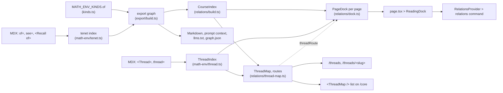
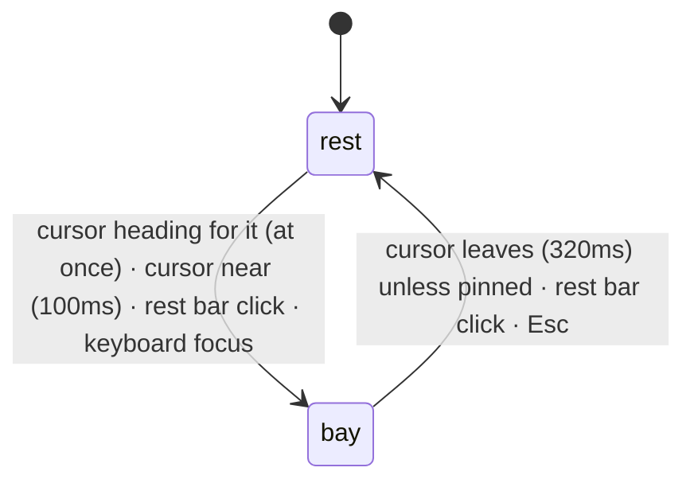

# Relations

How the notes know what depends on what, and which ideas recur across the
course. Two kinds of relation:

- **dependencies** (`of`): local and dense, "what do I need first";
- **threads**: sparse and written on purpose, "where else does this idea show
  up, and how is it the same" (see [Threads](#threads)).

The site shows them in two places:

- the **reading dock**, a cutout in the bottom-right corner of every page that
  follows the environment being read and shows its dependencies, and each of
  its threads as a summary and a small route you can move along;
- the **threads page**, `/threads` and `/threads/<slug>`: every thread as a
  line through the course, strands side by side and chapters as rows, with
  any of them shown or hidden. `/core` lists the threads and links into it.

Each thread's own section also compares its members' statements.

There used to be a course map of page-to-page dependencies (arcs, matrix,
ladder). It was removed: about 93% of dependencies stay within a page or
chapter, so the course-wide picture had little shape, and the dock already
shows the relations a reader acts on. Threads are the course-wide structure,
so they get the picture.

Both read the same relations as the exports (EXPORT.md), from one place.

## Layout

```
src/lib/math-env/kinds.ts          MATH_ENV_KINDS: what `of` means per kind (ENV_RELATIONS)
src/lib/math-env/remark.ts         reads env metadata, `<Thread>` sections and `thread=` tags
src/lib/math-env/thread.ts         ThreadIndex: threads and their members (getCorpus().threads)
src/lib/export/model.ts            edge kinds, DEPENDENCY_EDGES, relation names
src/lib/export/build.ts            site corpus > export graph (the one relation graph)
src/lib/export/query.ts            prerequisites(), relationsOf()

src/lib/relations/                 relation views (pure)
  types.ts                         CourseIndex, PageDock, DIRECTIONS
  build.ts                         page tree + export graph > CourseIndex (server), PAGE_LINK_RELATIONS
  dock.ts                          page envs + CourseIndex + ThreadIndex > PageDock (server)
  query.ts                         neighbours, chapterOfId
  thread-map.ts                    CourseIndex + ThreadIndex > ThreadMap and each thread's route (server)

src/components/relations/
  provider.tsx                     holds the current page's PageDock for the terminal
  dock.tsx                         ReadingDock: the cutout (rest, bay)
  dock-hooks.ts                    useDockState, useActiveAnchor, useProximity, useBoxHeight
  pointer.ts                       shared mouse tracker (position, velocity) and its geometry
  colors.ts                        relation colours

src/components/math-env/thread.tsx ThreadSection: a `<Thread>` with its COMPARE spine
src/components/math-env/thread-compare.tsx  ThreadFrame (section + right-click ask) and ThreadCompare (toggle, reveal)

src/components/threads/
  format.ts                        laneCode, placeLabel: the labels every drawing of a thread shares (numbers never zero-padded, separators `/`, never `·`)
  geometry.ts                      packChapters, squareLine: chapter packing and square lines, shared by the diagram and the track (pure)
  route-track.tsx                  RouteTrack and routeLayout: a route in the diagram's language, in percentages (server-safe, no state)
  route-strip.tsx                  RouteStrip: a RouteTrack with a cursor and keys, linking to the threads page (client)
  thread-list.tsx                  ThreadList: `<ThreadMap />` on /core, an index linking to /threads/<slug>
  page.tsx                         ThreadsPage: /threads and /threads/<slug>, statements (server)
  explorer.tsx                     ThreadsExplorer: the page's state (shown, preview, hover, cursor) and its layout (client)
  bracket.tsx                      Bracket, ACTION: the site's `[LABEL]` actions
  thread-index.tsx                 ThreadIndex: the key above the graph, choosing the threads shown (client)
  layout.ts                        layoutDiagram: ThreadMap + shown threads + width > bands, chapters, stops, lines (pure)
  diagram.tsx                      ThreadDiagram: the SVG, the hanging stop names, the spur and reading, and its keys (client)
  preview.tsx                      StopCard, ThreadCard: the reading's content; Marks: the key to the graph's marks (client)
src/app/(docs)/threads/            the two routes
src/app/(docs)/[...slug]/page.tsx  builds the page's PageDock, renders ReadingDock
src/app/global.css                 colour tokens, the cutout's shape, the active mark, the route track's background
src/lib/client/keybinds.ts         moveKey: the arrows and WASD every focus-scoped widget shares; cursorKey: Home/End and ←/→ along a row of stops
src/lib/terminal/relations-command.ts  the `relations` command
```

## Pipeline



`getCorpus()` builds the export graph, the `CourseIndex` and the thread map
once per worker (COMPILE.md §6). `PageDock` is built per
page during rendering and travels with the page, so the dock needs no fetch.
Nothing about relations is fetched on the client.

## Relation model

### What `of` means

Every environment can cite tenets with `of="slug,…"`. What that citation means
depends on the citing kind, and is set in one place: the `of` field of
`MATH_ENV_KINDS`.

| Kind | Code | `of` means | Edge |
|---|---|---|---|
| definition | DF | depends on | `uses` |
| theorem | TH | depends on | `uses` |
| lemma | LM | depends on | `uses` |
| proposition | PR | depends on | `uses` |
| corollary | CR | depends on | `uses` |
| method | MT | depends on | `uses` |
| proof | PF | proves | `proves` |
| example | EG | practises | `practises` |

`ENV_RELATIONS` (`uses`, `proves`, `practises`) is the set a kind can pick from.
`build.ts` reads `envRelation(kind)` for every `of` citation, so no consumer
special-cases a kind. Proof and example are also the kinds with
`optionalSlug: true`. Every other kind must declare a `slug` so it can be cited.

### Edges

The export graph has one node per page and per environment, and these edges
(full table in EXPORT.md):

| Edge | From > to | Source | Dependency? | Page link? |
|---|---|---|---|---|
| `contains` | page > its environment | every environment | no | no |
| `uses` | env > tenet | `of` on a `uses` kind | yes | yes |
| `proves` | proof > tenet | `of` on a proof | yes | yes |
| `practises` | example > tenet | `of` on an example | yes | yes |
| `recalls` | page > original env | `<Recall of>` on another page | no | yes |
| `see` | env > tenet | `see` | no | no |
| `references` | page > page | prose links | no | no |

Two sets decide what counts:

- `DEPENDENCY_EDGES` (`model.ts`): `uses`, `proves`, `practises`. These are what
  `prerequisites()` follows, for the exports and for the dock's NEEDS list.
- `PAGE_LINK_RELATIONS` (`relations/build.ts`): `DEPENDENCY_EDGES` plus `recalls`.
  These are what roll up into page-to-page links (the dock's page fallback). A recall
  is a page reusing a result, so it counts between pages, even though it isn't
  an environment depending on another.

`see` and `references` stay out of both sets on purpose. They are "related",
not "needed", and including them made index pages link to every child page.

### Reading relations from either end

`RELATION_NAMES` names each edge from both ends. The dock uses these names:

| Dock list | Relation | Meaning |
|---|---|---|
| NEEDS | `prerequisites()` over `DEPENDENCY_EDGES` | everything this transitively rests on |
| PRACTISED IN | `practised_by` | examples and seen questions that practise this |
| LEADS TO | `used_by` | results and methods that use this |

## Threads

A dependency says one result rests on another. Most of them point to the same
page or chapter (about 93% at the time of writing), so they can't show the
ideas that tie the strands together. Threads do that.

A **thread** is a named idea with a one-line summary. It is written where the
notes explain it, as a section of prose:

```mdx
<Thread slug="particular-plus-kernel" summary="Every solution of $T(x)=b$ is one particular solution plus an element of $\ker T$.">

### Kernels and solution sets

The kernel of a linear map …

</Thread>
```

| Part | Rule |
|---|---|
| `slug` | required, same pattern as tenet slugs, unique across the course |
| `summary` | required, inline Markdown; the one line shown wherever the thread is listed |
| title | the first child must be a heading; its text is the thread's title |
| placement | a direct child of the document, like an environment; any page can hold one |
| anchor | the section gets `id="thread-<slug>"` (`threadId`), stable when the heading changes |

The section's content renders and exports as ordinary prose: the Markdown
exports show the heading and text, never the `<Thread>` tag. Kind views hide it
like other prose.

An environment joins a thread with `thread="<slug>: <role>"`, several separated
by `;`. The role says how this place uses the idea, in a few words of inline
Markdown, and is optional:

```mdx
<Theorem slug="affine-solution-set" of="…" thread="particular-plus-kernel: linear differential equations">
<Definition slug="diagonalisation" thread="coordinates: …; change-of-variables: linear maps: a basis that decouples">
```

`createThreadIndex` (`thread.ts`) collects threads and their members, sorted
into course order by the page order it is given (`courseOrder`, the same
walk of the page tree that the `CourseIndex` is built from; members on one page keep source
order). It fails the build on a duplicate thread slug or a tag naming an
unknown thread. Every surface and export reads members in that one order,
except the threads page and the routes, which go in teaching order: by chapter number, then strand (see [Threads page](#threads-page)). Each `ThreadMember` carries the
environment's `href`, `kind`, `title`, `pageUrl`, `slug` and `role`.

MATH1251 defines five threads on `/core`: `coordinates`,
`particular-plus-kernel`, `modes`, `local-approximation` and
`change-of-variables`, with 29 tagged environments (30 memberships:
`polynomial-interpolation` is in two). They show in four places:

- **the dock** (see [Threads in the dock](#threads-in-the-dock));
- **the threads page**, with the list on `/core` (see [Threads page](#threads-page));
- **the thread's own section**, which ends with a closed `[COMPARE] N Origins`
  spine (`ThreadSection`, see below);
- **the exports**: each thread has its own Markdown and prompt context, and
  the same right-click ask panel as an environment (see EXPORT.md, Ask panel).

### The COMPARE spine

```
□  [COMPARE] 6 Origins                                 [RIGHT CLICK]
┃
▪  DEF / the kernel                            Linear transformations   ← passed
┃  Kernel
┃  If T : V → W is a linear map, its kernel is …
┃
■  THM / matrix equations                                    ← the reader is here
┆  Classes of solutions of Ax = b              ← dashed: crosses strands
▫  DEF / the kernel of a differential operator      Ordinary differential equations
   …
```

- One station per member, in course order: kind code and role (separated by
  `/`), the title linking to the environment, and its `<Statement>` (muted
  until hovered). Members without a statement show only their title.
- The chapter title sits at the right of the meta line, only where the
  chapter changes. There are no chapter codes.
- The spine is monochrome, to sit with the rest of the page: a hairline in
  the border colour with a small square tick per station. The line is solid
  within a strand and dashed where the thread crosses between Algebra and
  Calculus. The thread's aqua is kept for the dock and the thread map.
- Origins are separated by rules, not cards: each station opens with a border
  hairline that branches off its tick (`■────`) across the content column,
  with `pb-8` before the next. The current station's rule darkens to
  foreground at 40%.
- The trigger is the head of the spine: a square outline in the spine column,
  then `[COMPARE]` and the count (`6 Origins`, `1 Origin`). The square fills
  when the spine is open, and the hairline draws down from it to the first
  station.
- **The reader on the spine** (`SpineProgress`): while the spine is open, a
  foreground hairline (60%) fills it from the first tick down to the reading
  line, 40% of the way down the viewport (`READING_LINE`). The last station
  whose tick is above that line is `data-state="current"`: its tick is solid
  foreground and its statement is unmuted. The ones above it are `"passed"`,
  with muted-foreground ticks. Tick offsets are measured with a
  `ResizeObserver`; a scroll costs one rect read and a `--progress` write per
  frame, and touches station attributes only when the current station
  changes. Closing the spine clears the states.
- `ThreadCompare` (client) owns the open state and animates the region's
  height with the Web Animations API, from its measured height to the
  content's (`heightTiming`). Opening eases out (`cubic-bezier(0.2, 0, 0, 1)`)
  over 220 ms plus 0.25 ms per pixel, capped at 460 ms. Closing eases in over
  160 ms plus 0.12 ms per pixel, capped at 280 ms. A toggle mid-flight cancels
  and starts from the current height. Overflow is clipped only while the
  height moves, so display maths can scroll and focus rings show once open.
- Stations animate only opacity and transforms (`REVEAL` in `thread.tsx`):
  opening, each fades and rises 40 ms + 30 ms × its index (capped at the
  seventh) after the click, over 300 ms; closing, all fade together in 150 ms.
  The closed region is `inert`, and reduced motion skips the height animation
  and the transitions.
- `ThreadFrame` wraps the whole section in `AskShare`, like an environment:
  right click anywhere in it, or the `[RIGHT CLICK]` hint (`[ASK AI]` on
  touch screens) that shows at the right of the header while the section is
  hovered, opens `AskPopup` for the thread's `PromptTarget`
  (`promptTargetFor(thread.href)`, passed in through the MDX options), with
  `COPY .MD`. An environment inside the section keeps its own panel.

The spine is rendered on the server from `getCorpus().threads`, the tenet
index and the `CourseIndex` (for chapter titles and strands), so statements
never travel to the client.

## Course outline

`getCorpus()` walks the page tree once (`courseOrder(tree)`), and
`buildCourseIndex(order, exportGraph)` returns the `CourseIndex` that the
dock, the spine and the thread map read. It stays on the server. Threads are
not copied into it: those three read `ThreadIndex` directly.

### Strands, reading order and chapters

The page tree (`source.getPageTree()`, the same order as the sidebar) is walked
depth-first. Every top-level folder is a **strand**: its `id` is the first URL
segment of its pages and its `title` is the folder's name from `meta.json`.
Nothing here names the strands, so a new top-level folder is a new strand.
(`src/lib/course/strands.ts` still lists them for routing, OG images and the
exports.)

Each strand gets an intro chapter (number 0), and each folder inside it a
numbered chapter (1, 2, …, in `meta.json` order). A folder's index page comes
before its children.

| Field | Holds |
|---|---|
| `strands` | `id`, `title`, in tree order |
| `chapters` | `id`, `strand`, `number` (0 for the intro), `title` |
| `pages` | `id` (URL), `title`, `chapter` (index into `chapters`), in reading order |
| `pageById`, `position` | each page by URL, and its index in `pages` |
| `neighbours` | per direction, each page's linked pages (see [Links](#links)), heaviest link first, then reading order |

### Links

Every export edge whose kind is in `PAGE_LINK_RELATIONS` is lifted to its two
pages (a page node is its own page, and an environment's page is `node.page`).
Edges within one page are dropped. What's left is grouped by page pair, and
the pair's weight is its number of edges. A link's source builds on its
target.

### Queries (`query.ts`)

| Function | Returns |
|---|---|
| `neighbours(index, id, "builds-on" \| "leads-to")` | direct neighbour pages, heaviest link first, then reading order (a lookup) |
| `chapterOfId(index, id)` | the page's chapter |

## Reading dock

### Why a cutout, and why the corner

The first version was a course map above every page's prose. It failed for two
reasons:

- **Scale:** it worked on whole pages, but a reader is always on one theorem,
  definition or example.
- **Placement:** it scrolled out of view in the first few seconds.

The dock fixes both. It works on the environment at the reading line, and it
stays in view.

Its look is a **cutout**: a notch taken out of the page's corner, showing a
darker layer behind the page. It deliberately has no border, shadow or card
background. It sits in a fixed bottom-right corner rather than riding the
reading line, because an element that moves with scrolling is hard to keep
calm. The contents change with what is being read; the position doesn't.

### Shape

```
                page                 ╭──╮  ← data-dock-corner="top"
                                     │  │     (page's rounded corner)
                         ╭───────────╯  │
                         │  cutout      │  ← data-dock-surface: --dock-cut,
                         │  (dock)      │     border-top-left-radius
         ╭───────────────╯              │
         │  ↑ data-dock-corner="left"   │
─────────┴──────────────────────────────┘ viewport corner
```

| Piece | CSS (`global.css`) |
|---|---|
| `--dock-cut` | `color-mix(in oklab, var(--color-fd-background), black 5%)`; 45% in `.dark` |
| `--dock-radius` | 14px |
| `[data-dock-surface]` | `--dock-cut` background, rounded top-left: the inner corner of the notch |
| `[data-dock-corner]` | a `--dock-radius` square of `--dock-cut` with a transparent quarter circle (`radial-gradient(circle at 0 0, transparent r, cut r)`). It reads as the page's convex corner meeting the notch |
| `top` corner | above the surface, at the viewport's right edge |
| `left` corner | left of the surface, at the viewport's bottom edge |
| `body:has([data-dock])` | `padding-bottom: 6rem`, so the end of a page can scroll clear of the dock |
| `.math-env::before` | the active mark (see [The active mark](#the-active-mark)) |
| `[data-dock-swap]` | a 180ms fade-in, replayed whenever the subject changes |

The corners belong to `<aside data-dock>`, which is positioned fixed, so they
follow the surface through every size change.

### States

The cutout has two sizes. Each one is the same element growing, never
something drawn over it. Both are `min(19rem, 100vw − 2.5rem)` wide.

| State | Shows |
|---|---|
| rest | rest bar: title, one-line summary, course strip |
| bay | the lists above the rest bar |

The surface's height is explicit, so it animates (200ms
ease-out, off under `prefers-reduced-motion`). Its content is laid out at its
final width, anchored bottom right, and the surface clips it, so growing
reveals the content from the corner rather than reflowing it mid-animation:

- **Height** is measured by ResizeObservers (`useBoxHeight`): the rest bar,
  plus the bay when open. Before the first measurement it is left
  to the content.
- **The bay** sits directly above the rest bar, out of flow, and is always
  mounted. Closed, it is clipped, transparent and `inert`, so it is out of the
  tab order. Its content is capped at `min(60vh, 32rem)` and scrolls.
- **A subject change** while open resizes the bay, which the surface follows
  smoothly; the rest bar text and bay lists fade in (`data-dock-swap`).
- **The course strip** keeps its 8px slot on a page outside the `CourseIndex`, so
  the rest bar is the same height everywhere.

The dock is hidden when printing.

`useDockState` (`dock-hooks.ts`) derives the state:



| Input | Effect |
|---|---|
| `near` | `useProximity`: the cursor is heading for the dock, or within 48px of its current box (see [The corridor](#the-corridor)). Mouse and pen only; touch never sets it |
| `pinned` | set by a rest bar click (when closed); held until dismissed |
| `dismissed` | set by Esc or a rest bar click (when open). Ignores `near` until the cursor next leaves, so the bay doesn't reopen under a stationary cursor. Clears itself once `near` is false |
| keyboard focus | focus inside the dock that matches `:focus-visible`. Mouse clicks don't count, so clicking the bar can close it |

The result is `bay` if `(near && !dismissed) || pinned || keyboardFocus`, and
`rest` otherwise.

`useProximity` reads every move from `pointer.ts`, one shared `pointermove`
listener that keeps the last position and a velocity smoothed over about 40ms.
The dock's box is cached (refreshed by a ResizeObserver and on resize), so a
move costs only arithmetic. Each move sets the target:

| Cursor | Target | Applied after |
|---|---|---|
| moving along the corridor (below) towards the dock, for two moves in a row | open | at once, so the bay is open on arrival |
| aimed at it: ≥ 0.3 px/ms, ≤ 320px away, on a line that enters the box (grown by 48px) within 220ms, for two moves in a row | open | at once |
| within 48px | open | 100ms |
| otherwise, or out of the window | closed | 320ms |

A new target cancels the pending one, so turning back towards the dock while
it is closing keeps it open.

#### The corridor

Reaching the dock means crossing the page, which would both change the env
being read and, with only the aimed test, open the dock only from close in. A
safe triangle fixes both:

```
  apex: where the cursor last was on the env being read
   ·
   ·  ·
   ·     ·         corridor: the hull of the apex and the dock
   ·        ·      (grown by 24px)
   ·           ·
   ·              ╭─────────────╮
   ·  ·  ·  ·  ·  │    dock     │
                  ╰─────────────╯
```

- **Apex:** each frame the cursor is on the current env, the apex moves to it.
  When the cursor rests anywhere else outside the corridor (settled, as in
  [Following the reader](#following-the-reader)), the apex moves there. So
  leaving the env fixes the apex at the exit point.
- **Holding focus:** while the cursor is in the corridor and off the current
  env, `useActiveAnchor` keeps its choice. Resting in the corridor for 500ms
  ends the hold (the reader has stopped to read something else), and the apex
  moves there.
- **Opening:** in the corridor, at least 40px from the apex, and closing on the
  dock's centre at ≥ 0.2 px/ms opens the dock at once. The aimed test is the
  fallback for a cursor that never rested on the content.
- **Cost:** a point is in the hull exactly when the ray from the apex through
  it, carried on, meets the dock's box. So the test is one ray-box slab test
  (`inCorridor`, built on `timeToEnter`): a few multiplications, no DOM
  reads. The apex comes from the rects `useActiveAnchor` already measures, and
  the dock's box from the cache above. Both hooks share one `Corridor` object
  (`useCorridor`).

Because `near` is measured against the dock's current box, the open bay is a
larger target than the rest bar, which gives the hysteresis.

Esc is handled in the capture phase, and only while the dock is open. It
dismisses the bay and blurs focus inside the dock. It calls
`preventDefault`, and the terminal ignores prevented keys, so one Esc closes
one layer.

### Following the reader

`useActiveAnchor(anchors, frozen, corridor)` picks the environment being read. Its DOM
`id` is one of the `PageDock` anchors. In order:

1. **The cursor** (mouse only): the innermost environment under a cursor that
   has settled (still for 160ms, or slower than 0.15 px/ms, as when tracing a
   line) and moved in the last 6s. Not while it is in the
   [corridor](#the-corridor) to the dock.
2. **The reading line**, 35% down the viewport (`READING_LINE`): the innermost
   environment containing it. The current environment keeps it while the line
   is within 40px (`LINE_SLACK`) of its box, so crossing the gap between two
   environments doesn't flick the dock to the page and back.
3. **The page**, when neither finds one.

The cursor wins because pointing at something is a stronger signal than where
the page happens to be scrolled; it expires so a mouse left parked doesn't
override scrolling forever. Two things hold the current choice: the cursor in
the corridor to the dock (up to a 500ms rest), and the cursor still travelling
over an environment. So passing over content on the way to the dock changes
nothing. While the dock is `engaged` (cursor near it, keyboard focus
inside it), the choice is frozen outright. A pinned bay with
the cursor elsewhere keeps following.

Cost: an IntersectionObserver keeps the set of environments in the viewport,
and only those are measured, at most once per animation frame, on scroll,
resize and mouse moves. Two timers re-check when a hold may end and when the
cursor expires.

- **On an environment:** the dock shows that environment.
- **In prose between environments:** nothing qualifies, and the dock falls
  back to the page.

### The active mark

The environment the dock is showing gets `data-dock-active` (`rest` or `bay`,
the dock's state), set straight on the DOM so the page's content never
re-renders. It draws a hairline between the environment's rail and its body
(`.math-env::before`): 25% foreground at rest, 80% while the bay is open, so
opening the dock shows exactly what it describes. The line fades and grows in
over 200ms. A `<Thread>` section the dock is following gets the attribute too,
but nothing styles it yet.

### Subjects

The rest bar summarises a `DockSubject`, built by one of three functions
(`subjectAt` picks one):

| | `envSubject` (an environment is active) | `threadSubject` (a `<Thread>` section is active) | `pageSubject` (fallback) |
|---|---|---|---|
| title | the environment's title or label, plus `/ recalled` for a recall | the thread's title | the page title |
| summary | the first non-empty of "Builds on X", "Leads to X", "Practised in X" (with "and N more"), else "Part of the thread T.", else "Not linked to the rest of the course yet." | "Appears in N places." | "Builds on X" or "Leads to X" (pages), else not linked |
| strip | `env.strip` plus its threads' pages | the thread's pages | `page.strip` plus its threads' pages |
| bay | `EnvBay` | `ThreadBlock` | `PageBay` |

All three come from `PageDock`, so they work without a fetch, on kind-view
routes too.

### The course strip

The strip is an 8-unit-tall SVG under the summary, with one tick per page in
reading order, stretched to the dock's width (`preserveAspectRatio="none"`).

| Tick | Height | Colour |
|---|---|---|
| this page | 8 | foreground |
| a page this needs | 6 | `--relations-builds-on` (blue) |
| a page this leads to or is practised in | 6 | `--relations-leads-to` (orange) |
| a page sharing a thread with this | 8 | `--relations-thread` (aqua); wins over blue and orange |
| any other page | 2 | border |

Even at rest, the strip shows how far back in the course the current theorem
reaches and how far forward it is used. Ticks are full-height rects scaled with
`transform`, so height and colour transition (300ms) as the subject changes.

### The bay

The bay is prose, not a table: one sentence per relation, each item a link
underlined in that relation's colour. A relation with nothing in it is left
out.

| Subject | Sentences |
|---|---|
| environment (`EnvBay`) | "Builds on …." (blue), "Practised in …." (muted), "Leads to …." (orange), then one `ThreadBlock` per thread it is in |
| thread (`ThreadBlock`) | the thread's block (below) |
| page (`PageBay`) | "This page builds on …." (blue), "It leads to …." (orange), then one `ThreadBlock` per thread on the page |

If none apply, the bay says "Not linked to the rest of the course yet."

An item reads `Title (aside)`. The aside is the item's chapter title (only when it isn't this page's chapter) and an example's
difficulty. Lists are joined with commas and "and", and cut to their limit with
"N more" at the end:

| List | Limit | Colour |
|---|---|---|
| builds on (NEEDS) | 6 (`NEEDS_LIMIT`) | `--relations-builds-on` |
| practised in | 4 (`PRACTISED_LIMIT`) | muted foreground |
| leads to | 4 (`LEADS_LIMIT`) | `--relations-leads-to` |
| page builds on / leads to | 5 (`PAGE_LIST_LIMIT`) | blue / orange |

### Threads in the dock

Threads are not a list in the bay. Each is a `ThreadBlock` that reads like
the other clauses: "Part of the thread *Title*, in N places." (aqua, linking
to its prose section), its one-line summary set off by a hairline, then its
**route strip**, a miniature of the page's diagram.

```
Part of the thread Roots, modes and evolution, in 7 places.
│ A linear evolution splits into modes …
    1             2         4
ALG ░□─□─□░·      ░···░·    ░·□─□─■░      ← ■ here, □ the other stops
CAL ░░░░░░░ ·     ░··□··    ░░░░░░░
TH  A sufficient condition for long-term …
Markov systems                    ALG 4 / HERE
```

- **The strip** (`RouteStrip` over `RouteTrack`) draws the thread's route as
  the page draws it: time left to right, one band per strand the thread
  visits (labelled with the strand's first three letters), each chapter it
  visits a tinted block of every band with a gap before the next, and the
  chapter numbers above. Stops are hollow squares in teaching order, the line
  in aqua turning at right angles: solid within a chapter, dotted between
  chapters. Where the reader is (`here`) is filled: the environment being
  read, or on a page or thread subject every stop on this page. Positions are
  percentages (`routeLayout`), so the strip fills the dock without being
  measured. The line's colour is the CSS variable `--route-ink`, set by the
  track's `tone` (aqua, or grey for `muted`), so a container can recolour it.
- **The status line** under it is the page's readout for the stop under the
  cursor: kind code and title (a link straight to the environment), then its
  role, strand and chapter (`ALG 4`), and `/ HERE` when it is here. Both
  lines are always there, so moving the cursor never changes the dock's
  height. There is no key hint.
- **The whole strip is one link** to `/threads/<slug>#<station>`, the stop under
  the cursor, so clicking anywhere on it opens the threads page showing only that
  thread with the cursor on that stop.
- **The cursor** starts on here (else the first stop). While the strip is
  engaged its column is shaded and its stop filled, as on the page: the
  pointer moves it to the nearest stop, and so does the keyboard.

| Key | With focus on | Does |
|---|---|---|
| ←/→, A/D | a strip | move the cursor one stop |
| Home / End | a strip | first / last stop |
| ↑/↓, W/S | a strip | the previous / next strip; ↓ from the last returns to the rest bar |
| ↑, W | the rest bar | into the bay, at the last strip |
| Enter | a strip | open the threads page at the cursor |
| Esc | anywhere in the dock | close the bay (as before) |

The keys belong to the focused element (see TERMINAL.md, Keys): nothing
new listens on the window, so the terminal's printable keys and the sidebar's
digits are untouched. The rest bar and strips are marked `data-route-nav`
inside the dock's `data-route-group`, which is what ↑/↓ walk. While focus is
in the dock the subject is frozen, so moving the cursor never changes which
environment the dock follows.

- **Thread sections** are anchors too: a `<Thread>` defined on this page puts
  its `id` in the dock's anchors, so reading `/core` follows thread by thread.

### The payload

`buildPageDock(corpus, envs, { title, url })` runs in `page.tsx`.

```ts
interface PageDock {
	course: { length; position } | undefined; // this page in reading order, for the strip
	envs: DockEnv[];   // one per environment and per recall on the page
	page: {
		links: Record<Direction, DockList>; // page neighbours, as DockRefs
		strip: DockStrip;
		title;
	};
	threads: DockThread[]; // threads defined on this page or with a member here
}

interface DockEnv {
	anchor: string;    // DOM id: the environment's id, or the recall's id
	title: RenderedMarkdown<"inline">;
	recalled: boolean;
	needs: DockList;       // prerequisites(), nearest first
	practisedIn: DockList; // practised_by
	leadsTo: DockList;     // used_by
	strip: DockStrip;      // other pages reached
	threads: DockThread[]; // `here` is this environment
}

interface DockThread {
	anchor?: string;   // DOM id, when the thread is defined on this page
	href; slug; summary; title;
	mapHref: string;   // /threads/<slug>
	number: number;    // the thread's number, as on the threads page
	route: ThreadRoute; // every member, in teaching order (see Threads page, Model)
	here: number[];    // route stops that are here: the environment, else this page's members
	positions: number[]; // reading-order positions of members' other pages
}

type DockStrip = Record<Direction, number[]>; // reading-order positions; an env's needs are "builds-on"

interface DockList { count: number; items: DockRef[] } // items cut to the limit
interface DockRef { id; title; place?; difficulty?; role? } // place: the chapter title, only when it isn't this page's chapter; role is a thread member's
```

- **Markdown fields** go through `rendered()` (`html`, `mode`, `plain`), so
  their Markdown `source` stays on the server.
- **Recalls** carry the original environment's relations, under the recall's
  own anchor.
- **NEEDS** includes environments on the same page (with no chapter aside),
  because an earlier definition on the page is still a prerequisite.
- **The strip** counts only other pages.
- **Untitled targets** from another page are labelled with their page, e.g.
  `Example (Seen Questions)`.

## Threads page

`/threads` draws every thread as a line through the course. `/threads/<slug>`
is the same page showing only that thread, statically generated per thread
(`dynamicParams = false`), so it renders that way with no flash and
is saved for offline like any other page. Both routes render `ThreadsPage`
(`components/threads/page.tsx`) inside the docs layout, full width, with no
table of contents and no dock.

The ways in:

- **the dock**: each thread's route strip opens
  `/threads/<slug>#<station>`, at the stop under its cursor (see
  [Threads in the dock](#threads-in-the-dock));
- **`/core`**: `<ThreadMap />` under "Shared ideas" renders `ThreadList`, an
  index with each thread's number, title, summary and a grey route strip,
  every row linking to `/threads/<slug>`, plus `[MAP]` to `/threads`. Under
  the pointer or focus a `>` takes the
  number's place and no background is drawn; the title is underlined and the
  strip's ink (`--route-ink`, `[data-thread-row]` in `global.css`) turns
  from grey to aqua. It must
  be a direct child of the document; `remark.ts` keeps it out of the exports,
  and kind views hide it like prose.

### Model (`thread-map.ts`)

`buildThreadMap(courseIndex, threads, pages)` runs once in `getCorpus()`. All
of it reaches the client as props, so every Markdown field goes through
`rendered()`.

| Field | Holds |
|---|---|
| `strands` | the strands that have at least one member, in tree order (so `core`, which only defines threads, has no column) |
| `rows` | one per chapter number from the first to the last with a member; each has a `cell` per strand: that strand's chapter at that number (or none) and its `stations` |
| stations | one per tagged environment: `href`, `id` (`stationId(href)`, the DOM id a link can land on), kind `code`, `title`, and a `stop` per thread it is in (`thread` slug, `role`) |
| `threads` | `slug`, `number` (1-based, in definition order), `title`, `summary`, `href` (its prose section), `mapHref` (`/threads/<slug>`) and `route` |

**A route** (`threadRoute(courseIndex, thread)`, `ThreadRoute` in `types.ts`)
is the thread as a line: one stop per member in teaching order
(`routeMembers`: chapter number, then strand, then reading order), each with
`code`, `href`, `title`, `role`, `chapter` number, chapter title as `place`
and `station` id, and `lanes`, the
titles of the strands the thread visits. A stop's `lane` indexes `lanes`, so a
route has as many lanes as it needs whatever the number of strands. The dock,
the `/core` list and the threads index all draw routes; nothing names a strand.

**Rows are a shared timeline** (`alignedRows`). The strands are taught side by
side, so chapter *k* of every strand is on row *k*. Within a row, stations go
by strand, then by reading order (page, then source order). Each thread runs
through its stops in that order, which is time order rather than reading
order: `modes` runs Algebra 1 → Calculus 2 → Algebra 4. This is the one
MATH1251 assumption in the model: a course taught one strand after another
would lay rows out by reading order, and only `alignedRows` would change.

An environment in two threads is one station with two stops: an interchange.

### The page

The page is the graph. Under the title and a one-line description, three
things, unframed:

```
── 1 Coordinates   ── 2 Kernels and solution sets   ┄┄ 3 Modes     [SHOW ALL]

         1           2                3
ALGEBRA  ░░□─□─□░·   ░░□─□─■─□░···    ░░□─□░
         ░░░░░░░░    ░░░░░░│░░░░░     ░░░░░
CALCULUS ░░░░░░░░   ░░░□─□─□─□░··     ░░░░░
               ╱  ╱  ╱ ╱  │╱  ╱       stop names at 45°
             ╱  ╱  ╱ ╱  ╱ │ ╱
┌─────────────────────────┘                 the spur
■ Kernel of a matrix                        the reading: a station on it
│ DF  ALG 2  Kernels and solution sets
│ statement…
│ 2 Kernels and solution sets / the definition
│ [←] [→] [OPEN ↗]

── Within a chapter  ┄ Waiting between chapters  □ A stop  …
```

The **key** above chooses the threads shown; the **graph** draws them and
names every stop; the **reading** under it shows whatever is under the
pointer, at the end of a spur drawn from its column. `ThreadsExplorer` (client) holds the state:

| State | Is | Set by |
|---|---|---|
| `shown` | the threads drawn, in definition order | the key; starts as all, or the one in the address |
| `preview` | the key entry under the pointer or keyboard | the key |
| `hover` | the stop under the pointer | the graph's columns and stop names, the reading |
| `cursor` | the pinned stop | a click on a column or name (again to unpin), ←/→ in the graph, `#<station>` in the address; Esc unpins |

Every shown thread is drawn in the foreground. Aqua marks the threads in
question, first match wins: the key entry under the pointer, the hovered
stop's threads, the cursor's threads, the only thread shown.

The address follows `shown` (`history.replaceState`): `/threads` when all are
shown, else `/threads/<first shown>`, so a reload or a shared link opens on
it. Only the first of several is kept.

### Key

The threads as a map keys its lines (`ThreadIndex`,
`threads/thread-index.tsx`): a swatch, the number the line starts with, the
title, wrapping as needed. A shown thread's swatch is solid, a hidden one's
dotted and its title muted. Under the pointer or focus the swatch and the
thread's line turn aqua, the title underlines and the thread's summary reads
under the graph, spurred from its first shown stop; no background is drawn. `[SHOW ALL]`
shows only while some are hidden, but always keeps its place. Separators are `/` and spacing, never
`·`.

| Input | Does |
|---|---|
| click, Enter on an entry | show only this thread; again, show all |
| Space, Shift-click | show or hide this thread |
| ←/→, ↑/↓, WASD | previous / next entry |
| Esc anywhere in the page | unpin the stop; with none pinned, show all |

Hiding every thread leaves "No threads shown `[SHOW ALL]`" in the graph's
place.

### Diagram

A transit diagram, time running left to right (`layoutDiagram` in
`threads/layout.ts`, drawn by `ThreadDiagram` in `threads/diagram.tsx`):

```
         1           2                      3
ALGEBRA  ░░3□─□─□░·  ░░1□─□─□░·········□··  ░···□─□░
         ░░░░░░░░    ░░░░░│░░░░░░░░░░░░░░░  ░░░░░░░
                          □4
CALCULUS ░░░░░░░░░   ░░░2□─□─□─□░·········  ░░░░░░░
```

- **Bands** are strands, in tree order, only those with a shown stop,
  labelled in full, or by code (`ALG`) when the diagram is under 640px wide. Each
  shown thread has its own **track** in every band, at the same height, so a
  thread keeps its row and only changes band.
- **Chapters** are columns. Every band is tinted (foreground at 5%) under
  each chapter it has, and a 10px gap separates chapters: the separation is
  the gap, not a border. Chapter numbers sit on an axis above. A chapter with
  no shown stop shrinks to a 12px sliver and loses its number, so the time
  axis stays continuous.
- **Stops** each get a slot in their chapter, in the model's order (strand,
  then reading order), so every line runs left to right. The slot width fills
  the width available (`useWidth`, a ResizeObserver), between 16px and 44px;
  below 16px the diagram scrolls sideways. Before the first measure (and on
  the server) it lays out for 1000px.
- **Lines** turn at right angles, just after the earlier stop. A step within
  a chapter is **solid**; a step between chapters, where the idea is waiting
  for its next appearance, is **dotted** and thinner. Each line starts with
  its thread's number.
- **Stops** are hollow squares in their line's colour; an interchange (a stop
  on two shown threads in one band) joins its squares with a foreground bar.
  The cursor's stop is filled and its column shaded; the hovered stop gets a
  dashed hairline.
- **Names** hang under every column at 45°, rising to the stop: kind code,
  then title, in HTML over the drawing so titles keep their maths. Each is
  cut with an ellipsis where it would run past the diagram's left edge, so
  early stops say less. The cursor's and the hovered stop's names are the
  foreground; while threads are marked, the names of stops off them fade.
  The depth below the bands is estimated from the plain titles, not measured.

Everything is computed from the data and the width. Nothing in the
diagram is measured from the DOM but its width, so it renders on the server and changes
in one render when the threads shown change.

The diagram is one tab stop with `role="slider"` over the stops in time
order: ←/→ (A/D) move the cursor, Home/End jump to the ends, Enter opens the
cursor's stop. The pointer previews (`hover`); a click pins (`onPick`).

The **marks** key under the graph draws each mark beside its meaning, aqua
included.

### Reading

The reading is the point of the page, and it never covers the graph. It is
a spur off the map (`DiagramSpur` over a stack of `DiagramReading`s, drawn in `diagram.tsx`): from the foot
of the stop's column a line drops past the hanging names, turns at a right
angle to the left margin and runs down the reading, which sits beneath the
graph as a station on that branch, its name level with the spur's square
(the same line-and-square as the `COMPARE` spine). The reading stays where
it is; only the spur moves. While the pointer passes, the spur is dotted and
the square hollow (as a line waiting between chapters); pinned, both are
solid.

**Nothing moves.** Every reading the page can show (each shown stop and
each shown thread) is rendered from the start into one grid cell
and only the active one is visible (the rest `invisible` and `inert`, fading
in over 150ms). The area is always as tall as the tallest, so the page never
reflows as the pointer moves, and the space is reserved on first paint. It
changes only when the threads shown do. With nothing previewed or pinned
the area keeps its height but shows nothing, not even its line or square. `[SHOW ALL]` in the key is likewise always laid out,
hidden while every thread is shown. First match wins:

| Reads | Content |
|---|---|
| the stop the pointer rests on | title linking to the environment; kind code, strand and chapter, chapter title; statement; every thread it is on with this stop's role; `[OPEN ↗]` |
| the key entry under the pointer | from the thread's first shown stop: title; number / strands / stops; summary |
| the pinned stop | as a hovered stop, plus `[←]` and `[→]` |

The reading follows the pointer once it has rested for 90ms (`useSettled`),
so moving down to it across other names does not swap it, while the aqua
marks and the names follow at once. On the reading the pointer keeps it
(`hold`), so its links can be used. Statements are rendered on the server
(`StatementHtml`, keyed by the stop's `href`) and passed in as nodes, so they
never reach the client as data.

### Colour

| Token | Light | Dark | Job |
|---|---|---|---|
| `--relations-builds-on` | `#2a78d6` | `#3987e5` | what the subject needs (blue) |
| `--relations-leads-to` | `#eb6834` | `#d95926` | what builds on the subject (orange) |
| `--relations-thread` | `#1baf7a` | `#199e70` | threads (aqua) |

The two direction colours are slots 1 and 2 of the validated reference palette,
and the thread colour is slot 3. The three pass the palette validator in both
modes, with two caveats that the design works around:

- **Light contrast:** aqua is 2.74:1 on the light surface, below 3:1. Every
  aqua mark sits next to a text label (THREAD, threads, places, the key).
- **Tritan, dark:** worst pair ΔE 4.0. On the strip, thread ticks are full
  height and dependency ticks are 6 units, so height tells them apart.

The diagram's lines are the foreground at 55% (20% while another thread is
marked): it never needs more than one colour, because aqua only marks the
threads in question. Each thread keeps its own track and starts with its
number, so two marked threads stay apart.

## Terminal

| Command | Does |
|---|---|
| `relations` | lists what the current page builds on and leads to, and the threads through it (from its `PageDock`, so it works offline and on kind views) |

`ReadingDock` publishes its `PageDock` to `RelationsProvider`
(`usePublishDock`), which the terminal reads.

## Extending

- **A new environment kind:** add it to `MATH_ENV_KINDS` with an `of`
  relation, plus `optionalSlug` if it needn't be citable. Its citations reach
  the exports and the dock with no other change.
- **A new thread:** wrap the prose that explains it in `<Thread slug summary>`
  and tag each member environment with `thread="<slug>: <role>"`. A thread is
  worth adding when its members span chapters or strands; inside one page,
  `of` already says it. It gets a lane on the map, a route in the dock and a
  page at `/threads/<slug>`.
- **A new strand:** add a top-level folder with a `meta.json`. The `CourseIndex`,
  the dock's strip, routes (a lane wherever a thread visits it) and the map
  pick it up; routing, OG images and the
  exports still need it in `src/lib/course/strands.ts`.
- **A new relation:** add it to `ENV_RELATIONS`, `EXPORT_EDGE_KINDS`,
  `RELATION_NAMES`, `RELATION_LABELS` and `RELATION_ORDER` (EXPORT.md). Add it
  to `DEPENDENCY_EDGES` if it is a prerequisite: it then joins NEEDS,
  `prerequisites()` and the page links.
- **A new dock list:** add a `DockList` field to `DockEnv`, fill it in
  `dockEnv` (`relations/dock.ts`) from `relationsOf`, render a `Clause` in
  `EnvBay` and add it to the `firstClause` call in `envSubject`.

## Tuning

Starting values, none yet checked in a browser:

| Knob | Where | Value |
|---|---|---|
| reading line | `READING_LINE`, `dock-hooks.ts` | 35% of viewport height |
| line slack | `LINE_SLACK` | 40px |
| cursor settle / expiry | `SETTLE_MS`, `SETTLED_SPEED`, `CURSOR_TTL` | 160ms or 0.15 px/ms / 6s |
| proximity radius | `PROXIMITY`, `dock-hooks.ts` | 48px |
| open / close delay | `PROXIMITY` | 100ms / 320ms |
| approach | `APPROACH`, `dock-hooks.ts` | ≥ 0.3 px/ms, ≤ 320px, arriving within 220ms |
| corridor | `CORRIDOR`, `dock-hooks.ts` | 24px margin, 40px travel, 0.2 px/ms closing, 500ms rest |
| active mark | `.math-env::before`, `global.css` | 25% / 80% foreground |
| cutout depth | `--dock-cut`, `global.css` | 5% darker (light), 45% (dark) |
| notch radius | `--dock-radius` | 14px |
| dock width | `dock.tsx` | 19rem |
| list limits | `relations/dock.ts` | 6 / 4 / 4 env, 5 page |
| route strip | `UNIT`, `BAND`, `AXIS`, `route-track.tsx` | 10 : 2 : 4 slot, pad and chapter gap; 14px bands, 13px axis |
| diagram slot | `DIAGRAM.minSlot`, `maxSlot`, `threads/layout.ts` | 16px to 44px per stop, fitted to the width |
| diagram rhythm | `DIAGRAM` | 12px track, 11px band padding, 22px band gap, 10px chapter gap, 12px empty chapter |
| diagram band labels | `DIAGRAM.label`, `narrowLabel`, `narrow` | 92px in full; 34px by code below 640px |
| spur | `SPUR`, `threads/diagram.tsx` | turns 12px under the names, reading 28px under them, runs 4.5px from the left |
| reading rest | `REST_MS`, `threads/explorer.tsx` | 90ms |
| stop names | `NAME_SIZE`, `threads/diagram.tsx` | 45°, 12px below the bands, at most 200px |
| page bottom padding | `global.css` | 6rem |

## Not yet built

- **Several shown threads in the address:** only the first is kept, so a
  reload drops the others.
- **The diagram on phones** scrolls sideways once slots reach 16px; a
  vertical layout (time running down) would avoid that.

- **Hover to preview:** hovering a prose link, footnote or recall to show that
  tenet's statement in the bay.
- **Peek first:** clicking a NEEDS row to expand its statement in the bay before
  navigating. At the moment every row navigates.
- **Narrow screens:** the cutout is the same element on phones. At rest it
  covers the bottom-right of the prose, and only a tap opens it.
- **Footnotes:** environment footnotes still list direct uses and cited-by,
  which the bay repeats. Decide whether to simplify them once the dock has been
  used.
