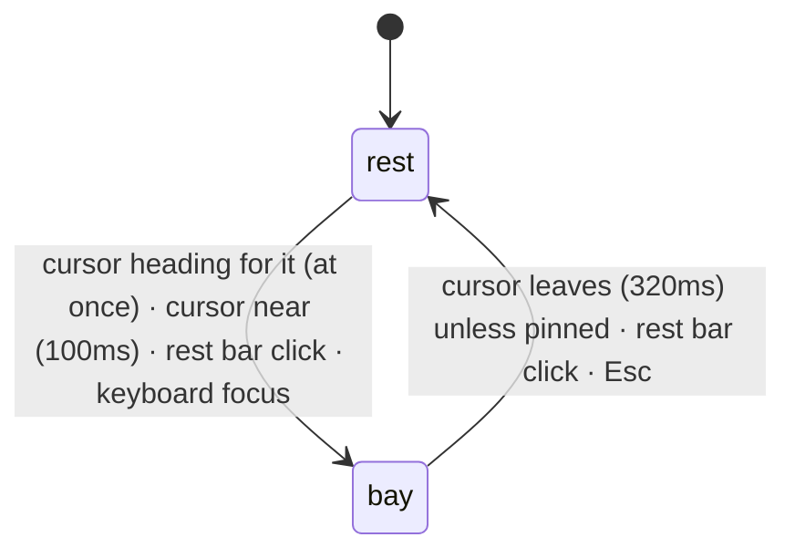

# Relations

How the notes show what depends on what, and which ideas recur across the
course. There are two kinds of relation:

- **dependencies** (an environment's `of`): local and dense, "what do I need
  first";
- **threads**: sparse and written on purpose, "where else does this idea show
  up, and how is it the same".

They appear in three places:

- the **reading dock**, a cutout in the bottom-right corner of every page that
  follows the environment being read and shows what it builds on, what it leads
  to, what practises it, and each of its threads as a small route you can move
  along;
- the **thread sections** in the notes, each ending with a `[COMPARE]` spine of
  every place the idea appears;
- the **threads page** (`/threads`, `/threads/<slug>`): every thread as a line
  through the course, strands side by side and chapters as columns.

All of them read the same graph as the exports (EXPORT.md). `lib/relations`
builds the views on the server: the course outline and thread map once per
process (in production), the dock payload once per page render;
`components/relations` draws the dock and `components/threads` the thread
sections, route strips and the threads page. The module sits above
`export` and `mdx-env` and below `terminal` and `site`.

## Layout

```
src/lib/relations/
  types.ts                 CourseIndex, ThreadMap, ThreadRoute, PageDock, DIRECTIONS
  build.ts                 courseOrder, buildCourseIndex: page tree + export graph → CourseIndex; PAGE_LINK_RELATIONS
  query.ts                 neighbours, chapterOfId
  dock.ts                  buildPageDock: page envs + CourseIndex + ThreadIndex → PageDock; list limits
  thread-map.ts            buildThreadMap, threadRoute: the threads page model and each thread's route
  urls.ts                  threadsRoute, threadMapHref, stationId
src/components/relations/
  dock.tsx                 ReadingDock: the cutout, rest bar, bay and course strip
  subject.tsx              envSubject, threadSubject, pageSubject; RelationsBay, ThreadBlock
  dock-hooks.ts            useDockState, useActiveAnchor, useProximity, the corridor; tuning constants
  pointer.ts               shared pointer tracker (position, velocity) and ray-box geometry
  provider.tsx             RelationsProvider: the page's dock for the terminal
  colors.ts                direction colours
src/components/threads/
  mdx.tsx                  the <Thread> and <ThreadMap> MDX components
  thread-section.tsx       ThreadSection: a thread's section with its COMPARE spine
  thread-compare.tsx       ThreadFrame (ask menu), ThreadCompare (open, height animation), SpineProgress
  thread-list.tsx          ThreadList: <ThreadMap />, an index linking to /threads/<slug>
  route-track.tsx          RouteTrack, routeLayout: a route in percentages (server-safe)
  route-strip.tsx          RouteStrip: a RouteTrack with a cursor and keys (client)
  page.tsx                 ThreadsPage (server; the route passes corpus data as props)
  explorer.tsx             ThreadsExplorer: shown, preview, hover and cursor state; the page's layout
  thread-index.tsx         the key: choosing the threads shown
  layout.ts                layoutDiagram: bands, chapters, stops, lines and name depth (pure)
  diagram.tsx              ThreadDiagram: the SVG, hanging names, spur and reading; its keys
  marks.tsx                StopMarks, line strokes, and Marks (the legend, drawn by the same code)
  preview.tsx              StopCard, ThreadCard: the reading's content
  geometry.ts              packChapters, squareLine (pure)
  format.ts                laneCode and shared labels
  bracket.tsx              Bracket, ACTION: the site's [LABEL] actions
  colors.ts                THREAD_COLOR, foregroundAt
src/app/(docs)/threads/    /threads and /threads/[slug]
src/lib/terminal/relations-command.ts   the `relations` command (TERMINAL.md)
```

## The relation model

What an environment's `of` means is set by its kind's relation in the pack
(MDX-ENV.md): `uses`, `proves` or `practises`. The export graph turns every
citation into an edge of that kind (EXPORT.md has the full edge table). Two
sets decide what counts here:

| Set | Edges | Used for |
|---|---|---|
| `DEPENDENCY_EDGES` (`export/model.ts`) | `uses`, `proves`, `practises` | `prerequisites()`: the dock's "builds on" and the exports' prerequisites |
| `PAGE_LINK_RELATIONS` (`relations/build.ts`) | the above plus `recalls` | page-to-page links: the dock's page fallback and the course strip |

A recall is a page reusing a result, so it links pages even though no
environment depends on another. `see` and prose `references` are in neither
set: they are "related", not "needed", and counting them made index pages link
to every child page.

The dock reads relations from both ends using the export layer's names:

| Dock list | Relation |
|---|---|
| builds on | `prerequisites()` over `DEPENDENCY_EDGES`, nearest first |
| practised in | `practised_by`: examples that practise this |
| leads to | `used_by`: results and methods that use this |

## Threads

A dependency says one result rests on another, and nearly all of them are
local: of the 788 dependency edges, 70% stay on the same page and about 95%
within a chapter. They can't show the ideas that tie the strands together.
Threads do that.

A **thread** is a named idea with a one-line summary, written where the notes
explain it as a `<Thread slug summary>` section, and joined by environments
anywhere in the course with `thread="<slug>: <role>"`; the role says how this
place uses the idea. The syntax and its rules are in MDX-ENV.md (Authoring).

```mdx
<Thread slug="particular-plus-kernel" summary="Every solution of $T(x)=b$ is one particular solution plus an element of $\ker T$.">
### Kernels and solution sets
…
</Thread>

<Theorem slug="affine-solution-set" of="…" thread="particular-plus-kernel: linear differential equations">
```

A thread is worth adding when its members span chapters or strands; within one
page, `of` already says it.

MATH1251 defines five threads, all on `/core`: `coordinates`,
`particular-plus-kernel`, `modes`, `local-approximation` and
`change-of-variables`, with 29 tagged environments.

**Two orders.** `createThreadIndex` sorts members in **course order** (reading
order of their pages, then source order); the dock's lists, the COMPARE spine
and the exports use it. Routes and the threads page use **teaching order**:
chapter number, then strand, then reading order (`routeMembers`), because the
strands are taught side by side (see Aligned rows below).

A thread appears in four places: the dock, its own section's COMPARE spine, the
threads page (with the list on `/core`), and the exports (its own Markdown and
prompt context, and the same right-click ask menu as an environment).

## Course outline

`getCorpus()` walks the page tree once (`courseOrder`, the same order as the
sidebar), and `buildCourseIndex(order, exportGraph)` returns the `CourseIndex`
that the dock, the spine and the thread map read. It stays on the server;
threads are not copied into it.

The walk is depth-first. Every top-level folder is a **strand** (`id` is the
first URL segment, `title` the folder name from `meta.json`). Each strand gets
an intro chapter (number 0), and each folder inside it a numbered chapter (1,
2, …, in `meta.json` order); a folder's index page comes before its children.
`getCorpus` checks the strands against `course.config.ts` (README.md).

| Field | Holds |
|---|---|
| `strands` | `id`, `title`, in tree order |
| `chapters` | `id`, `strand`, `number` (0 for the intro), `title` |
| `pages` | `id` (URL), `title`, `chapter`, in reading order |
| `pageById`, `position` | each page by URL, and its index in `pages` |
| `neighbours` | per direction, each page's linked pages, heaviest link first, then reading order |

**Links.** Every export edge in `PAGE_LINK_RELATIONS` is lifted to its two pages
(an environment's page is `node.page`); edges within a page are dropped; the
rest are grouped by page pair, weighted by their number of edges. A link's
source builds on its target. `neighbours(index, id, direction)` and
`chapterOfId(index, id)` (`query.ts`) are the lookups.

## Reading dock

### Shape

The dock is a **cutout**: a notch taken out of the page's bottom-right corner,
showing a darker layer behind the page. It has no border, shadow or card
background, and it sits in a fixed corner rather than riding the reading line:
the contents change with what is being read, the position doesn't.

```
                page                 ╭──╮  ← data-dock-corner="top"
                                     │  │     (the page's rounded corner)
                         ╭───────────╯  │
                         │  cutout      │  ← data-dock-surface
                         │  (dock)      │
         ╭───────────────╯              │
         │  ↑ data-dock-corner="left"   │
─────────┴──────────────────────────────┘ viewport corner
```

| Piece | CSS (`global.css`) |
|---|---|
| `--dock-cut` | `color-mix(in oklab, var(--color-fd-background), black 5%)`; 45% in dark mode |
| `--dock-radius` | 14px |
| `[data-dock-surface]` | `--dock-cut` background, rounded top-left: the notch's inner corner |
| `[data-dock-corner]` | a `--dock-radius` square of `--dock-cut` with a transparent quarter circle, read as the page's convex corner meeting the notch; `top` above the surface at the right edge, `left` beside it at the bottom edge |
| `body:has([data-dock])` | `padding-bottom: 6rem`, so the end of a page scrolls clear of the dock |
| `[data-dock-swap]` | a 180ms fade-in, replayed when the subject changes |

The corners belong to the fixed `<aside data-dock>`, so they follow the surface
through every size change. The dock is hidden when printing.

### States

The cutout has two sizes, both `min(19rem, 100vw − 2.5rem)` wide; each is the
same element growing, never something drawn over it.

| State | Shows |
|---|---|
| rest | the rest bar: title, one-line summary, course strip |
| bay | the relation lists above the rest bar |

The surface's height is explicit so it animates (200ms ease-out, off under
reduced motion). Content is laid out at its final width, anchored bottom right
and clipped, so growing reveals it from the corner instead of reflowing it:

- **Height** comes from ResizeObservers (`useBoxHeight`): the rest bar, plus the
  bay when open.
- **The bay** sits above the rest bar, out of flow and always mounted; closed,
  it is clipped, transparent and `inert`. Its content is capped at
  `min(60vh, 32rem)` and scrolls.
- **A subject change** while open resizes the bay smoothly; the text fades in.
- **The course strip** keeps its slot on pages outside the course index, so the
  rest bar is the same height everywhere.

`useDockState` derives the state:



| Input | Effect |
|---|---|
| `near` | `useProximity`: the cursor is heading for the dock or within 48px of its current box. Mouse and pen only; touch never sets it |
| `pinned` | set by a rest bar click while closed; held until dismissed |
| `dismissed` | set by Esc or a rest bar click while open; ignores `near` until the cursor next leaves, so the bay doesn't reopen under a stationary cursor |
| keyboard focus | focus inside the dock matching `:focus-visible` (mouse clicks don't count, so clicking the bar can close it) |

The state is `bay` if `(near && !dismissed) || pinned || keyboardFocus`.

**Proximity.** `pointer.ts` keeps one shared `pointermove` listener with the last
position and a velocity smoothed over about 40ms. The dock's box is cached
(refreshed by a ResizeObserver and on resize), so a move costs only arithmetic.

| Cursor | Target | Applied after |
|---|---|---|
| moving along the corridor (below) towards the dock, two moves in a row | open | at once, so the bay is open on arrival |
| aimed at it: ≥ 0.3 px/ms, ≤ 320px away, on a line entering the box (grown by 48px) within 220ms, two moves in a row | open | at once |
| within 48px | open | 100ms |
| otherwise, or out of the window | closed | 320ms |

A new target cancels the pending one, so turning back towards the dock while it
is closing keeps it open. Because `near` is measured against the current box,
the open bay is a larger target than the rest bar, which gives hysteresis.

**The corridor.** Reaching the dock means crossing the page, which would both
change the environment being read and, with only the aim test, open the dock
only from close in. A safe triangle fixes both:

```
  apex: where the cursor last was on the env being read
   ·
   ·  ·
   ·     ·         corridor: the hull of the apex and the dock
   ·        ·      (grown by 24px)
   ·           ·
   ·              ╭─────────────╮
   ·  ·  ·  ·  ·  │    dock     │
                  ╰─────────────╯
```

- **Apex:** while the cursor is on the current environment the apex follows it;
  when it settles anywhere else outside the corridor, the apex moves there.
- **Holding:** while the cursor is in the corridor and off the current
  environment, `useActiveAnchor` keeps its choice; resting there for 500ms ends
  the hold.
- **Opening:** in the corridor, at least 40px from the apex and closing on the
  dock's centre at ≥ 0.2 px/ms opens the dock at once.
- **Cost:** a point is in the hull exactly when the ray from the apex through it
  meets the dock's box, so the test is one ray-box slab test (`inCorridor` on
  `timeToEnter`), with no DOM reads. Both hooks share one corridor object
  (`useCorridor`).

Esc is handled in the capture phase, only while the dock is open: it dismisses
the bay, blurs focus inside the dock and calls `preventDefault`, which the
terminal respects, so one Esc closes one layer.

### Following the reader

`useActiveAnchor` picks the environment being read, in order:

1. **The cursor** (mouse or pen): the innermost environment under a cursor that
   has settled (still for 160ms, or slower than 0.15 px/ms, as when tracing a
   line, with 16px of horizontal slack) and moved in the last 6s, unless it is
   in the corridor.
2. **The reading line**, 35% down the viewport: the innermost environment
   containing it. The current environment keeps it while the line is within
   40px of its box, so crossing the gap between two environments doesn't flick
   to the page and back.
3. **The page**, when neither finds one (for example in prose between
   environments).

The cursor wins because pointing is a stronger signal than scroll position; it
expires so a parked mouse doesn't override scrolling forever. While the dock is
engaged (cursor near it, keyboard focus inside), the choice is frozen. A
`<Thread>` section defined on the page is an anchor too, so reading `/core`
follows thread by thread.

An IntersectionObserver keeps the set of environments in the viewport, and only
those are measured, at most once per frame, on scroll, resize and pointer moves.

**The active mark.** The environment the dock shows gets `data-dock-active`
(`rest` or `bay`), set directly on the DOM so the page never re-renders. It
draws a hairline between the environment's rail and body (`.mdx-env::before`):
25% foreground at rest, 80% with the bay open, fading in over 200ms.

### Subjects

The rest bar summarises a `DockSubject` (`subject.tsx`, chosen by `subjectAt`):

| | `envSubject` | `threadSubject` | `pageSubject` (fallback) |
|---|---|---|---|
| title | the environment's title or label, plus `/ recalled` for a recall | the thread's title | the page title |
| summary | the first of "Builds on X", "Leads to X", "Practised in X" (with "and N more"), else "Part of the thread T.", else "Not linked to the rest of the course yet." | "Appears in N places." | "Builds on X" or "Leads to X" (pages), else not linked |
| strip | the environment's pages plus its threads' pages | the thread's pages | the page's links plus its threads' pages |
| bay | `RelationsBay` of its clauses | `ThreadBlock` | `RelationsBay` of its clauses |

All three come from `PageDock`, so they work without a fetch, on kind views too.

**The course strip** is an 8-unit SVG under the summary: one tick per page in
reading order, stretched to the dock's width.

| Tick | Height | Colour |
|---|---|---|
| this page | 8 | foreground |
| a page this needs | 6 | `--relations-builds-on` (blue) |
| a page this leads to or is practised in | 6 | `--relations-leads-to` (orange) |
| a page sharing a thread | 8 | `--relations-thread` (aqua), wins over blue and orange |
| any other page | 2 | border |

Even at rest it shows how far back the current result reaches and how far
forward it is used. Ticks are full-height rects scaled with `transform`, so
height and colour transition (300ms) as the subject changes.

### The bay

The bay is prose, not a table: one sentence per relation, each item a link
underlined in that relation's colour; empty relations are left out.

| Subject | Sentences |
|---|---|
| environment | "Builds on …." (blue), "Practised in …." (muted), "Leads to …." (orange), then a `ThreadBlock` per thread it is in |
| thread | its `ThreadBlock` |
| page | "This page builds on …." (blue), "It leads to …." (orange), then a `ThreadBlock` per thread on the page |

An item reads `Title (aside)`: the aside is the item's chapter title (only when
it isn't this page's chapter) and an example's difficulty. Lists are cut with
"N more":

| List | Limit (`relations/dock.ts`) |
|---|---|
| builds on | 6 (`NEEDS_LIMIT`) |
| practised in | 4 (`PRACTISED_LIMIT`) |
| leads to | 4 (`LEADS_LIMIT`) |
| page builds on / leads to | 5 (`PAGE_LIST_LIMIT`) |

### Threads in the dock

Each thread is a `ThreadBlock`: "Part of the thread *Title*, in N places."
(aqua, linking to its section), its summary set off by a hairline, then its
**route strip**, a miniature of the threads page's diagram:

```
Part of the thread Roots, modes and evolution, in 7 places.
│ A linear evolution splits into modes …
    1             2         4
ALG ░□─□─□░·      ░···░·    ░·□─□─■░      ← ■ here, □ the other stops
CAL ░░░░░░░ ·     ░··□··    ░░░░░░░
TH  A sufficient condition for long-term …
Markov systems                    ALG 4 / HERE
```

- **The strip** (`RouteStrip` over `RouteTrack`) draws the route as the page
  does: time left to right, one band per strand the thread visits (labelled
  with the strand's first three letters), a tinted block per chapter visited,
  chapter numbers above. Stops are hollow squares in teaching order, the line
  aqua and right-angled: solid within a chapter, dotted between chapters.
  `here` is filled: the environment being read, or every stop on this page for
  a page or thread subject. Positions are percentages (`routeLayout`), so the
  strip fills the dock without being measured. The line colour is
  `--route-ink`, set by the track's `tone`, so a container can recolour it.
- **The status line** reads out the stop under the cursor: kind code and title
  (linking to the environment), role, strand and chapter (`ALG 4`), and
  `/ HERE`. Both lines are always present, so moving the cursor never changes
  the dock's height.
- **The strip is one link** to `/threads/<slug>#<station>`, the stop under the
  cursor.
- **The cursor** starts on `here`; the pointer or the keyboard moves it.

| Key | Focus on | Does |
|---|---|---|
| ←/→, A/D | a strip | move one stop |
| Home / End | a strip | first / last stop |
| ↑/↓, W/S | a strip | previous / next strip; ↓ from the last returns to the rest bar |
| ↑, W | the rest bar | into the bay, at the last strip |
| Enter | a strip | open the threads page at the cursor |
| Esc | anywhere, while the bay is open | close the bay |

The keys belong to the focused element (`moveKey`, `cursorKey`,
`focusSibling` over `[data-route-nav]` inside `[data-route-group]`); apart from
the dock's Esc (above), nothing new listens on the window.

### The payload

`buildPageDock(corpus, envs, { title, url })` runs in the docs page and travels
with it as props:

```ts
interface PageDock {
	course: { length; position } | undefined; // this page in reading order
	envs: DockEnv[];      // one per environment and per recall on the page
	page: { links: Record<Direction, DockList>; strip: DockStrip; title };
	threads: DockThread[]; // threads defined on this page or with a member here
}

interface DockEnv {
	anchor: string;        // DOM id: the environment's or the recall's
	title: RenderedMarkdown<"inline">;
	recalled: boolean;
	needs: DockList;       // prerequisites(), nearest first
	practisedIn: DockList; // practised_by
	leadsTo: DockList;     // used_by
	strip: DockStrip;      // other pages reached
	threads: DockThread[]; // `here` is this environment
}

interface DockThread extends ThreadMapThread {
	anchor?: string;       // DOM id, when the thread is defined on this page
	here: number[];        // route stops that are here
	positions: number[];   // reading-order positions of members' other pages
}
```

- Markdown fields go through `rendered()`, so their source stays on the server.
- Recalls carry the original's relations under the recall's own anchor.
- "Builds on" includes environments on the same page (with no chapter aside):
  an earlier definition on the page is still a prerequisite.
- The strip counts only other pages.
- Untitled targets from another page are labelled with their page:
  `Example (Seen Questions)`.

`ReadingDock` publishes its payload to `RelationsProvider` (`usePublishDock`),
where the terminal's `relations` command reads it, so the command works offline
and on kind views (TERMINAL.md).

## Thread sections

A `<Thread>` renders as `ThreadSection`: its prose, then a closed `[COMPARE]`
spine of every member in course order:

```
□  [COMPARE] 6 Origins                                 [RIGHT CLICK]
┃
▪  DF / the kernel                             Linear transformations   ← passed
┃  Kernel
┃  If T : V → W is a linear map, its kernel is …
┃
■  TH / matrix equations                                     ← the reader is here
┆  Classes of solutions of Ax = b              ← dashed: crosses strands
▫  TH / constant-coefficient ODEs                   Ordinary differential equations
```

- One station per member: kind code and role, the title linking to the
  environment, and its statement (muted until hovered). The chapter title sits
  at the right of the meta line only where the chapter changes.
- The spine is monochrome: a hairline in the border colour with a square tick
  per station, solid within a strand and dashed where it crosses strands. Aqua
  is kept for the dock and the threads page.
- Stations are separated by rules that branch off their tick; the current
  station's rule darkens.
- The trigger is the spine's head: a square that fills when open, then
  `[COMPARE]` and the count.
- **Progress** (`SpineProgress`): while open, a hairline fills the spine down to
  a reading line 40% down the viewport; the last station above it is `current`
  (solid tick, unmuted statement), earlier ones `passed`. Tick offsets come from
  a ResizeObserver; a scroll costs one rect read and one `--progress` write per
  frame.
- **Animation** (`ThreadCompare`): the region's height animates with the Web
  Animations API. Opening eases out over 220ms + 0.25ms per pixel (at most
  460ms); closing eases in over 160ms + 0.12ms per pixel (at most 280ms). A
  toggle mid-flight starts from the current height. Stations fade and rise in
  with a stagger of 40ms + 30ms per index (capped at the seventh) over 300ms,
  and fade out together in 150ms (`REVEAL`). The closed region is `inert`;
  reduced motion skips the animation.
- **Ask** (`ThreadFrame`): the whole section is wrapped in `AskShare` like an
  environment (right click, or `[ASK AI]` on touch screens), for the thread's
  prompt target (EXPORT.md). An environment inside keeps its own menu.

The spine is rendered on the server from the thread index and the course index,
so statements never travel to the client as data. Each member carries its own
compiled statement, so a member without a slug (an Example, a Proof) shows its
statement here and on the threads page as it does in the exports.

## Threads page

`/threads` draws every thread; `/threads/<slug>` is the same page showing only
that thread, prerendered per thread (`dynamicParams = false`) so it renders that
way with no flash and is saved for offline like any page. Both render
`ThreadsPage` inside the docs layout, full width, with no TOC and no dock. The
ways in are the dock's route strips (at the stop under their cursor) and
`<ThreadMap />` on `/core`, which renders `ThreadList`: each thread's number,
title, summary and a grey route strip that turns aqua under the pointer, every
row linking to `/threads/<slug>`, plus `[MAP]` to `/threads`.

### Model (`thread-map.ts`)

`buildThreadMap(courseIndex, threads, pages)` runs once in `getCorpus()` and
reaches the client as props:

| Field | Holds |
|---|---|
| `strands` | strands with at least one member, in tree order (`core`, which only defines threads, has no band) |
| `rows` | one per chapter number from the first to the last with a member; each a `cell` per strand with that chapter and its stations |
| stations | one per tagged environment: `href`, `id` (`stationId(href)`, a DOM id a link can land on), kind `code`, `title`, and a `stop` per thread it is in |
| `threads` | `slug`, `number` (definition order), `title`, `summary`, `href` (its section), `mapHref`, `route` |

A **route** (`threadRoute`) is the thread as a line: one stop per member in
teaching order, each with `code`, `href`, `title`, `role`, `chapter` and
`station`, and `lanes`, the titles of the strands it visits; a stop's `lane`
indexes them. An environment in two threads is one station with two stops: an
interchange.

**Aligned rows** (`alignedRows`): the strands are taught side by side, so
chapter *k* of every strand is on row *k*, and a thread runs through its stops
in time order rather than reading order (`modes` runs Algebra 1 → Calculus 2 →
Algebra 4). This is the one MATH1251 assumption in the model; a course taught
one strand after another would change only `alignedRows`.

### The page

```
── 1 Coordinates   ── 2 Kernels and solution sets   ┄┄ 3 Modes     [SHOW ALL]

         1           2                3
ALGEBRA  ░░□─□─□░·   ░░□─□─■─□░···    ░░□─□░
CALCULUS ░░░░░░░░   ░░░□─□─□─□░··     ░░░░░
               ╱  ╱  ╱ ╱  │╱  ╱       stop names at 45°
┌─────────────────────────┘           the spur
■ Coordinate vector                   the reading
│ DF  ALG 2  Vector spaces
│ statement…
│ [←] [→] [OPEN ↗]

── Within a chapter  ┄ Waiting between chapters  □ A stop  …
```

The **key** chooses the threads shown, the **graph** draws them and names every
stop, the **reading** under it shows what is under the pointer, at the end of a
spur from its column. `ThreadsExplorer` holds the state:

| State | Is | Set by |
|---|---|---|
| `shown` | the threads drawn | the key; starts as all, or the one in the address |
| `preview` | the key entry under the pointer or keyboard | the key |
| `hover` | the stop under the pointer | columns, stop names, the reading |
| `cursor` | the pinned stop | a click (again to unpin), ←/→ in the graph, `#<station>` in the address; Esc unpins |

Shown threads are drawn in the foreground; aqua marks the threads in question
(first match: the previewed key entry, the hovered stop's threads, the cursor's,
the only thread shown). The address follows `shown` with `replaceState`:
`/threads` when all are shown, else `/threads/<first shown>`.

**Key** (`thread-index.tsx`): a swatch, number and title per thread; solid when
shown, dotted and muted when hidden. Click or Enter shows only that thread
(again: all); Space or Shift-click toggles it; arrows and WASD move; Esc unpins
the stop or, with none pinned, shows all. `[SHOW ALL]` keeps its place even when
hidden.

**Diagram** (`layoutDiagram`, `ThreadDiagram`):

- **Bands** are strands with a shown stop, labelled in full, or by code (`ALG`)
  below 640px. Each shown thread has its own track in every band at the same
  height, so a thread keeps its row and only changes band.
- **Chapters** are columns: every band is tinted under each chapter it has, with
  a 10px gap between chapters; numbers sit on an axis above. A chapter with no
  shown stop shrinks to a 12px sliver.
- **Stops** each get a slot (16–44px, fitted to the width by `useWidth`; the
  diagram scrolls sideways below 16px; before the first measure and on the
  server it lays out for 1000px).
- **Lines** turn at right angles: solid within a chapter, dotted and thinner
  between chapters (the idea waiting for its next appearance). Each starts with
  its thread's number. Interchanges join their squares with a bar; the cursor's
  stop is filled and its column shaded.
- **Names** hang under every column at 45°, as HTML over the SVG so titles keep
  their maths, cut with an ellipsis at the left edge. Their depth below the
  bands is estimated from the plain titles, not measured.

The diagram is one tab stop with `role="slider"`: ←/→ (A/D) move the cursor,
Home/End jump, Enter opens the stop.

**Reading** (`DiagramSpur` over `DiagramReading`s): from the foot of the stop's
column a line drops past the names, turns to the left margin and runs down the
reading, which sits under the graph as a station on that branch (the same
line-and-square as the COMPARE spine). Previewing draws the spur dotted and the
square hollow; pinning makes them solid. What it reads, first match: the stop
under the pointer (title, code, strand and chapter, statement, every thread with
this stop's role, `[OPEN ↗]`), the previewed key entry (title, number, strands,
stops, summary), the pinned stop (plus `[←]` `[→]`). It follows the pointer
after a 90ms rest (`useSettled`), so moving down to it across other names
doesn't swap it; the aqua marks follow at once.

## Colour

| Token | Light | Dark | Job |
|---|---|---|---|
| `--relations-builds-on` | `#2a78d6` | `#3987e5` | what the subject needs (blue) |
| `--relations-leads-to` | `#eb6834` | `#d95926` | what builds on the subject (orange) |
| `--relations-thread` | `#1baf7a` | `#199e70` | threads (aqua) |

The three are slots 1–3 of a validated categorical palette and pass in both
modes, with two caveats the design works around: aqua is 2.58:1 on the light
background (`#f5f5f5`, below 3:1), so every aqua mark sits next to a text label;
and the worst dark-mode tritan pair is ΔE 4.0, so on the course strip thread
ticks are full height and dependency ticks shorter. The diagram's lines are the
foreground at 55% (20% while another thread is marked): aqua only marks the
threads in question, so the diagram never needs one colour per thread.

## Design decisions

**1. A dock, not a course map.** About 95% of dependencies stay within a
chapter, so a course-wide map of page dependencies has little shape, and a map
above the prose scrolls away in seconds and works on whole pages while the
reader is on one theorem. The dock works on the environment at the reading line
and stays in view. Threads are the course-wide structure, so they get the
picture.

**2. A cutout in a fixed corner.** An element that moves with scrolling is hard
to keep calm. The dock's contents change, its position doesn't, and the cutout
look (no border, shadow or card) keeps it from competing with the page.

**3. Growing, not overlaying.** Rest and bay are one element changing height,
with content laid out at its final size and clipped. Nothing reflows during the
animation, and the bay is always mounted so opening it costs no render.

**4. The cursor beats the reading line, but expires.** Pointing is the stronger
signal; a parked mouse must not override scrolling forever. The corridor keeps
the choice while the reader travels to the dock, so crossing content on the way
changes nothing.

**5. Geometry, not DOM reads, on every move.** Pointer moves cost arithmetic: a
cached box, a smoothed velocity and one ray-box test. Only environments in the
viewport are measured, at most once per frame.

**6. Everything is built on the server and travels with the page.** `PageDock`,
the thread map and the spine's statements are computed in `getCorpus()` or the
page render and passed as props or server-rendered nodes. Nothing about
relations is fetched on the client, which is why the dock and the `relations`
command work offline and on kind views.

**7. The page never re-renders for the dock.** The active mark is a DOM
attribute set directly, not React state on the content.

**8. Threads are written, not inferred.** Shared ideas across strands aren't in
the dependency graph, so a thread is authored where the idea is explained, and
members say how they use it (the role). That keeps them few and meaningful.

**9. Two orders, on purpose.** Lists read best in course order; routes read
best in teaching order, because the strands run in parallel. `alignedRows` is
the only place that knows this.

**10. Nothing in the diagram is measured but its width.** Layout is computed
from the data and one width, so it renders on the server, changes in one render
when the threads shown change, and never flashes.

**11. Nothing moves on the threads page.** Every reading the page can show is
rendered up front into one grid cell, only the active one visible, so the area
is as tall as the tallest and the page never reflows under the pointer.

**12. Routes are percentages.** A route strip fills whatever width it is given
(the dock, the `/core` list) without measuring, and the same `RouteTrack` draws
it everywhere.

**13. One colour carries meaning.** Lines are foreground; aqua marks only the
threads in question. Two direction colours and one thread colour, each always
next to a label, are all the dock and the page need.

**14. Keys belong to the focused widget.** Route strips, the key and the diagram
handle their own keys and `preventDefault`, so nothing new listens on the window
and the terminal's and sidebar's keys are untouched (TERMINAL.md, Keys).

## Performance

- The course index, thread map and export graph are built once per process in
  production (per request in dev); the dock payload once per page render.
- One shared pointer listener; pointer moves cost arithmetic only.
- An IntersectionObserver limits measurement to visible environments, at most
  once per frame.
- The spine's progress costs one rect read and one custom-property write per
  frame, and touches station attributes only when the current station changes.
- Route strips and the diagram are laid out from data; the diagram measures only
  its width.
- Statements are server-rendered nodes, never client data.

## Limitations

- Several shown threads in the address: only the first is kept, so a reload
  drops the others.
- The diagram on phones scrolls sideways once slots reach 16px; a vertical
  layout would avoid that.
- On narrow screens the cutout covers the bottom-right of the prose at rest, and
  only a tap opens it.
- Hovering a prose link, footnote or recall doesn't preview its statement in the
  bay, and "builds on" rows navigate instead of expanding.
- Environment footnotes repeat what the bay shows.
- A `<Thread>` section the dock follows gets `data-dock-active`, but nothing
  styles it yet.
- `alignedRows` assumes strands are taught in parallel.
- The tuning values below have not been checked systematically in browsers.

## Changing things

**A new kind:** add it to the pack with an `of` relation (MDX-ENV.md); its
citations reach the exports and the dock with no other change.

**A new thread:** wrap the prose that explains it in `<Thread slug summary>` and
tag each member with `thread="<slug>: <role>"`. It gets a lane on the map, a
route in the dock and a page at `/threads/<slug>`.

**A new strand:** add the folder and list it in `meta.json` and
`course.config.ts` (README.md). The course index, the strip, routes and the map
pick it up.

**A new relation:** add it to `ENV_RELATIONS` and the export model's edge kinds,
names, labels and order (EXPORT.md); add it to `DEPENDENCY_EDGES` if it is a
prerequisite, so it joins "builds on" and the page links.

**A new dock list:** add a `DockList` to `DockEnv`, fill it in `dockEnv`
(`relations/dock.ts`) from `relationsOf`, and in `envSubject` make it a clause
in the bay's and the summary's lists.

### Tuning

| Knob | Where | Value |
|---|---|---|
| reading line | `READING_LINE`, `dock-hooks.ts` | 35% of viewport height |
| line slack | `LINE_SLACK` | 40px |
| cursor settle / expiry / slack | `SETTLE_MS`, `SETTLED_SPEED`, `CURSOR_TTL`, `CURSOR_SLACK` | 160ms or 0.15 px/ms / 6s / 16px |
| proximity | `PROXIMITY` | 48px; open after 100ms, close after 320ms |
| approach | `APPROACH` | ≥ 0.3 px/ms, ≤ 320px, arriving within 220ms |
| corridor | `CORRIDOR` | 24px margin, 40px travel, 0.2 px/ms closing, 500ms rest |
| active mark | `.mdx-env::before` | 25% / 80% foreground |
| cutout | `--dock-cut`, `--dock-radius` | 5% darker (light), 45% (dark); 14px |
| dock width | `dock.tsx` | `min(19rem, 100vw − 2.5rem)` |
| list limits | `relations/dock.ts` | 6 / 4 / 4 per environment, 5 per page |
| spine reading line | `READING_LINE`, `thread-compare.tsx` | 40% of viewport height |
| route strip | `UNIT`, `BAND`, `AXIS`, `route-track.tsx` | slot 10, pad 2, gap 4; 14px bands; 13px axis |
| diagram | `DIAGRAM`, `threads/layout.ts` | 16–44px slots, 12px track, 11px band padding, 22px band gap, 10px chapter gap, 12px empty chapter, 26px axis; labels 92px, or 34px below 640px |
| stop names | `NAME_ANGLE`, `NAME`, `threads/layout.ts` | 45°, 12px below the columns' foot (4px under the bands), at most 200px |
| spur | `SPUR`, `threads/diagram.tsx` | turns 12px under the names, reading 28px under them, 4.5px from the left |
| reading rest | `REST_MS`, `threads/explorer.tsx` | 90ms |

## Invariants

- Relations come from the export graph; no view builds its own edges.
- Nothing about relations is fetched on the client; payloads are props and
  Markdown fields are `rendered()`.
- `see` and `references` never count as dependencies or page links.
- Members are in course order everywhere except routes and the threads page,
  which use teaching order.
- The diagram is laid out from data and its width only.
- Aqua marks threads and nothing else; every aqua mark has a text label next to
  it.
- Dock and thread keys are handled by the focused element, never on the window;
  the one exception is the dock's Esc, a capture-phase window listener that
  exists only while the bay is open.
- No view names a strand or a kind.
