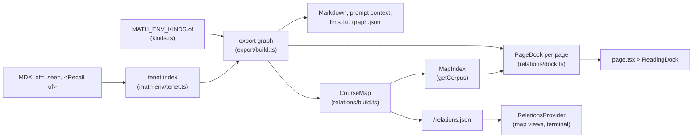
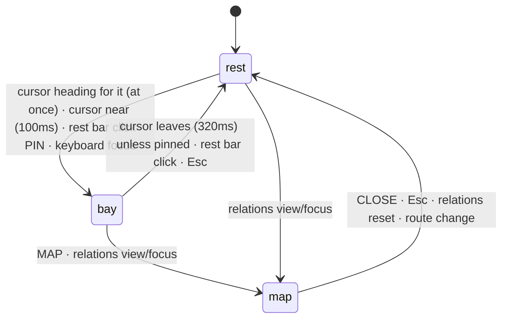

# Relations

How the notes know what depends on what, and which ideas recur across the
course. Two kinds of relation:

- **dependencies** (`of`): local and dense, "what do I need first";
- **threads**: sparse and written on purpose, "where else does this idea show
  up, and how is it the same" (see [Threads](#threads)).

The site shows dependencies in two ways:

- the **reading dock**, a cutout in the bottom-right corner of every page that
  follows the environment being read;
- the **course map**, opened from the dock: three views of how pages depend
  on one another (arcs, matrix, ladder) and one of threads.

Threads also show in the dock, and each thread's own section compares its
members' statements.

Both read the same relations as the exports (EXPORT.md), from one place.

## Layout

```
src/lib/math-env/kinds.ts          MATH_ENV_KINDS: what `of` means per kind (ENV_RELATIONS)
src/lib/math-env/remark.ts         reads env metadata, `<Thread>` sections and `thread=` tags
src/lib/math-env/thread.ts         ThreadIndex: threads and their members (getCorpus().threads)
src/lib/export/model.ts            edge kinds, DEPENDENCY_EDGES, relation names
src/lib/export/build.ts            site corpus > export graph (the one relation graph)
src/lib/export/query.ts            prerequisites(), relationsOf()

src/lib/relations/                 relation views (pure)
  types.ts                         CourseMap, PageDock, views, DIRECTIONS, RelationsRuntime, PAGE_LINK_RELATIONS
  build.ts                         page tree + export graph > CourseMap (server)
  dock.ts                          page envs + export graph > PageDock (server)
  query.ts                         MapIndex (sorted neighbours, chapter spans), ladder, link roles
  parse.ts                         `relations` command actions and arguments

src/components/relations/
  provider.tsx                     loads /relations.json; holds focus, view and whether the map is open
  dock.tsx                         ReadingDock: the cutout (rest, bay, map)
  dock-hooks.ts                    useDockState, useActiveAnchor, useProximity, useBoxHeight
  pointer.ts                       shared mouse tracker (position, velocity) and its geometry
  view.tsx                         MapPanel: view tabs, focus line, legend
  arcs.tsx                         arc diagram
  matrix.tsx                       dependency matrix
  ladder.tsx                       prerequisite ladder
  threads.tsx                      thread index (threads × chapters) and thread detail
  links.tsx                        "builds on" / "leads to" lists under arcs and matrix
  parts.tsx                        colours, ViewProps, BracketButton, Swatch, SectionHeading, LinkRow, RoleLabel

src/components/math-env/thread.tsx ThreadSection: a `<Thread>` with its COMPARE spine
src/components/math-env/thread-compare.tsx  ThreadFrame (section + right-click ask) and ThreadCompare (toggle, reveal)
src/app/(docs)/[...slug]/page.tsx  builds the page's PageDock, renders ReadingDock
src/app/relations.json/route.ts    the CourseMap as static JSON
src/app/global.css                 colour tokens and the cutout's shape
src/lib/terminal/relations-command.ts  the `relations` command
```

## Pipeline



`getCorpus()` builds the export graph, the course map and its `MapIndex` once
per worker (COMPILE.md §6). `PageDock` is built per page during rendering and
travels with the page, so the whole dock (environment lists, page fallback and
strip) needs no fetch. The course map is fetched once per page load and serves
only the map views and the `relations` command.

## Relation model

### What `of` means

Every environment can cite tenets with `of="slug,…"`. What that citation means
depends on the citing kind, and is set in one place: the `of` field of
`MATH_ENV_KINDS`.

| Kind | Code | `of` means | Edge |
|---|---|---|---|
| definition | DF | depends on | `uses` |
| theorem | TH | depends on | `uses` |
| lemma | LM | depends on | `uses` |
| proposition | PR | depends on | `uses` |
| corollary | CR | depends on | `uses` |
| method | MT | depends on | `uses` |
| proof | PF | proves | `proves` |
| example | EG | practises | `practises` |

`ENV_RELATIONS` (`uses`, `proves`, `practises`) is the set a kind can pick from.
`build.ts` reads `envRelation(kind)` for every `of` citation, so no consumer
special-cases a kind. Proof and example are also the kinds with
`optionalSlug: true`. Every other kind must declare a `slug` so it can be cited.

### Edges

The export graph has one node per page and per environment, and these edges
(full table in EXPORT.md):

| Edge | From > to | Source | Dependency? | On the map? |
|---|---|---|---|---|
| `contains` | page > its environment | every environment | no | no |
| `uses` | env > tenet | `of` on a `uses` kind | yes | yes |
| `proves` | proof > tenet | `of` on a proof | yes | yes |
| `practises` | example > tenet | `of` on an example | yes | yes |
| `recalls` | page > original env | `<Recall of>` on another page | no | yes |
| `see` | env > tenet | `see` | no | no |
| `references` | page > page | prose links | no | no |

Two sets decide what counts:

- `DEPENDENCY_EDGES` (`model.ts`): `uses`, `proves`, `practises`. These are what
  `prerequisites()` follows, for the exports and for the dock's NEEDS list.
- `PAGE_LINK_RELATIONS` (`relations/types.ts`): `DEPENDENCY_EDGES` plus `recalls`.
  These are what roll up into page-to-page links on the course map. A recall
  is a page reusing a result, so it counts between pages, even though it isn't
  an environment depending on another.

`see` and `references` stay out of both sets on purpose. They are "related",
not "needed", and including them made index pages link to every child page.

### Reading relations from either end

`RELATION_NAMES` names each edge from both ends. The dock uses these names:

| Dock list | Relation | Meaning |
|---|---|---|
| NEEDS | `prerequisites()` over `DEPENDENCY_EDGES` | everything this transitively rests on |
| PRACTISED IN | `practised_by` | examples and seen questions that practise this |
| LEADS TO | `used_by` | results and methods that use this |

## Threads

A dependency says one result rests on another. Most of them point to the same
page or chapter (about 93% at the time of writing), so they can't show the
ideas that tie the strands together. Threads do that.

A **thread** is a named idea with a one-line summary. It is written where the
notes explain it, as a section of prose:

```mdx
<Thread slug="particular-plus-kernel" summary="Every solution of $T(x)=b$ is one particular solution plus an element of $\ker T$.">

### Kernels and solution sets

The kernel of a linear map …

</Thread>
```

| Part | Rule |
|---|---|
| `slug` | required, same pattern as tenet slugs, unique across the course |
| `summary` | required, inline Markdown; the one line shown wherever the thread is listed |
| title | the first child must be a heading; its text is the thread's title |
| placement | a direct child of the document, like an environment; any page can hold one |
| anchor | the section gets `id="thread-<slug>"` (`threadId`), stable when the heading changes |

The section's content renders and exports as ordinary prose: the Markdown
exports show the heading and text, never the `<Thread>` tag. Kind views hide it
like other prose.

An environment joins a thread with `thread="<slug>: <role>"`, several separated
by `;`. The role says how this place uses the idea, in a few words of inline
Markdown, and is optional:

```mdx
<Theorem slug="affine-solution-set" of="…" thread="particular-plus-kernel: linear differential equations">
<Definition slug="diagonalisation" thread="coordinates: …; change-of-variables: linear maps: a basis that decouples">
```

`createThreadIndex` (`thread.ts`) collects threads and their members, sorted
into course order by the page order it is given (`courseOrder`, the same
walk of the page tree that the course map is built from; members on one page keep source
order). It fails the build on a duplicate thread slug or a tag naming an
unknown thread. Every surface and export reads members in that one order. Each `ThreadMember` carries the
environment's `href`, `kind`, `title`, `pageUrl`, `slug` and `role`.

MATH1251 defines five threads on `/core`: `coordinates`,
`particular-plus-kernel`, `modes`, `local-approximation` and
`change-of-variables`, with 29 tagged environments (30 memberships:
`polynomial-interpolation` is in two). They show in three places:

- **the dock** (see [Threads in the dock](#threads-in-the-dock));
- **the map's THREADS view** (see [Threads view](#threads-view-threadstsx));
- **the thread's own section**, which ends with a closed `COMPARE N PLACES`
  spine (`ThreadSection`, see below);
- **the exports**: each thread has its own Markdown and prompt context, and
  the same right-click ask panel as an environment (see EXPORT.md, Ask panel).

### The COMPARE spine

```
□  [COMPARE] 6 Origins                                 [RIGHT CLICK]
┃
▪  DEF / the kernel                            Linear transformations   ← passed
┃  Kernel
┃  If T : V → W is a linear map, its kernel is …
┃
■  THM / matrix equations                                    ← the reader is here
┆  Classes of solutions of Ax = b              ← dashed: crosses strands
▫  DEF / the kernel of a differential operator      Ordinary differential equations
   …
```

- One station per member, in course order: kind code and role (separated by
  `/`), the title linking to the environment, and its `<Statement>` (muted
  until hovered). Members without a statement show only their title.
- The chapter title sits at the right of the meta line, only where the
  chapter changes. There are no chapter codes.
- The spine is monochrome, to sit with the rest of the page: a hairline in
  the border colour with a small square tick per station. The line is solid
  within a strand and dashed where the thread crosses between Algebra and
  Calculus. The thread's aqua is kept for the dock and the map.
- Origins are separated by rules, not cards: each station opens with a border
  hairline that branches off its tick (`■────`) across the content column,
  with `pb-8` before the next. The current station's rule darkens to
  foreground at 40%.
- The trigger is the head of the spine: a square outline in the spine column,
  then `[COMPARE]` and the count (`6 Origins`, `1 Origin`). The square fills
  when the spine is open, and the hairline draws down from it to the first
  station.
- **The reader on the spine** (`SpineProgress`): while the spine is open, a
  foreground hairline (60%) fills it from the first tick down to the reading
  line, 40% of the way down the viewport (`READING_LINE`). The last station
  whose tick is above that line is `data-state="current"`: its tick is solid
  foreground and its statement is unmuted. The ones above it are `"passed"`,
  with muted-foreground ticks. Tick offsets are measured with a
  `ResizeObserver`; a scroll costs one rect read and a `--progress` write per
  frame, and touches station attributes only when the current station
  changes. Closing the spine clears the states.
- `ThreadCompare` (client) owns the open state and animates the region's
  height with the Web Animations API, from its measured height to the
  content's (`heightTiming`). Opening eases out (`cubic-bezier(0.2, 0, 0, 1)`)
  over 220 ms plus 0.25 ms per pixel, capped at 460 ms. Closing eases in over
  160 ms plus 0.12 ms per pixel, capped at 280 ms. A toggle mid-flight cancels
  and starts from the current height. Overflow is clipped only while the
  height moves, so display maths can scroll and focus rings show once open.
- Stations animate only opacity and transforms (`REVEAL` in `thread.tsx`):
  opening, each fades and rises 40 ms + 30 ms × its index (capped at the
  seventh) after the click, over 300 ms; closing, all fade together in 150 ms.
  The closed region is `inert`, and reduced motion skips the height animation
  and the transitions.
- `ThreadFrame` wraps the whole section in `AskShare`, like an environment:
  right click anywhere in it, or the `[RIGHT CLICK]` hint (`[ASK AI]` on
  touch screens) that shows at the right of the header while the section is
  hovered, opens `AskPopup` for the thread's `PromptTarget`
  (`promptTargetFor(thread.href)`, passed in through the MDX options), with
  `COPY .MD`. An environment inside the section keeps its own panel.

The spine is rendered on the server from `getCorpus().threads`, the tenet
index and the course `MapIndex` (for chapter titles and strands), so
statements never travel in `/relations.json`.

## Course map data

`getCorpus()` walks the page tree once (`courseOrder(tree)`), and
`buildCourseMap(order, exportGraph, threads)` returns a `CourseMap`, served at
`/relations.json` (about 70 KB, 8.5 KB gzipped, of which threads are 29 KB
and 4 KB; mostly KaTeX in titles and summaries; cached network-first by the service worker, see
PWA.md).

### Reading order and chapters

The page tree (`source.getPageTree()`, the same order as the sidebar) is walked
depth-first. Each strand folder whose pages live under `/core`, `/algebra` or
`/calculus` becomes a strand intro chapter. Each folder inside it becomes a
numbered chapter. A folder's index page comes before its children.

| Chapter | `short` | Holds |
|---|---|---|
| strand intro | `CORE`, `ALG`, `CALC` | the strand index and any loose pages beside the chapters |
| chapter folder | `A1`…`A4`, `C1`…`C5` (`K` for core) | the chapter index and its pages |

| Field | Holds |
|---|---|
| `pages` | `id` (URL), `title`, `module`, `chapter` (index into `chapters`), in reading order |
| `chapters` | `id`, `module`, `short`, `title` |
| `links` | one per (source page, target page): the source builds on the target |
| `threads` | `MapThread[]`: `slug`, `title`, `summary`, `href`, and `members` (`href`, `kind`, `page`, `title`, `role`) in reading order |

### Links

Every export edge whose kind is in `PAGE_LINK_RELATIONS` is lifted to its two
pages (a page node is its own page, and an environment's page is `node.page`).
Edges within one page are dropped. What's left is grouped by page pair:

| Field | Holds |
|---|---|
| `counts` | edges per relation, e.g. `{ uses: 5, practises: 4, recalls: 2 }` |
| `weight` | total edges |
| `via` | up to 4 (`VIA_LIMIT`) plain labels of the target environments depended on |

A link whose target comes later in reading order than its source is a
**forward reference** (`isForwardLink`). These are usually seen-question pages
practising a later chapter.

At the time of writing there are 76 pages, 12 chapters, 116 links and 8
forward references. 20 pages have no links. Most of those are index pages; the
others only link to other pages in prose.

### Queries (`query.ts`)

`indexCourseMap` builds a `MapIndex` once per load: `pageById`, `position`,
`neighbours` (per direction, already sorted heaviest first, then reading order)
and `spans` (each chapter's first and last position, for the arcs' bands and the
matrix's gridlines).

| Function | Returns |
|---|---|
| `neighbours(index, id, "builds-on" \| "leads-to")` | direct neighbours with their link, heaviest first, then reading order (a lookup) |
| `isIsolated(index, id)` | whether the page has no links either way (the legend's "no cross-page links" note) |
| `linkRole(link, activeId)` | `builds-on`, `leads-to` or `idle`; arcs and matrix colour by it |
| `ladder(index, id, direction)` | every page reachable in that direction, grouped by breadth-first distance (`Rung[]`) |
| `isForwardLink(index, link)` | whether the target comes after the source |
| `linkSummary(link)` | `"uses 5, practises 4 · Definition. Basis; …"` for tooltips |

## Reading dock

### Why a cutout, and why the corner

The first version was a course map above every page's prose. It failed for two
reasons:

- **Scale:** it worked on whole pages, but a reader is always on one theorem,
  definition or example.
- **Placement:** it scrolled out of view in the first few seconds.

The dock fixes both. It works on the environment at the reading line, and it
stays in view.

Its look is a **cutout**: a notch taken out of the page's corner, showing a
darker layer behind the page. It deliberately has no border, shadow or card
background. It sits in a fixed bottom-right corner rather than riding the
reading line, because an element that moves with scrolling is hard to keep
calm. The contents change with what is being read; the position doesn't.

### Shape

```
                page                 ╭──╮  ← data-dock-corner="top"
                                     │  │     (page's rounded corner)
                         ╭───────────╯  │
                         │  cutout      │  ← data-dock-surface: --dock-cut,
                         │  (dock)      │     border-top-left-radius
         ╭───────────────╯              │
         │  ↑ data-dock-corner="left"   │
─────────┴──────────────────────────────┘ viewport corner
```

| Piece | CSS (`global.css`) |
|---|---|
| `--dock-cut` | `color-mix(in oklab, var(--color-fd-background), black 5%)`; 45% in `.dark` |
| `--dock-radius` | 14px |
| `[data-dock-surface]` | `--dock-cut` background, rounded top-left: the inner corner of the notch |
| `[data-dock-corner]` | a `--dock-radius` square of `--dock-cut` with a transparent quarter circle (`radial-gradient(circle at 0 0, transparent r, cut r)`). It reads as the page's convex corner meeting the notch |
| `top` corner | above the surface, at the viewport's right edge |
| `left` corner | left of the surface, at the viewport's bottom edge |
| `body:has([data-dock])` | `padding-bottom: 6rem`, so the end of a page can scroll clear of the dock |
| `.math-env::before` | the active mark (see [The active mark](#the-active-mark)) |
| `[data-dock-swap]` | a 180ms fade-in, replayed whenever the subject changes |

The corners belong to `<aside data-dock>`, which is positioned fixed, so they
follow the surface through every size change.

### States

The cutout has three sizes. Each one is the same element growing, never
something drawn over it.

| State | Width | Shows |
|---|---|---|
| rest | `min(19rem, 100vw − 2.5rem)` | rest bar: kind code, title, counts, course strip |
| bay | same | the lists above the rest bar, then `[MAP] [PIN]` |
| map | `min(60rem, 100vw − 1rem)` | `MapPanel`, at most `min(80vh, 46rem)` tall, scrolling |

The surface's width and height are both explicit, so both animate (200ms
ease-out, off under `prefers-reduced-motion`). Its content is laid out at its
final width, anchored bottom right, and the surface clips it, so growing
reveals the content from the corner rather than reflowing it mid-animation:

- **Height** is measured by ResizeObservers (`useBoxHeight`): the rest bar,
  plus the bay when open, or the map. Before the first measurement it is left
  to the content.
- **The bay** sits directly above the rest bar, out of flow, and is always
  mounted. Closed, it is clipped, transparent and `inert`, so it is out of the
  tab order. Its content is capped at `min(60vh, 32rem)` and scrolls.
- **A subject change** while open resizes the bay, which the surface follows
  smoothly; the rest bar text and bay lists fade in (`data-dock-swap`).
- **The course strip** keeps its 8px slot on a page outside the course map, so
  the rest bar is the same height everywhere.

The dock is hidden when printing.

`useDockState` (`dock-hooks.ts`) derives the state:



| Input | Effect |
|---|---|
| `near` | `useProximity`: the cursor is heading for the dock, or within 48px of its current box (see [The corridor](#the-corridor)). Mouse and pen only; touch never sets it |
| `pinned` | set by a rest bar click (when closed) or `[PIN]`; held until unpinned or dismissed |
| `dismissed` | set by Esc or a rest bar click (when open). Ignores `near` until the cursor next leaves, so the bay doesn't reopen under a stationary cursor. Clears itself once `near` is false |
| keyboard focus | focus inside the dock that matches `:focus-visible`. Mouse clicks don't count, so clicking the bar can close it |
| `mapOpen` | provider state (see [Shared state](#shared-state)) |

The result is `map` if the map is open, `bay` if `(near && !dismissed) ||
pinned || keyboardFocus`, and `rest` otherwise.

`useProximity` reads every move from `pointer.ts`, one shared `pointermove`
listener that keeps the last position and a velocity smoothed over about 40ms.
The dock's box is cached (refreshed by a ResizeObserver and on resize), so a
move costs only arithmetic. Each move sets the target:

| Cursor | Target | Applied after |
|---|---|---|
| moving along the corridor (below) towards the dock, for two moves in a row | open | at once, so the bay is open on arrival |
| aimed at it: ≥ 0.3 px/ms, ≤ 320px away, on a line that enters the box (grown by 48px) within 220ms, for two moves in a row | open | at once |
| within 48px | open | 100ms |
| otherwise, or out of the window | closed | 320ms |

A new target cancels the pending one, so turning back towards the dock while
it is closing keeps it open.

#### The corridor

Reaching the dock means crossing the page, which would both change the env
being read and, with only the aimed test, open the dock only from close in. A
safe triangle fixes both:

```
  apex: where the cursor last was on the env being read
   ·
   ·  ·
   ·     ·         corridor: the hull of the apex and the dock
   ·        ·      (grown by 24px)
   ·           ·
   ·              ╭─────────────╮
   ·  ·  ·  ·  ·  │    dock     │
                  ╰─────────────╯
```

- **Apex:** each frame the cursor is on the current env, the apex moves to it.
  When the cursor rests anywhere else outside the corridor (settled, as in
  [Following the reader](#following-the-reader)), the apex moves there. So
  leaving the env fixes the apex at the exit point.
- **Holding focus:** while the cursor is in the corridor and off the current
  env, `useActiveAnchor` keeps its choice. Resting in the corridor for 500ms
  ends the hold (the reader has stopped to read something else), and the apex
  moves there.
- **Opening:** in the corridor, at least 40px from the apex, and closing on the
  dock's centre at ≥ 0.2 px/ms opens the dock at once. The aimed test is the
  fallback for a cursor that never rested on the content.
- **Cost:** a point is in the hull exactly when the ray from the apex through
  it, carried on, meets the dock's box. So the test is one ray-box slab test
  (`inCorridor`, built on `timeToEnter`): a few multiplications, no DOM
  reads. The apex comes from the rects `useActiveAnchor` already measures, and
  the dock's box from the cache above. Both hooks share one `Corridor` object
  (`useCorridor`).

Because `near` is measured against the dock's current box, the open bay is a
larger target than the rest bar, which gives the hysteresis. Unpinning while
the cursor is over the bay leaves it open until the cursor leaves. Unpinning
means "stop holding it open", not "close now".

Esc is handled in the capture phase, and only while the dock is open. It closes
the map, or else dismisses the bay and blurs focus inside the dock. It calls
`preventDefault`, and the terminal ignores prevented keys, so one Esc closes
one layer.

### Following the reader

`useActiveAnchor(anchors, frozen, corridor)` picks the environment being read. Its DOM
`id` is one of the `PageDock` anchors. In order:

1. **The cursor** (mouse only): the innermost environment under a cursor that
   has settled (still for 160ms, or slower than 0.15 px/ms, as when tracing a
   line) and moved in the last 6s. Not while it is in the
   [corridor](#the-corridor) to the dock.
2. **The reading line**, 35% down the viewport (`READING_LINE`): the innermost
   environment containing it. The current environment keeps it while the line
   is within 40px (`LINE_SLACK`) of its box, so crossing the gap between two
   environments doesn't flick the dock to the page and back.
3. **The page**, when neither finds one.

The cursor wins because pointing at something is a stronger signal than where
the page happens to be scrolled; it expires so a mouse left parked doesn't
override scrolling forever. Two things hold the current choice: the cursor in
the corridor to the dock (up to a 500ms rest), and the cursor still travelling
over an environment. So passing over content on the way to the dock changes
nothing. While the dock is `engaged` (cursor near it, keyboard focus
inside it, or the map open), the choice is frozen outright. A pinned bay with
the cursor elsewhere keeps following.

Cost: an IntersectionObserver keeps the set of environments in the viewport,
and only those are measured, at most once per animation frame, on scroll,
resize and mouse moves. Two timers re-check when a hold may end and when the
cursor expires.

- **On an environment:** the dock shows that environment.
- **In prose between environments:** nothing qualifies, and the dock falls
  back to the page.

### The active mark

The environment the dock is showing gets `data-dock-active`, set straight on
the DOM so the page's content never re-renders. It draws a hairline between the
environment's rail and its body (`.math-env::before`): 25% foreground at rest,
80% while the dock is open, so opening the dock shows exactly what it
describes. The line fades and grows in over 200ms.

### Subjects

The rest bar summarises a `DockSubject`, built by one of three functions
(`subjectOf`):

| | `envSubject` (an environment is active) | `threadSubject` (a `<Thread>` section is active) | `pageSubject` (fallback) |
|---|---|---|---|
| code | kind code (`TH`, `DF`, …), `↺ TH` for a recall | `TR` | `PG` |
| title | the environment's title or label | the thread's title | the page title |
| counts | needs · practised · leads, swatched blue · muted · orange, then threads (aqua) | places (aqua) | builds on · leads to (pages), blue · orange, then threads |
| strip | `env.strip` plus its threads' pages | the thread's pages | `page.strip` plus its threads' pages |
| bay | each THREAD, then NEEDS / PRACTISED IN / LEADS TO (`EnvBay`) | the thread (`ThreadRefSection`) | THREADS, then BUILDS ON / LEADS TO pages (`PageBay`) |

The threads count appears only when it is above zero. Most environments are in
no thread, so the aqua swatch showing up is itself the signal.

Both come from `PageDock`, so they work before the course map loads and on
kind-view routes. Only `[MAP]` waits for the map, and is hidden on kind-view
routes.

### The course strip

The strip is an 8-unit-tall SVG under the counts, with one tick per page in
reading order, stretched to the dock's width (`preserveAspectRatio="none"`).

| Tick | Height | Colour |
|---|---|---|
| this page | 8 | foreground |
| a page this needs | 6 | `--relations-builds-on` (blue) |
| a page this leads to or is practised in | 6 | `--relations-leads-to` (orange) |
| a page sharing a thread with this | 8 | `--relations-thread` (aqua); wins over blue and orange |
| any other page | 2 | border |

Even at rest, the strip shows how far back in the course the current theorem
reaches and how far forward it is used. Ticks are full-height rects scaled with
`transform`, so height and colour transition (300ms) as the subject changes.

### The bay

Each `BaySection` has a heading with a colour swatch and the full count, up to
its limit of rows, and `+N more` for the rest. A section with a count of zero
is omitted.

A row in `EnvBay` reads:

```
C3    DF   Taylor polynomial                    exam
│     │    │                                    └ difficulty (examples)
│     │    └ link to the environment (same-page links scroll)
│     └ kind code
└ chapter code, or HERE for this page
```

| Section | Limit | Swatch |
|---|---|---|
| NEEDS | 6 (`NEEDS_LIMIT`) | blue |
| PRACTISED IN | 4 (`PRACTISED_LIMIT`) | muted |
| LEADS TO | 4 (`LEADS_LIMIT`) | orange |
| page BUILDS ON / LEADS TO | 5 (`PAGE_LIST_LIMIT`, `relations/dock.ts`) | blue / orange |
| THREAD members | 8 (`THREAD_MEMBER_LIMIT`) | aqua |
| page THREADS | all | aqua |

### Threads in the dock

A `ThreadRefSection` reads:

```
━ THREAD 5
Kernels and solution sets                      ← link to the thread's section (env bay only)
Every solution of T(x)=b is one particular …   ← summary
A3    TH   Solution classes of Ax=b   matrix equations
│     │    │                          └ role
│     │    └ link to the member
│     └ kind code
└ chapter code, or HERE
```

- **Members** are every other environment in the thread, in reading order of
  their pages. The environment being read is left out; its count is the
  others. The dock reads them from the course map's `threads`, which keep
  `ThreadIndex` order.
- **Thread sections** are anchors too: a `<Thread>` defined on this page puts
  its `id` in the dock's anchors, so reading `/core` follows thread by thread.
- **The page fallback** lists every thread defined on the page or with a
  member on it, with each one's member count.

### The payload

`buildPageDock(corpus, envs, { title, url })` runs in `page.tsx`.

```ts
interface PageDock {
	course: { length; position } | undefined; // this page in reading order, for the strip
	envs: DockEnv[];   // one per environment and per recall on the page
	page: {
		links: Record<Direction, DockList>; // course-map neighbours, as DockRefs of kind "page"
		strip: DockStrip;
		title;
	};
	threads: DockThread[]; // threads defined on this page or with a member here
}

interface DockEnv {
	anchor: string;    // DOM id: the environment's id, or the recall's id
	title: RenderedMarkdown<"inline">;
	recalled: boolean;
	needs: DockList;       // prerequisites(), nearest first
	practisedIn: DockList; // practised_by
	leadsTo: DockList;     // used_by
	strip: DockStrip;      // other pages reached
	threads: DockThread[]; // members exclude this environment
}

interface DockThread {
	anchor?: string;   // DOM id, when the thread is defined on this page
	href; slug; summary; title;
	members: DockList; // items cut to the limit
	positions: number[]; // reading-order positions of members' other pages
}

type DockStrip = Record<Direction, number[]>; // reading-order positions; an env's needs are "builds-on"

interface DockList { count: number; items: DockRef[] } // items cut to the limit
interface DockRef { id; title; place?; difficulty?; role? } // place: the chapter title, only when it isn't this page's chapter; role is a thread member's
```

- **Recalls** carry the original environment's relations, under the recall's
  own anchor.
- **NEEDS** includes environments on the same page (marked `HERE`), because an
  earlier definition on the page is still a prerequisite.
- **The strip** counts only other pages.
- **Untitled targets** from another page are labelled with their page, e.g.
  `Example (Seen Questions)`.

## Course map views

### Shared state

`RelationsProvider` (mounted in the docs layout) holds one `MapState`: `focusId`,
`homeId` (the current page), `open` and `view`. The provider exposes it as
`ReadyRelations` once `/relations.json` has loaded.

| Call | Does |
|---|---|
| `setView(view)` | switches view and opens the map |
| `setFocus(id)` | focuses a page and opens the map |
| `setMapOpen(open)` | opens or closes the map |
| `reset()` | focuses the current page, returns to arcs and closes the map |

A route change refocuses the new page and closes the map in one update. The
view is kept across pages. The provider reports `unavailable` on kind-view
routes and `loading` / `error` while the JSON loads. Nothing retries a failed
load; the next page load does.

### Frame (`MapPanel`)

- **Header:** `[ARCS] [MATRIX] [LADDER] [THREADS]`, and when the focus isn't the current
  page, `FOCUS <title> [BACK]`, then `[CLOSE]`.
- **Body:** the active view. Arcs and matrix also show `FocusLinks` under the
  diagram: the BUILDS ON and LEADS TO page lists for the previewed or focused
  page, 6 each with `+N MORE`. Collapsed, each list is padded to 6 rows, so
  previewing a page never changes the height and moves the diagram under the
  cursor. The ladder replaces those lists.
- **Legend:** strand dots, the two direction swatches, a note on how the view
  marks forward references, and a note when the focused page has no links.

### Colour

| Token | Light | Dark | Job |
|---|---|---|---|
| `--relations-builds-on` | `#2a78d6` | `#3987e5` | what the focus needs (blue) |
| `--relations-leads-to` | `#eb6834` | `#d95926` | what builds on the focus (orange) |
| `--relations-thread` | `#1baf7a` | `#199e70` | threads (aqua) |
| `--relations-strand-algebra` | `#ffadad` | `#af7178` | strand identity (dots, ladder borders) |
| `--relations-strand-calculus` | `#a8c7e8` | `#7a93ab` | strand identity |
| `--relations-strand-core` | `#74828a` | `#74828a` | strand identity |

The two direction colours are slots 1 and 2 of the validated reference palette,
and the thread colour is slot 3. The three pass the palette validator in both
modes, with two caveats that the design works around:

- **Light contrast:** aqua is 2.74:1 on the light surface, below 3:1. Every
  aqua mark sits next to a text label (THREAD, threads, places).
- **Tritan, dark:** worst pair ΔE 4.0. On the strip, thread ticks are full
  height and dependency ticks are 6 units, so height tells them apart. Forward references are marked by position
and a dash or outline, not a third colour. Idle marks use the foreground at
low opacity.

### Arcs (`arcs.tsx`)

Pages sit on one horizontal axis in reading order. Each link is an elliptical
arc between its two pages.

| Constant | Value | Meaning |
|---|---|---|
| `STEP` | 10 | units between pages |
| `PAD` | 12 | side padding |
| `ARC_HEIGHT` | 116 | tallest backward arc, above the axis |
| `FORWARD_HEIGHT` | 32 | tallest forward arc, below the axis |
| `LABEL_HEIGHT` | 16 | chapter labels under everything |

- **Arc height:** `ry = max(reach · √(span / 800), 3)`, capped at `reach`. The
  square root keeps short arcs visible while the longest one reaches the full
  height.
- **Stroke:** `min(0.75 + 0.6 · log₂ weight, 3)`, plus 1.5 when emphasised.
- **Colour:** blue if the active page builds on the target, orange if the
  target is the active page, otherwise foreground at 0.16 opacity. Active arcs
  are drawn last, on top.
- **Forward references** are dashed (`3 2`) and drawn below the axis.
- **Page dots** are strand-coloured. The active page is larger and ringed, and
  the current page has a tick under the axis. Alternate chapters get a muted
  band, and each chapter's `short` code is printed below.
- The SVG scales to its container from a minimum of 640px, and scrolls
  sideways below that.

Interaction: each page has a full-height, step-wide hit column. Hovering a
column previews that page: arcs recolour, the lists below follow, and a
tooltip shows its chapter and title. Clicking focuses it. Hovering a row in the
lists below emphasises that one arc.

### Matrix (`matrix.tsx`)

An N×N grid in reading order: a row builds on the columns where it has a cell.

| Constant | Value |
|---|---|
| `CELL` | 8 units, cells drawn 7 wide with a 1-unit gap |
| `MARGIN` | 24 units for chapter labels on the top and left |
| max width | 640px, centred |

- **Cell opacity:** `0.3 + 0.7 · log₂(weight + 1) / log₂(max weight + 1)`.
- **Colour:** the active page's row is blue (what it needs) and its column is
  orange (what needs it), each with a faint band behind. Every other cell is
  the foreground colour.
- **Structure:** chapter gridlines across both axes, and a dashed diagonal.
  Cells above the diagonal are forward references, and are also outlined.
- **Interaction:** one pointer handler maps the cursor to a row and column.
  Hovering previews the row's page and fills the line under the grid with "A
  builds on B · uses 3, … · via …". Clicking focuses the row's page.

### Ladder (`ladder.tsx`)

The ladder lists everything the focused page depends on, grouped by
breadth-first distance with the furthest first (`−3 STEPS`, `−2`, `−1`). Then
comes the focused page with `[OPEN]`, then everything that depends on it
(`+1`, `+2`, …). Within a rung, pages are in reading order, and each is a
button with a strand-coloured left edge that focuses that page. The swatch
fades with distance.

### Threads view (`threads.tsx`)

A grid: one row per thread (in definition order), one column per chapter.

- **Cell:** an aqua dot where the thread has members in that chapter, 6px for
  one member plus 2px per extra member, at most 12px.
- **Focus:** the focused page's chapter column has a faint band and a
  foreground label. A dot is ringed when one of the thread's members is on
  the focused page.
- **Rows** are buttons. Hovering or focusing one previews it; clicking selects
  it. The first selection is the first thread with a member on the focused
  page, else the first thread.
- **Detail** under the grid, for the previewed or selected thread: title,
  summary, `[COMPARE]` (a link to the thread's section) and every member as a
  row (chapter, kind code, title, role). The rows are the text form of the
  grid, so the grid itself is `aria-hidden`.
- Below 36rem the grid scrolls sideways.

## Terminal

| Command | Does |
|---|---|
| `relations` | lists what the focused page builds on and leads to (chapter code and weight per row) |
| `relations view <arcs\|matrix\|ladder\|threads>`, `relations arcs` … | switches view; the map opens |
| `relations focus <page>` | resolves the page like `open` does, focuses it, opens the map, lists its links |
| `relations reset` | back to the current page and arcs; the map closes |

Tab completes subcommands, view names and page titles or URLs for `focus`.

## Extending

- **A new environment kind:** add it to `MATH_ENV_KINDS` with an `of`
  relation, plus `optionalSlug` if it needn't be citable. Its citations reach
  the exports, the dock and the map with no other change. The dock shows its
  `code`.
- **A new thread:** wrap the prose that explains it in `<Thread slug summary>`
  and tag each member environment with `thread="<slug>: <role>"`. A thread is
  worth adding when its members span chapters or strands; inside one page,
  `of` already says it.
- **A new relation:** add it to `ENV_RELATIONS`, `EXPORT_EDGE_KINDS`,
  `RELATION_NAMES`, `RELATION_LABELS` and `RELATION_ORDER` (EXPORT.md). Add it
  to `DEPENDENCY_EDGES` if it is a prerequisite: it then joins NEEDS,
  `prerequisites()` and the map links.
- **A new dock list:** add a `DockList` field to `DockEnv`, fill it in
  `dockEnv` (`relations/dock.ts`) from `relationsOf`, render a `Clause` in
  `EnvBay` and add it to the `firstClause` call in `envSubject`.
- **A new map view:** add its ID to `MAP_VIEWS` and `MAP_VIEW_LABELS`, and an
  entry to `VIEWS` in `view.tsx`: its component (taking `ViewProps`), whether
  it shows `FocusLinks`, and its legend note. The tabs,
  `relations view <id>` and its completion all read `MAP_VIEWS`.

## Tuning

Starting values, none yet checked in a browser:

| Knob | Where | Value |
|---|---|---|
| reading line | `READING_LINE`, `dock-hooks.ts` | 35% of viewport height |
| line slack | `LINE_SLACK` | 40px |
| cursor settle / expiry | `SETTLE_MS`, `SETTLED_SPEED`, `CURSOR_TTL` | 160ms or 0.15 px/ms / 6s |
| proximity radius | `PROXIMITY`, `dock-hooks.ts` | 48px |
| open / close delay | `PROXIMITY` | 100ms / 320ms |
| approach | `APPROACH`, `dock-hooks.ts` | ≥ 0.3 px/ms, ≤ 320px, arriving within 220ms |
| corridor | `CORRIDOR`, `dock-hooks.ts` | 24px margin, 40px travel, 0.2 px/ms closing, 500ms rest |
| active mark | `.math-env::before`, `global.css` | 25% / 80% foreground |
| cutout depth | `--dock-cut`, `global.css` | 5% darker (light), 45% (dark) |
| notch radius | `--dock-radius` | 14px |
| dock widths | `dock.tsx` | 19rem rest/bay, 60rem map |
| list limits | `relations/dock.ts`, `links.tsx` | 6 / 4 / 4 env, 5 page, 6 map |
| page bottom padding | `global.css` | 6rem |

## Not yet built

- **Hover to preview:** hovering a prose link, footnote or recall to show that
  tenet's statement in the bay.
- **Peek first:** clicking a NEEDS row to expand its statement in the bay before
  navigating. At the moment every row navigates.
- **Narrow screens:** the cutout is the same element on phones. At rest it
  covers the bottom-right of the prose, and only a tap opens it.
- **Footnotes:** environment footnotes still list direct uses and cited-by,
  which the bay repeats. Decide whether to simplify them once the dock has been
  used.
